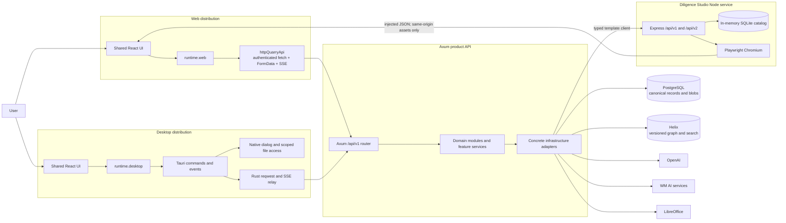
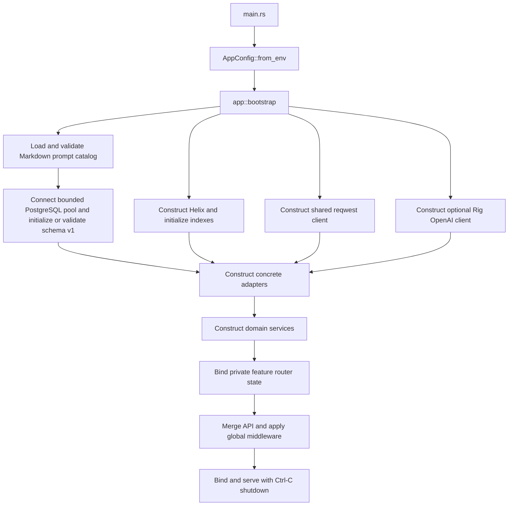
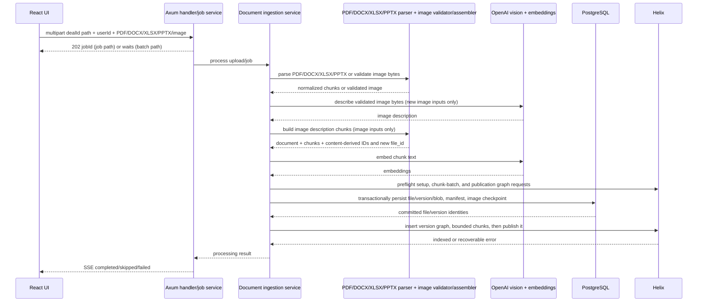

# Quarry architecture

| Field | Value |
| --- | --- |
| Status | Canonical current-state architecture reference |
| Last verified | 2026-09-25 |
| Repository snapshot | Live working tree; optional legacy Diligence Studio is in a separate checkout |
| Audience | Quarry developers, reviewers, operators, and coding agents |
| Scope | Shared React/Vite UI, web transport, Tauri desktop shell, Axum API, Diligence Studio service, persistence, integrations, and verification |

This document describes the implementation in the live repository, not an idealized target.
When it disagrees with code, manifests, lockfiles, or tests, the executable repository is the
authority and this document should be corrected in the same change.

For a focused map of product-domain ownership, implemented versus reserved domains, canonical
entities, projections, ephemeral state, identifiers, and model gaps, see the companion
[`DOMAIN_MODEL.md`](DOMAIN_MODEL.md). This architecture guide remains the source for runtime and
deployment boundaries; the domain-model guide expands the product/data semantics without turning
planned domain scaffolds into implemented capabilities.

The backend topology described here includes the live domain-modularization change. Confirm
`git status --short` before relying on working-tree code as a committed baseline.

The root [README](../README.md) provides the product overview, feature status, and roadmap direction;
[Getting Started](../Getting%20Started.md) covers dependencies, setup, commands, and verification.
The current code has a broader Tauri
boundary: desktop product API traffic, PDF bytes, multipart uploads, and document-job events cross
Tauri IPC before reaching the same Axum API used by the browser. This document records that
implemented path in detail.

## Maintenance contract

Every feature, refactor, fix, API/data/configuration change, and infrastructure change must begin
by reading the relevant sections of this document and end with an architecture-impact check.
Update this file in the same change when implementation changes any documented behavior,
responsibility, boundary, flow, schema, contract, integration, configuration, security control,
verification command, feature maturity, or known limitation. If no update is needed, the handoff
must state `Architecture impact: none — <specific reason>`.

Agent-led frontend changes use the project frontend and verification skills together with the
globally installed `refactor` and `dev-refactor-frontend` skills; the refactoring skills are not
vendored under `.agents/skills/`. Review records applicable coverage, evidence, and finding
dispositions. External recommendations can improve Quarry's guidance after an explicit
evaluation and update; they do not silently redefine the runtime or framework contract. See
[the frontend refactor skill evaluation](frontend-refactor-skill-evaluation.md) for the source,
adopted improvements, and adaptations for Quarry's React/Vite architecture.

## 1. Executive summary

Quarry is a multiplatform diligence application with three core runtimes and a selectable legacy template service:

1. A single React application under `frontend/src/`, compiled by Vite for either a browser or a
   Tauri webview.
2. A thin Tauri 2 Rust shell under `frontend/src-tauri/`, responsible for validated native
   capabilities and the current desktop-to-Axum transport gateway.
3. An Axum 0.8 product API under `backend/`, responsible for product behavior, configuration,
   persistence, document processing, AI integrations, search, and background jobs.
4. An explicitly selected legacy Node/Express service in a separate checkout, responsible for
   its separate app-scoped in-memory template catalog, PowerPoint import/export, optional classification,
   and Playwright previews. Default embedded mode runs templates in Axum with shared durable PostgreSQL,
   native Rust conversion, and Chromium/CDP previews. Authenticated template operations require
   embedded mode; the legacy service lacks user isolation and its facade operations return 503.

The web and desktop distributions share pages, components, hooks, contracts, and product routes.
Build-time aliases select the router and runtime adapter:

- Web: `BrowserRouter` plus authenticated browser HTTP, multipart, binary, and fetch SSE transport.
- Desktop: `HashRouter` plus Tauri `invoke`/events; Rust `reqwest` then forwards product traffic
  to the same Axum `/api/v1` routes.

The backend is an explicit modular monolith. `AppConfig` parses process configuration once;
`app::bootstrap` validates and loads the Markdown prompt catalog before opening PostgreSQL, then
constructs concrete adapters, assembles domain services, and merges routers whose private state
has already been bound by the owning feature. There is no global application state or repository
service locator.

PostgreSQL is the canonical store for users, deals, logical files, immutable file versions, and
file bytes. Helix is the versioned document graph and search projection. Document ingestion
persists bytes, attribution, immutable identities and activity in PostgreSQL first and then indexes Helix, so cross-store writes are intentionally recoverable
through an exact-content re-upload today rather than transactionally atomic. A general reindex
utility is not implemented.

Quarry is a tested development foundation, not a production-secure deployment. Username/password
authentication, revocable sessions, private-resource ownership, deal membership capabilities and bounded local auth throttling are
implemented. Organization tenancy, distributed abuse protection, durable job queues, production
storage, CI and deployment manifests remain absent. See [authentication](authentication.md).

## 2. System context



The Tauri shell is not a second product backend. It does not own users, deals, document jobs,
AI orchestration, or durable product state. Its generic API relay is a local transport hop; Axum
remains the final product router and trust boundary for server-owned data.

## 3. Repository topology

```text
Quarry/
├── AGENTS.md                         repository-wide agent rules
├── quarry                            root-only local process launcher
├── docs/
│   ├── ARCHITECTURE.md               this canonical Markdown reference
│   ├── DOMAIN_MODEL.md                domain ownership and product/data model companion
│   └── architecture/                 retained point-in-time DOCX reports
├── .agents/skills/                   project-local development skills
├── frontend/
│   ├── src/                          shared React application
│   │   └── fixtures/                 shipped mock/demo records grouped by feature
│   ├── tests/                        Vitest suites mirroring the React source tree
│   ├── scripts/                      runtime-boundary enforcement
│   ├── src-tauri/                    Tauri desktop crate with its own mirrored tests/ tree
│   ├── package.json                  npm scripts and declared dependencies
│   ├── package-lock.json             npm lockfile
│   └── vite.config.ts                build-mode composition root
├── backend/
│   ├── prompts/                      startup-validated server-side model prompt catalog
│   ├── src/
│   │   ├── app/                      configuration, composition, migrations, HTTP shell
│   │   ├── domains/                  product modules with feature-owned routes and state
│   │   ├── adapters/                 PostgreSQL, Helix, AI, Office, and SharePoint mechanisms
│   │   ├── shared/                   small cross-domain primitives and policies
│   │   └── bin/                      operational and diagnostic utility binaries
│   ├── tests/
│   │   ├── unit/                     unit tests mirroring backend/src
│   │   └── integration/              persistence, transport, router, and architecture suites
│   ├── Cargo.toml                    backend crate manifest
│   ├── Cargo.lock                    Rust lockfile
│   ├── .env                          ignored local runtime configuration
│   └── helix.toml                    local Helix metadata; launcher reads `[local.dev]` image/tag/digest
└── plans/                            tracked, non-canonical implementation plans
```

### 3.1 Independent build roots

| Root | Package | Primary commands | Relationship to product build |
| --- | --- | --- | --- |
| repository root | Bash launcher | `./quarry web`, `./quarry desktop` | Local dependency and selected-process orchestration only |
| `frontend/` | npm application | `npm test`, typechecks, Vite builds | Shared web and desktop UI |
| `frontend/src-tauri/` | Cargo crate `quarry-desktop` | Rust format, Clippy, tests | Native desktop shell |
| `backend/` | Cargo crate `quarry-backend` | Rust format, Clippy, tests | Product API |
| `$QUARRY_DILIGENCE_STUDIO_ROOT` (default `$HOME/diligence-studio-server/`) | npm package `diligence-studio-server` | `npm run typecheck`, `npm test` | Optional legacy template and PowerPoint API in a separate checkout |

There is no root workspace manifest. The root `quarry` executable is a development-only process
supervisor, not another build root: it can run only while the working directory is the repository
root. Both modes reject conflicting listeners on ports 3001 and 1420; legacy mode also checks
43127. They start Docker Desktop on macOS when its daemon is unavailable and wait for Docker and the Helix service
at `127.0.0.1:6970`. The launcher first inspects the local container named by
`QUARRY_HELIX_CONTAINER_NAME`, defaulting to `helix-quarry-postgres-dev`. If it is absent, the launcher
creates it with the digest-pinned image from `backend/helix.toml`'s `[local.dev]` section,
the `unless-stopped` restart policy, and the loopback-only `127.0.0.1:6970:8080` port mapping.
It sets `HELIX_DATA_DIR=/var/lib/helix` and mounts the named Docker volume
`<container-name>-data` there. Helix's default storage is in memory: `DB_PATH=db/` and a
restart policy alone do not preserve graph data when the server stops. The data volume is
independent of the container; preserve it during container replacement and Docker cleanup.
It starts that named container before waiting for the local runtime's `/healthz` endpoint, so an
unrelated listener cannot satisfy readiness. Before reusing an existing named container, it compares the
container image ID with the configured digest and fails without modifying a mismatch. This keeps
the local Docker topology while preventing a stale v2 runtime from silently serving a v3 SDK. The
launcher does not recreate or delete an existing container. It also rejects existing containers
unless disk storage is enabled at `/var/lib/helix` and the expected named volume is mounted there
read-write; an old memory-backed container requires an explicit operator cutover. Stop product
writers and preserve/export any live graph before stopping that old container, retain the old
container under a different name, and create the disk-backed replacement with the original name.
Previously lost document projections still require exact-byte upload recovery (section 9.3);
enabling disk storage cannot restore graph data already lost on an earlier stop.
It then starts `cargo run --locked` from `backend/` with Axum pinned to `127.0.0.1:3001` and the versioned
Diligence Studio upstream URL and selected `QUARRY_TEMPLATE_BACKEND` set explicitly; waits for `/api/v1/health`; and runs either
`npm run dev:web` or `npm run dev:desktop` from `frontend/`. After Vite serves the internal preview
route, legacy mode starts `npm start` from `$QUARRY_DILIGENCE_STUDIO_ROOT` (default
`$HOME/diligence-studio-server/`), binding it to
`127.0.0.1:43127`, and probes its app-scoped preview page. It stops all selected owned process groups
when any child exits or the launcher receives a termination signal. Docker Desktop and Helix are
shared external dependencies and remain running. Backend configuration, migrations, and Tauri's
own `beforeDevCommand` remain owned by their build roots. Embedded mode skips Node startup, health probes, and child supervision; Axum readiness does not require the UI renderer, so Vite can become ready before an import requests a screenshot.

The backend contains an isolated Rust SharePoint adapter under
`backend/src/adapters/sharepoint/`; it is tested but not assembled into a domain or exposed
through routes. Treat it as inactive infrastructure until ownership and product integration are
explicitly decided.

## 4. Distribution and runtime composition

### 4.1 Shared application entry

[`frontend/src/main.tsx`](../frontend/src/main.tsx) mounts one application:

```text
React.StrictMode
  -> build-selected AppRouter
      -> root route split
          -> lazy internal template-preview renderer
          -> product App fallback
              -> ThemeModeProvider
                  -> shared product route manifest and pages
```

The app does not perform runtime sniffing to choose its host. Vite mode and the corresponding
TypeScript project select the implementation before the bundle runs.

[`frontend/src/app/RootRoutes.tsx`](../frontend/src/app/RootRoutes.tsx) keeps the headless template
renderer outside the product application shell. The renderer is lazy-loaded and requires a server
runner to inject template JSON into `window.__TTS_MERMAID_TEMPLATE_PREVIEW_INPUT__` before React
renders it. A direct visit without that input produces an explicit render error and never mounts
the product application. The route name and injected global are not authentication or
authorization controls; deployments that require the render URL to be private must enforce that
at their network/server boundary.

### 4.2 Build-time aliases

[`frontend/vite.config.ts`](../frontend/vite.config.ts) maps:

| Stable import | Web mode | Desktop mode |
| --- | --- | --- |
| `@quarry/router` | `src/platform/Router.web.tsx` | `src/platform/Router.desktop.tsx` |
| `@quarry/runtime` | `src/platform/runtime.web.ts` | `src/platform/runtime.desktop.ts` |

`tsconfig.web.json` and `tsconfig.desktop.json` repeat these paths and exclude the opposite
platform modules. This is deliberate: shared code must compile independently against both host
contracts. Any alias change must update Vite and both TypeScript configurations together.

Every Vite mode other than the literal `desktop` mode resolves to the web target. Vitest therefore
uses the web runtime in its normal test mode unless a test directly exercises the Tauri adapter.

### 4.3 Development ports

| Process | Default address | Notes |
| --- | --- | --- |
| Vite | `http://localhost:1420` | Strict port; `/api` proxies to Axum |
| Axum | `http://127.0.0.1:3001` | Configurable host/port |
| Diligence Studio | `http://127.0.0.1:43127` | Express; launcher binds loopback |
| Helix | `http://127.0.0.1:6970` | Required during normal backend bootstrap |

An empty browser `VITE_API_BASE_URL` uses Vite's `/api` proxy in development. Static web hosting
must rewrite application routes to `index.html` because web mode uses normal history URLs.
Desktop mode uses hash routing so the bundled static assets do not need server-side route rewrites.

## 5. Frontend architecture

### 5.1 Technology baseline

The live frontend is an npm package using:

- React/React DOM 19 canary in the active working tree
- Vite 7 and TypeScript 6.0 with strict/no-unused/no-emit checks
- React Router DOM 7
- Tailwind CSS 4's CSS-first Vite integration
- Radix/shadcn primitives, Lucide icons, Motion, dnd-kit, and the custom Assistant `AgentRuntime`
  and thread primitives
- Extend UI's EmbedPDF/PDFium editor for Data Room PDF preview and in-memory annotations;
  the earlier reusable react-pdf/pdf.js viewer remains in the frontend tree
- BlockNote 0.56 with its shadcn integration for the Notebook editor; Plate remains
  the Diligence Canvas text editor
- Vitest, Testing Library, user-event, and per-file happy-dom tests

The repository does not pin Node, set `packageManager`/`engines`, or define ESLint/Prettier.
The current uncommitted `.npmrc` enables `legacy-peer-deps`, supporting the canary dependency
combination. Manifest and lockfile state must be inspected before dependency work.

### 5.2 Route map

[`frontend/src/app/RootRoutes.tsx`](../frontend/src/app/RootRoutes.tsx) declares the isolated
headless-render route and product fallback. [`frontend/src/App.tsx`](../frontend/src/App.tsx)
declares the authentication and workspace loading boundaries;
[`frontend/src/app/WorkspaceRoutes.tsx`](../frontend/src/app/WorkspaceRoutes.tsx) declares the
shared `/hub/*` route tree:

| Route | Page | Loading |
| --- | --- | --- |
| `/_internal/template-preview` | `TemplatePreviewRenderPage` outside the product shell | lazy; waits for server-injected JSON and renders only the SVG capture surface |
| `/` | Redirect to `/login` | eager |
| `/login` | Username-or-email/password `LoginPage` | lazy authentication boundary |
| `/register` | Account registration `LoginPage` | lazy authentication boundary |
| `/hub` | `HubPage` | lazy workspace route and page |
| `/hub/account` | `AccountPage` | lazy workspace route and page |
| `/hub/vault` | `GlobalVaultPage` | lazy |
| `/hub/initiatives/vault` | `VaultPage` | lazy |
| `/hub/assistant` | `Assistant` | lazy |
| `/hub/notebook` and `/hub/notebook/:noteId` | `NotebookPage` | lazy page; BlockNote loads only for a selected draft |
| `/hub/logs` | `LogsPage` | lazy |
| `/hub/deals` | `Deals` | lazy; currently uncommitted |
| `/hub/deals/:dealId` | `DealRoomPage` + `DealRoomOverviewPage` | lazy parent and nested leaf |
| `/hub/deals/:dealId/activity` | `DealActivityPage` compatibility redirect to `?section=activity` | lazy nested leaf |
| `/hub/deals/:dealId/data-room` | `DataRoomPage` | lazy nested leaf |
| `/hub/deals/:dealId/analysis` | `DealAnalysisPage` | lazy nested leaf |
| `/hub/deals/:dealId/deliverables` | `DeliverablesPage` | lazy nested leaf |
| `/hub/deals/:dealId/deliverables/templates` | `DeliverableTemplatesPage` | lazy nested leaf |
| `/hub/deals/:dealId/deliverables/templates/:templateId` | `DeliverableTemplateEditorPage` | lazy nested leaf; canvas and Plate editor load through additional on-demand boundaries |
| unmatched `/hub/*` paths | Missing-page recovery inside the workspace shell; unauthenticated visitors still go to sign-in | workspace boundary |
| other unmatched paths | Missing-page recovery with a sign-in link | eager |

Both router targets opt into React transitions. `App.tsx` loads Login through an accessible authentication boundary, avoiding its form and
animation dependencies during authenticated startup, and loads one `WorkspaceRoutes` boundary for `/hub/*`; the workspace provider remains mounted while nested routes
change. Deal Room is a parent route whose shared sidebar and deal-scoped state wrap lazy child
routes, so a URL, refresh, Back, or Forward action selects the same view without a second local
view router. For an already authorized deal, navigation revalidates access without replacing the
workspace; a denied check removes the protected content. Lazy boundaries commit an accessible workspace or in-content skeleton while their
module loads. Reduced-motion CSS disables transition animation.

The authentication boundary also catches failed sign-in/registration module loads. Its recovery
screen keeps the product shell mounted, announces the error, and focuses the recovery heading.
Reload page reloads the current web URL or desktop hash route, preserving the navigation entry
while clearing the rejected lazy-module state; it does not repeatedly render the cached failure.

The product root supplies route-specific browser titles, including the deal activity query tab,
without placing deal names or document contents in browser metadata. A keyboard-visible skip link
focuses the shared main landmark. Workspace scroll bodies expose themed scrollbars, use smaller
phone gutters, and size the shell to the dynamic viewport. Below desktop width, a safe-area-aware
bottom navigation keeps Home, Deals, Assistant, Notebook, Vault, and Account reachable while the
full sidebar is hidden. Shared controls retain visible focus outlines and targeted transitions;
text inputs, textareas and editable text surfaces use a single thin inset line in a muted,
theme-aware focus color. Composite auth/date/color fields, file-review search, the Home question
draft and chat composers put the same indicator on the outer surface without a second inner ring.
Validation colors and forced-color focus remain available; global reduced-motion styles cover
ordinary animations as well as route transitions. The HTML entry uses Quarry icons and excludes the private application from
search indexing; it includes an explicit JavaScript-required message for script-disabled browsers.
The Home-to-Assistant draft travels in router state, initializes the scoped runtime once, and never
starts a model request until the user sends it. Suggestions fill the Home draft and focus it.
The saved-work samples expose no file-opening or deal-filter actions because they are not backed
by those integrations. The profile menu uses the shared Radix dropdown primitive for keyboard
navigation, outside dismissal, Escape, positioning, and trigger focus restoration, including when
the sidebar is collapsed. Shared auth fields and their email-domain composite use consistent
48-pixel controls; workspace panels generally use a flat surface, and cards are static unless explicitly
marked interactive. Deal Room overview cards use the Kanban lanes' muted-to-transparent surface
and compact corners, with a transparent Key Questions grid. Deals keeps portfolio metrics out of the phone header so search and creation
remain reachable. Search opens a collision-aware popover with a full-width field, and Escape or
Close clears the filter and restores trigger focus. It distinguishes initial loading, request failure,
an empty portfolio, and a filtered-to-empty result; table text and headers align left for easier comparison. Dialog, empty,
and error content widths use explicit rem limits: the custom `--spacing-sm/md/lg/xl` tokens collide
with Tailwind's named `max-w-*` utilities. The profile subtitle uses the actual deal context when
provided, otherwise “Your workspace,” rather than a fixture-backed deal name.

The product tree is wrapped in `UserProvider`, backed by one session store with an origin-scoped
local-storage cache. Login and registration establish a verified user, token and expiry; `/hub/*` requires that session and keys
workspace state by its generation. Registration uses a responsive two-column card (900px max);
small screens stack the fields. Login uses a compact card with a username-or-email step followed by a
password step, retaining the entered identity and allowing users to go back. The card and steps
animate unless reduced motion is requested. Registration shows a fixed
`@westmonroe.com` suffix and the backend enforces that exact email domain. Auth fields use native,
named inputs and read their current values through `FormData` at submission so browser/password-manager
autofill does not depend on React change events. Native required-field validation blocks empty
submissions; submit buttons disable only while a request is pending. Password fields expose an
inline eye control, report Caps Lock, and preserve entered values across visibility and error
rerenders; passwords are never trimmed. Reload restores a structurally valid, unexpired cached
session without extending its server expiry. Router state and the removed `quarry.workspace.email` storage key cannot authenticate a user. See [authentication](authentication.md).

### 5.3 Layer responsibilities

| Frontend area | Responsibility | Examples |
| --- | --- | --- |
| `pages/` | Route-level orchestration and screen composition | login, hub, deals, data room, assistant |
| `components/<feature>/` | Product feature UI | deal room, data room, deals, PDF viewer |
| `components/ui/` | Reusable primitives and interaction foundations | button, dialog, field/input/select, popover, view transition, floating panel |
| `components/reui/` | Vendored ReUI data-grid foundation | table rendering, column controls, scrolling, pagination |
| `hooks/` | Cross-component state and synchronization | workspace session/deals, theme |
| `data/` | UI domain types, mapping, selectors and lifecycle-owned request stores | workspace, deal extraction, deals view |
| `fixtures/` | Explicit shipped mock/demo/placeholder records, grouped by consuming feature | workspace portfolio, hub activity, Data Room report data |
| `contracts/` | Transport-neutral application contract | `QuarryApi`, runtime and platform capabilities |
| `api/` | Browser and Tauri transport adapters | HTTP, multipart, binary, SSE, IPC mapping |
| `platform/` | Build-selected router/runtime composition | web and desktop adapters |
| `lib/` | Shared utilities, activity logging, and transport-free reusable UI libraries | class merging, bounded/redacted activity log, controlled Diligence Canvas snapshot |

### 5.4 State and data ownership

Quarry currently uses React-local state, narrow contexts, and pure data modules rather than a
global state or query-cache library.

- `ThemeModeProvider` owns theme application, mirrors it to the root element and `localStorage`,
  and updates the browser theme color. The dark palette remains defined for restoration, but the
  current feature flag normalizes stored or requested dark mode to `slate-frost` and hides the
  profile theme picker.
- `UserProvider` restores unexpired cached bearer sessions from `quarry.auth.session.v1` in
  origin-scoped `localStorage`. Invalid/expired records are removed; blocked storage leaves sign-in
  usable in memory. Logout, expiry, and protected-request 401s clear the cache. Storage events
  synchronize tabs and cancel prior-session requests. Cached fields never establish server
  authorization; the bearer token and ownership checks remain authoritative. The token is readable
  by origin JavaScript, as detailed in [authentication](authentication.md).
- `UserProvider` owns verified identity/session state for the product tree; `WorkspaceProvider`
  owns deal-resource state for `/hub/*` and reads the verified profile through its session hook.
  Its `loadDeal` operation captures the deal’s local revocation revision before each API request;
  eviction rejects older responses while a fresh authorized lookup can restore membership access.
  Revisions survive restoration so late pre-eviction list/lookup responses stay excluded.
  `DealAccessBoundary` reports denied requests to `DealRoomPage`, which owns the redirect state
  and cache eviction. The parent keeps rendering the deal-list redirect and access-loss notice
  after eviction unmounts the boundary, without starting a replacement lookup.
  `WorkspaceHomeShell` is a layout consumer and fails fast if rendered outside that provider.
- Workspace shells render their route-specific sidebar navigation directly. The normal home
  sidebar starts with Home (`/hub`), Vault, and Assistant (`/hub/assistant`), followed by the
  Workspace section containing Deals and Notebook. Vault's category filters include All items, Documents, Insights,
  Links, Prompts, Notes, Tasks, Templates, and Global variables. The Deal Room and non-Assistant Deal Hub
  headers identify the active sidebar without fixture-backed alternate
  spaces. `/hub/assistant` replaces that identity with Deal Hub and Chat sidebar-view tabs and
  initially selects Chat. Deal Hub restores the normal home navigation in the same sidebar without
  leaving the Assistant route or unmounting its conversation; Chat shows the persisted regular
  thread list plus a New chat action. The normal home sidebar still labels `/hub/assistant` as Assistant
  and uses an animated Twitch glyph.
  The Deal Room sidebar identity opens a deal-switching menu from the existing workspace deal
  resource. It lists other accessible non-terminal deals (excluding Closed and Pencils Down),
  preserves navigation state, and links to the selected deal’s overview route. Its back and collapse
  controls remain separate; an empty menu explains that no other active deals are available.
  Collapsing any shared sidebar reduces its rail from 288px to 48px, leaving only the centered
  expand button. Back/navigation, profile and logo/tool controls are hidden from view and keyboard
  navigation until expanded; the flex layout gives the released width to the main inset surface.
  An unselected Data Room keeps the Deal Room sidebar and the same inset main surface used
  by the other deal routes. Opening a document preview replaces that sidebar in the same shell slot
  with the Data Room file explorer; closing the last document tab restores the Deal Room sidebar, while the
  explorer's left-arrow back control returns to Deal Home.
- Notebook uses native BlockNote edit buffers plus explicit server saves. Its `NotebookProvider`
  owns search, URL selection and the mobile drawer around `WorkspaceHomeShell`. The sidebar reuses
  `SidebarFrame`, profile/collapse behavior and Back to Deal Hub. The expanded sidebar and mobile
  drawer show a notebook-selector label (`{Notebook name} notes`) with its scoped count and a
  create-note plus icon on the right; the collapsed sidebar retains its create icon. The selector
  lists the authenticated user's notebooks plus a distinct Unsaved notes group. Switching notebooks
  clears search and note selection while preserving all edit buffers. The selected notebook is
  session-scoped; direct note URLs select their owning notebook. `notebookSession.ts` retains
  in-memory edits across workspace routes and clears them on reload/authentication changes;
  `notebookPersistence.ts` owns the session-scoped external store for saved-note catalog loading,
  lazy native-document reads, server IDs/revisions, immutable save snapshots and durable job tracking.
  The provider exposes stable store handles and drawer/search state. Catalog summaries, the selected
  draft, and save records have separate subscriptions; body edits keep sidebar catalog references
  stable while their displayed date is unchanged. Save controls observe dirty transitions rather
  than every document edit. Draft edit versions and immutable submitted versions track savedness;
  canonical-content checkpoints recognize undo back to saved content at edit/save boundaries,
  without serializing documents during rendering or before-unload checks.
  Saved notes reload from the authenticated API after sign-in; drafts and newer unsaved edits are
  never promoted automatically. Collections load through bounded 100-row pages; the selector uses
  this catalog and scopes the visible list, count and title search to one notebook, including its
  assigned local drafts. Loading/error/retry feedback remains explicit. Lists omit blocks until a
  note is selected. New drafts in a selected notebook keep that save destination without creating
  server records until Save. Unassigned drafts remain available under Unsaved notes.
  The header Save button immediately precedes Export and reuses New note's filled action styling.
  The selected note's Personal note icon/label sits beside the Notebook heading. Its title begins
  immediately below the inset header at the existing document-column width, with deletion beside
  the title. The static save-explanation banner is omitted; live loading, save and error feedback
  remains in the footer so it does not push the title down.
  Saving an unassigned draft explicitly chooses/creates a notebook; a draft created in a selected
  notebook saves directly to that notebook. Saved-note edits PATCH the same note with expectedRevision.
  Admission retries reuse an immutable operation ID/input; SSE plus status polling reconciles
  completion across navigation.
  Only a completed job displays Saved; edits made while pending remain Unsaved changes. Loaded
  canonical notes display Stored on server because a note GET alone does not confirm indexing.
  Indexing failures retain content and retry the same job; conflicts offer an explicit confirmed
  reload. Editor content/undo stays mounted across the first save/server-ID URL change. Saved note
  deletion calls the API and keeps the local buffer on failure; unresolved saves prevent deletion.
  The independently lazy editor uses BlockNote's shadcn controls with Quarry semantic tokens,
  Geist Serif, and reduced-motion handling. Both block controls appear when hovering anywhere across
  a block's row, including the document's responsive side padding. Its dedicated six-dot handle
  has no click menu. An adjacent plus button opens the same block options as typing `/`, reusing
  an empty block or inserting a paragraph after a nonempty block. Both insertion paths remain
  available. Pointer dragging uses a
  frame-scheduled, full-width preview, faded source, blue insertion line and edge scrolling.
  Only a completed drop changes native blocks, grouped as one undoable edit; Escape, pointer
  cancellation, window blur, editor unmount and drops outside the note viewport cancel the move.
  The focused handle also supports Arrow Up/Down reordering. Both Vite targets emit ProseMirror
  as a separate lazy dependency chunk to keep the Notebook schema below the application chunk-size limit.
  Its keyed mount isolates content/undo sessions between notes;
  acknowledgements apply only to the submitted snapshot; autosave is absent. Paragraphs, headings, lists/checklists, quotes, code,
  tables, and HTTP(S)/mailto links are supported. Asset blocks, upload and file paste/drop paths
  are disabled. The viewport meta tag requests `interactive-widget=resizes-content` for mobile
  keyboards. Editor loading/failure/retry, missing draft URLs, empty/search-empty states, and
  confirmed deletion have explicit UI. A browser unload warning is best-effort for unsaved changes;
  native close coordination and offline recovery are not implemented. Folder organization controls,
  autosave, collaboration, sharing and global search remain deferred. Existing web/desktop notebook
  APIs and validated native relay handle saves; no new native commands or schema changes accompany
  this UI integration. The header's compact Export menu creates Markdown
  or standalone HTML from an immutable snapshot of the selected draft (including its title), using
  BlockNote's lossy interoperability converters loaded on demand. Both formats can omit some editor
  structure/formatting; neither is the canonical storage format. Exports use `platform.saveFile`:
  browser downloads for web, a native save dialog on desktop. HTML escapes the document title and
  includes a restrictive document CSP. The shared 5 MB bound, native origin/name/extension checks,
  and atomic write remain in force. HTML is the only addition to the native text-export MIME allowlist.
  Pending exports block duplicate submissions; cancellation, errors/retry, and completion are announced.
  Export filenames are redacted in the activity log. PDF/DOCX exporters are not installed.
- `AccountPage` reads the verified `UserProvider` profile and owns only its sign-out busy state.
  Profile-menu navigation commits `/hub/account` immediately; it does not fetch a public profile
  from a router-supplied email. The account view does not support profile editing.
- `useWorkspaceDeals` has explicit loading, success, and error states. Its default `api` mode maps
  server records and exposes a retryable error without fixture fallback. Explicit `demo` mode
  dynamically imports `fixtures/workspace/portfolio.ts` and the shell visibly labels the result
  as demo data. The provider uses a local external resource store; create/update responses replace
  cached aggregates, and pending older lists cannot overwrite those writes. Shared company edits
  refresh linked cached deal summaries and overlay pending list results, including deals not yet
  loaded into the cache. Metadata saves retain the selected uploaded SOW filename in the session
  cache, and core deal edits preserve those resource details. Uploaded filenames are session-only;
  a fresh load marks the resource available only when its metadata contains a saved link.
  API-backed deals retain their typed persisted fields for
  editing. Creation and editing share optional date, engagement/transaction, scope, and company-role
  controls. Date fields accept typed dates and calendar selection, preserve date-only values, and
  reject unreadable drafts before submission; company search is bounded, stale results are ignored,
  and directory creation is explicit.
  Enter in a company text input saves that company; Save and Cancel buttons retain their native
  keyboard activation and do not submit the surrounding deal form.
  `useDealSaveWorkflow` owns core writes, team reconciliation, metadata submission and final
  navigation, with explicit core/team/metadata/completion/error stages. It retains the created deal
  across retries, reconciles an uncertain team response before replaying creation, blocks duplicate
  submissions, and ignores responses after its modal unmounts. The modal owns editable form and
  step/focus interaction. Directory entries remain saved when a deal form is cancelled or its write fails. Closed and
  Pencils Down engagements are Historic; Pipeline and the six working stages are Current.
  Transaction closing never changes engagement status. Views show all companies for each role and
  distinguish expected close, actual close, and engagement completion.
  The portfolio table shows project name, status, target, portfolio company (PortCo), engagement
  type, PE sponsor, and SOW/fact-sheet/SharePoint quick links from the existing safe resource URLs.
  The table spans the full main inset width without outer horizontal gutters, with aligned
  header/body padding, browser-sized columns based on their headings and text, and horizontal row dividers.
  The table begins 8px below the workspace header. Long names and metadata truncate at
  bounded widths with full-text tooltips. The table fills the page width, sharing spare
  space through automatic table layout rather than assigning it all to the project name.
  Columns scroll together and sorting remains available. Native content sizing replaces
  manual column resizing and pinning on this table.
  Missing values and unavailable links display `N/A`; external links open in a separate tab.
  A search with no matching deals shows centered guidance directly on the page and a Reset filters action.
- `UploadFilesModal` delegates its queue, retry/completion transitions, timing and SSE cleanup to
  `uploadWorkflow`. At most three jobs upload or process concurrently; additional selected files
  wait in a queued state. Active and queued work protects dismissal. Unmount invalidates pending
  admission callbacks, clears queued starts and closes subscriptions; it does not cancel jobs
  already admitted by Axum. Attempt identity rejects stale events after retry, including synchronous
  terminal replay while a subscription is being created. Interrupted processing streams reconnect
  to the same admitted job with exponential delays from one to ten seconds, retaining their queue
  slots until a terminal event replays. They never re-upload a file to recover a connection.
  Connection identity rejects callbacks from replaced streams; terminal events and unmount clear
  reconnect timers as well as subscriptions. A continuing outage leaves jobs visibly reconnecting;
  local cleanup does not cancel server processing.
- The Data Room PDF surface uses the vendored Extend UI editor on EmbedPDF/PDFium for rendering,
  page navigation, annotations, comments, and export. The Data Room instance exposes only View and
  Annotate modes through a mode dropdown. A single toolbar row starts with the pages sidebar
  toggle, page navigation, and mode dropdown. Document controls and preview actions appear in
  the horizontally scrollable remainder of the ribbon.
  The zoom selector sizes to its current percentage and dropdown arrow instead of a fixed width.
  The loaded PDF toolbar omits the raw-text toggle and duplicate Close action; document tabs own
  closing. Loading/error shells retain their accessible Close action.
  The annotation ribbon omits rectangle, ellipse, line, arrow, polyline, and polygon
  creation controls; existing shape annotations remain renderable. The details-panel, download, and
  more-actions controls sit at the right end of the ribbon in both modes; the annotation ribbon has
  no separate comments or properties buttons. Forms, signatures, stamps,
  redaction, capture, print, security, attachments, and fullscreen controls remain disabled. Annotation snapshots are retained only in module memory by
  selected-document ID, restored when a document is reopened in the same browser session, and
  intentionally disappear on refresh. Signature persistence is disabled so the editor does not
  write signature data to `localStorage`.
- `useDataRoomContents` owns independent local-tree and stored-document resources, stale-request
  protection, retry, and their derived explorer/review model. `useDocumentSession` owns open
  document tabs with one active preview, deduplicated preview/text requests, and a route-local
  64 MiB least-recently-used cache. The cache budgets PDF byte lengths (or twice the base64
  string length) plus twice the extracted-text length. Oversized payloads remain usable only in
  the active viewer and bypass the cache; the budget excludes the active viewer's working memory,
  editor engine, and existing annotation snapshots. Eviction preserves tabs and reloads their
  payloads on selection. Closing a tab drops its cached payload and ignores its pending responses;
  leaving the route or refreshing releases all cached payloads. Nothing is persisted to disk.
- The Data Room uses the controlled Movin browser-tab component adapted to Quarry theme tokens.
  Each document tab has a close button; the plus button opens a New tab file-review picker.
  Selecting an already-open file activates its existing tab. Closing the active tab selects its
  neighbor; closing the last tab returns to the file-review grid. Arrow keys, Home/End, and Delete
  support tab navigation and closing. Only the active document preview/editor is mounted.
- A Data Room file selection lazy-loads the document-preview module. Its local Suspense fallback
  preserves the filename and an accessible Close action; once loaded, the preview shell shows
  preview-byte loading and errors before mounting the PDF editor. The editor's EmbedPDF packages
  are split into package-scoped lazy chunks; its PDFium WASM is emitted as a same-origin asset for
  the desktop CSP and resolved to an absolute URL before it crosses the blob-worker boundary. The
  separately emitted PDFium engine runtime is tracked alongside other non-application PDF engine
  assets by the bundle-size check. Neither is requested by an
  unselected Data Room. The viewer no longer exposes a raw-text mode; the raw-text API and
  session request/cache capability remain available below the UI. The selected-document session also owns the sidebar swap: the
  Data Room explorer exists while any document tabs are open (including the New tab picker), and the
  workspace shell suppresses its normal sidebar whenever that structural replacement is mounted.
- `DataRoomWorkspace` owns selected-document search coordination. It registers live current-file,
  file identities/names, page-count, requested-page, boundary, and focus capabilities with the Data
  Room tools registry. The route also registers the stored-file catalog without an open preview;
  unmounting the workspace removes those capabilities. This preserves page jumps without coupling
  the reusable search UI to the editor implementation.
- `DealRoomPage` keeps `DataRoomToolsProvider` around the persistent shell and activates its tools
  only for the Data Room route. The West Monroe logo
  opens a Stealth speed dial with Assistant and Workspace Search; outside that route the logo is
  non-interactive. The shared shell and replacement explorer use the same provider. The provider
  module exports components only; `dataRoomToolsContext.ts` owns the shared context, registry and
  registration hook so component edits remain compatible with Vite Fast Refresh. Search filtering
  and highlight matching helpers likewise live in non-component model modules. A floating
  logo trigger keeps the tools reachable below the desktop sidebar breakpoint.
- `DataRoomToolPanels` lazy-loads on first tool invocation. Its draggable Assistant panel reuses
  the Assistant runtime and thread view with a provider keyed by user and deal. Its picker lists
  only that deal's chats, and new threads persist the active deal association. Closing the panel
  preserves chat state for the Data Room route mount; leaving the route releases it. Each Assistant
  open snapshots the active uploaded file from the tools registry into a removable reference chip.
  The lazy first mount seeds the draft; later opens notify the retained runtime through a scoped
  reference-event subscription. Tab changes while open do not alter the draft, and removing the
  chip keeps it removed until another open. Reopening adds the then-active file without duplicating
  an existing reference or clearing draft text/uploads/other references; normal draft limits apply.
  With no active stored-file ID (including local-only previews), no default reference is added.
  This applies only to the Data Room panel. Search
  uses the additive deal-scoped hybrid API, including without a selected document. Enter or Search
  submits the draft, with All/Keyword/Semantic result views, source badges, and an explicit keyword fallback when
  hybrid is unavailable. It hides results while editing, ignores late responses on query
  changes/close/unmount, and displays loading, empty and retryable error states. The server rollout
  defaults to disabled pending disposable load/relevance review. Page
  activation still requires the selected stored-file identity and an available page target.
- `DealRoomPage` resolves the active deal and owns the shared sidebar, overview-section state, and
  timeline state for URL-backed nested routes. Direct API lookup also resolves archived deals excluded
  from the default portfolio list. Lookup results enter the shared deal cache so company edits
  refresh their summaries too; archived records remain excluded from portfolio navigation.
  The Overview exposes Edit deal for persisted aggregates. Its keyed deal boundary initializes those local
  values for a new deal without render-derived effects. The Deliverables summary links to a
  dedicated template route whose request-scoped external store exposes loading, empty, error/retry, and
  populated states without page-level effect state. Small-screen template headers hide the subtitle and use compact
  Slide/Deck import labels while retaining full accessible names. The store owns mutually exclusive template
  deletion, PPTX import, and catalog-refresh operations. It keeps the current carousel visible
  during writes. Classified slide/deck imports show a centered, delayed spinner/status panel over
  the retained gallery, mark it busy and inert, disable both actions, and distinguish saving from
  the subsequent gallery refresh. The panel uses semantic theme colors, polite announcements,
  and reduced-motion handling; populated catalogs restore focus to the initiating header button. The store refreshes
  every preview page after a successful save, explains that classification continues in the
  background, and distinguishes a
  failed write from a completed write whose preview refresh failed. The template header and
  gallery subscribe to that same store: a populated catalog exposes explicit single-slide and
  deck import actions, while an empty catalog provides the same actions plus a single-slide PPTX
  drop zone. Selecting a preview opens a nested editor route. A separate request-scoped external
  store loads and validates that hydrated template document, suppresses stale completions, owns
  the in-memory replacement document and dirty flag, and releases document data when its final
  subscriber unmounts. Edits are local to the current route view and are discarded on exit; save,
  autosave, and deliverable creation are not implemented. PowerPoint export creates a new file
  from the current in-memory document without persisting those edits. The route module, canvas, and
  Plate text editor are independently lazy-loaded so ordinary workspace, Deal Room, Deliverables,
  and gallery navigation does not fetch the heavy editor graph. The editor uses the shared header
  rail for template identity and its JSON-panel toggle; the presentation canvas renders without a
  second title panel and fills the remaining inset surface. Entering text edit mode preserves the
  canvas's SVG-rendered glyph layout until the user changes the draft, at which point the Plate
  editor becomes the visible layout owner. The Deal Room sidebar keeps Deal
  Room as its primary navigation. It groups Data Room, Analysis, and Deliverable under a Deal Artifacts
  section. Their animated
  folder-tree, file-stack, and ship icons respectively honor the operating system's reduced-motion
  preference.
  Deal Room tabs and both Deliverables headers occupy the same fixed-height `WorkspaceMain` header
  rail and bottom divider inside the persistent `WorkspaceShell`. The overview
  section enables Overview, Deal Activity, Site Visits, File Summary, Settings, and Search documents.
  Deal Activity shows persisted activity for saved deals through a Quarry-themed Stealth activity
  feed with day groups, event icons, exact timestamp labels, and a responsive timeline. Icons use
  semantic colors: green for uploads/additions/creation, red for removal/deletion, amber for edits,
  purple for ownership transfers, and blue for other history; action labels retain the meaning
  independently of color. It retains the API’s oldest-first cursor order; loading, empty, retry,
  and paginated states remain owned by the existing request resource. Site Visits follows it and restores the
  existing editable calendar, timeline, and tasks beneath the persistent tab header; demo Deal
  Activity retains its fixture timeline. Site Visits calendar edits remain session-only and do not
  create persisted activity events or durable visit records. Enabled tabs use the `section` query parameter, with Overview
  as the default; tab navigation preserves router state and supports refresh, Back, and Forward.
  The former `/activity` route redirects to `?section=activity`. Timeline edits remain deal-scoped
  in-memory state. Evidence, Findings, Open Items,
  and History remain explicitly disabled until typed backing data and view behavior exist. The
  page consumes already extracted/persisted key questions and does not trigger extraction. A
  freshly submitted SOW name
  is carried only in router state, while a validated persisted SharePoint URL is mapped as an
  external resource; neither behavior turns the dormant SharePoint client into an import
  integration.
- A populated Data Room with no selected document renders a read-only ReUI file-review grid built
  from the same explorer nodes inside one direct, full-size inset main surface. File identity and
  folder context remain runtime-derived, while the displayed review findings are explicitly
  illustrative fixtures. File rows use locally bundled, unmodified Microsoft Fluent file-type
  artwork selected from case-insensitive filename extensions, with generic kind fallbacks.
  The same format resolver supplies the type labels/filter, including Markdown, images,
  presentations, and text; official artwork provenance and license are retained alongside the
  assets under `frontend/src/assets/file-types/fluent/`. No runtime third-party icon requests or
  new icon dependency are introduced. Its compact search control is left-aligned with the grid and expands in
  normal layout flow so the adjacent status filters move with it; search, status, and file-type
  controls use a consistent 12-pixel text size. Status filters form one segmented group. The grid
  matches the main inset surface, uses horizontal row dividers, gives file identity a wider pinned
  column, and wraps findings and descriptions rather than truncating them. Rows use compact
  10-pixel vertical cell padding and display descriptions without severity badges. Pagination stays
  at the bottom of the available panel while the table scrolls independently. Selecting a file from
  the grid enters the existing preview state and swaps the Deal Room sidebar for the file explorer
  without nesting another main
  container; an empty Data Room continues to use the upload-first state.
- The Assistant page uses the custom `AgentRuntime` for its selected conversation and remote
  thread list. Axum/PostgreSQL own thread metadata and normalized messages; the runtime owns the
  composer, active streaming state, retry actions, and pinned scroll. Each keyed provider owns a
  `threadRuntimeStore` observed through `useSyncExternalStore`. Its first/last subscriber controls
  the deletion-event subscription; snapshot reads and store construction are side-effect-free.
  Deletion callbacks clear affected conversations, cancel streams and invalidate pending history;
  unrelated events leave the snapshot unchanged. The provider publishes stable actions/store handles;
  selector subscriptions isolate thread-list/history, composer and streamed-message consumers.
  Composer and message boundaries retain unchanged props, and updates preserve the thread-array
  reference unless its contents change. The provider wraps both the
  route-specific sidebar and conversation, so New chat and persisted previous-chat selection share
  one runtime owner. It retains locally created threads when the initial remote list resolves late
  and returns a failed history load to an explicit retryable selection state. The provider is keyed by the workspace email to prevent one development
  profile's client cache from surviving an identity change. Runtime ownership additionally includes
  chat scope/deal; a switch clears drafts, selected thread, cursor, and pending work. Assistant defaults
  to All chats, offers Freeform chats, labels associations, and creates freeform chats from New chat.
  Both pickers support scoped cursor pagination. A narrow `ModelAdapter` converts
  the callback-based stream into cumulative custom thread-message snapshots, treats completion as
  authoritative, and cancels the matching transport exactly once.
  Thread-scoped runs send stable thread/user/assistant message IDs and no client context snapshot;
  Axum loads bounded canonical completed pairs from PostgreSQL for every chat. There is no temporary
  chat fallback: sending requires a signed-in profile and a saved thread; failures retain the draft.
- Legacy summarize presentation components and data helpers remain available, but the unused
  `useSummarizeWorkflow` and unsupported server-path API methods have been removed. Uploaded-file
  summaries remain available through both adapters; no summary screen is registered in the product route tree.
- The activity log uses `useSyncExternalStore`, keeps at most 400 entries for the session, and
  recursively redacts secret-like fields, paths, and email addresses.

Runtime fixtures live under `frontend/src/fixtures/`, grouped by feature and imported directly by
every consumer. This makes the fixture tree a removable development boundary: deleting it should
surface every remaining fixture-backed product path as an import/type failure. Fixtures make
explicit demo and presentational screens usable without authoritative product data. Demo-backed
state is visibly labelled; API failures remain failures and do not select fixtures implicitly.
New code must keep fixture data distinct from successful server state and avoid masking
operational failures.

### 5.5 Feature inventory and maturity

| Feature | Implemented behavior | Current limitations |
| --- | --- | --- |
| Login/profile | Username/password registration and username-or-email login on both targets; revocable eight-hour sessions | Local-storage session cache is JavaScript-readable; no account recovery or email verification |
| Hub | A multiline question draft and suggestions open Assistant with an unsent prompt; keyboard-operable saved-work tabs show clearly labeled, read-only sample content | No unified document search or live saved-work catalog; sending remains an explicit action in Assistant |
| Deals | Search, compact List/Kanban view picker, sortable/content-sized ReUI table, lazy read-only Kanban with softly tinted lanes, status-ring headers/counts, and compact bordered deal cards with detail chips and close-date/question footers, add-deal flow | Additional view configuration and portfolio-filter controls are deferred; Kanban collapse controls do not yet retain state in the controlled Deals board; current table/Kanban implementation is uncommitted |
| Deal room | Deal lookup, responsive overview/resource/key-question cards, persisted SOW/fact-sheet/SharePoint/request-list resource links, nested Overview, Deal Activity, Site Visits, File Summary, Settings, and Search documents tabs, ReUI question/review grids, timeline, activity and selected views; Deliverables keeps only completed and in-progress sections, with a View Templates action opening a dedicated route and large, single-slide API-backed preview carousel; generated previews open a lazy controlled Diligence Canvas editor backed by validated hydrated template JSON; the editor header includes a route-local deliverable name initialized to `Unnamed` that displays as text and becomes an input on double-click or keyboard activation, and the editor exports its current in-memory presentation as a PowerPoint through Quarry’s selected template backend; each user can delete templates from their private catalog; populated and empty catalogs expose explicit PPTX single-slide and deck imports, with the empty state also accepting a single-slide drop | Editor changes and its deliverable name are route-local and discarded on exit; the name is not connected to the document or exported filename; save and deliverable creation are not implemented; PowerPoint export creates a new file and does not persist editor changes; imported templates without a generated preview remain absent from the preview-only gallery; Evidence, Findings, Open Items, and History tabs are disabled pending backing contracts; Site Visits calendar edits are session-only; uploaded SOW filename display is not reload-safe; completed/in-progress deliverables have no backing API; several sidebar diligence/synthesis views remain `UnderConstructionView` placeholders |
| Data room | Shared membership/capabilities, uploaded-file attribution, persisted activity, explicit API search scopes, stored/local tree, empty/error/loading states, PDF/DOCX/XLSX/PPTX/image upload jobs, populated file-review grid, PDF/text preview (including on-demand PDF-rendered Office and image previews), explorer quick-action submitted deal-scoped hybrid search (server opt-in, explicit keyword fallback) with current-document page jumps, and a floating Synthesis Canvas Assistant chat with a previous-chat picker | Review content is partly fixture-derived; Synthesis Canvas shares authenticated deal-linked threads and explicit current-room file references; there is no automatic document retrieval; search has no activatable page target until a preview reports its page count; cross-document navigation and exact in-PDF term highlighting are not implemented; SharePoint connect submission is not implemented |
| Assistant | PostgreSQL-backed multi-thread chat with current-turn uploads and scoped `@` file references, server-default/GPT-5.5/custom model selection, previous-chat selection, incremental Markdown, stop/retry/copy actions, server-owned bounded context, and shared web/desktop streaming transport | Authenticated per-user thread ownership; no restart stream recovery, durable attachment reuse, voice, tools, automatic retrieval, citations, organization tenancy, provider quotas or moderation |
| Summarization APIs | Authenticated upload summary contract in both adapters; retained presentation components | No active product route; arbitrary server-path summaries are disabled |
| Notebook | Durable authenticated backend API, save jobs, revision protection, Markdown/embedding/Helix pipeline and web/desktop adapters; native editor with explicit Save, saved-note reload, job feedback and revision conflict handling | Folder organization UI remains deferred; no notebook global search, collaboration, attachments or offline sync |
| Global Vault | File/folder staging UI | Summary behavior is placeholder |
| Initiative Vault | Page-embedded ReUI library table without an outer card, with an explicit Sample data label, category counts, local text search, project filtering, result counts, and filter reset; project, practice area, and creator metadata are separate, with unavailable values shown as a dash | Data remains fixture-derived; filters are page-local and do not query the API. Empty categories show no matches; file opening, favorites, and category-specific creation are not implemented |
| Logs | View/export/clear bounded activity log | Session-local only |
| Account/profile | Shows the verified provider-owned profile and signs out the current session | No profile editing or recovery; theme picker remains unavailable |

### 5.6 UI and styling system

[`frontend/src/index.css`](../frontend/src/index.css) is the styling source of truth. It imports
Tailwind 4, animation utilities, and shadcn CSS, then defines semantic tokens for canvas, surfaces,
content, borders, interaction, sidebar, status, typography, spacing, radii, and shared panels.
The shared heading, body, sidebar, sans, and mono compatibility tokens all use locally bundled
Geist Serif, including code, logs, PDF controls, and technical labels. Existing `font-mono` classes
remain semantic compatibility hooks but render proportional Serif by product choice. The official
Geist 1.9.0 Serif regular WOFF2 face is weight 400; browsers synthesize the existing bold and italic
UI styles. It lives under `frontend/public/fonts/geist/` with its SIL OFL 1.1 license and source notes.
CSS declares `font-display: swap`; the main HTML preloads the Serif face. Serif system fallbacks
remain available. The font is served from the application origin and packaged into both builds,
requiring no Google Fonts requests or desktop CSP changes for UI text. Previously bundled Sans
and Mono files remain retained assets but are not registered or preloaded by the UI.
Existing type sizes, weights, tabular-number usage, and document/template-specific font choices
remain intact; PDF signature font configuration is separate.
The active light palette uses neutral gray surface/hover/border tokens, preserves the slate text
tokens, and separates deep-navy action fills from text/link interaction colors. Enabled neutral
buttons share the light-gray hover surface; filled primary actions share the deep-navy action
tokens. The retained dark palette changes tokens rather than component structure, but is currently
disabled by `DARK_THEME_ENABLED` in `useThemeMode.tsx`.

Deal Resources maps persisted HTTPS SOW, fact-sheet, SharePoint, and request-list URLs to external
links and keeps each resource icon, title, and availability badge on one horizontal row; only an
actual source filename adds secondary text beneath the title. Missing or unsafe URLs remain
non-clickable and unavailable. Saved deals expose **Add deal resources** at the top right of this
card. Its dialog reuses the creation source fields, prefills saved links, and submits optional
links and SOW/timeline files to the existing metadata endpoint without recreating or editing core
deal fields. Failed saves retain the draft for retry; successful saves refresh cached resources and
questions in place. Link-only saves preserve persisted questions and session-only SOW filenames.
The enabled **Settings** overview tab replaces the disabled History tab and contains **Edit deal**;
the Overview no longer has a standalone edit button. The API accepts only credential-free HTTPS resource links and also
requires the SharePoint hostname to end in `.sharepoint.com`. The Key Questions header
identifies its questions as SOW-derived without a decorative icon. The populated Data Room,
Deals, Deal Room key-question, and File Summary review tables use the vendored public ReUI
data-grid implementation on TanStack React Table. When a selected document replaces the normal
workspace sidebar with the Data Room explorer, Saved documents has a separate plus button that
opens the existing file-upload modal without toggling the folder; dismissing it restores focus to
the plus button. The former four-icon toolbar is removed. Upload uses the ReUI dialog primitives,
including focus trapping and a scrollable body.
Its compact dropzone and selected-file rows use motion-aware transitions; per-file processing
retains the activity circle, completion check, selection, and retry behavior. The sidebar's West
Monroe logo opens a motion-aware, keyboard-accessible speed dial with Assistant and Workspace
Search, using custom SVGs rather than a plus trigger. Base UI owns popup mounting and dismissal;
its transition-state attributes drive short CSS transitions, with no second animation/presence
controller or invisible per-action initial state. Reduced motion disables those transitions. The search floating panel opens centered
within the usable Data Room surface without a backdrop. Its title bar supports dragging and stays
above sticky file-review chrome. Its body adapts Stealth's search-dialog and highlight-match
components to Quarry tokens: a compact results list, a selected-result preview at panel widths of
600px or more, match highlighting, result counts, and keyboard hints anchored at the bottom.
Matched words use the light-theme action button's deep indigo with white text in both themes,
through shared search-match tokens, including file names, result snippets and the preview.
Live keyword results supply whole-token match ranges for file names and preserve the excerpt
helper's ranges through both result and preview rendering, including punctuation-separated terms
and distinct C/C++/C# tokens. Local search items without supplied ranges retain generic highlighting.
Its search input stays borderless when focused; the existing row divider supplies a subtle focus
indicator instead of an inner rectangle.
The existing floating shell retains resizing and background interaction; no modal backdrop or
focus trap is added. The source label identifies deal keyword results. Request lifecycle and
page activation remain owned by the Data Room feature; API results are not filtered again by
filename or truncated excerpt. Closing either panel restores focus to the originating logo;
selecting an available search result returns focus to the document viewer. The logo remains static
outside the Data Room.

[`frontend/components.json`](../frontend/components.json) configures shadcn's `radix-nova` style,
CSS variables, Lucide icons, and the `@` aliases. Shared components should use the existing tokens
and primitives instead of adding hard-coded parallel color/spacing systems. Workspace navigation
uses shared semantic icon accents: slate blue for navigation, muted teal for knowledge/analysis,
plum for Assistant, and ochre for folders. The same color roles appear in desktop and mobile
navigation; Data Room folders, search results and tool actions reuse these accents. Light and
dark token values preserve contrast on neutral surfaces; icons inside filled identity badges
inherit their contrasting foreground. Labels and selected backgrounds continue to convey state.
Shared text, search, password, textarea, and checkbox controls adapt Stealth interactions to
Quarry's theme and retain native form values and event contracts. Search fields with a clear action
return focus to the input, and textareas retain their feature-specific keyboard behavior. Native
file inputs remain behind their existing upload controls. Deal Room settings/membership and document
search compose the Stealth registry adaptations under `components/ui/stealth/`: Base UI fields,
selects, buttons, team disclosures, confirmation dialogs, and motion-aware empty states. They reuse
the existing Stealth text/search inputs, Lucide icons, motion tokens, and Quarry light/dark colors;
no registry-wide CSS or dependency changes override other screens. Feature reducers/subscriptions
still own API requests, permissions, pending state, conflicts and cancellation. Confirmation starts
on Cancel, blocks dismissal while pending, shows failures in place and restores trigger focus.
Selects retain native form behavior and support keyboard selection; search clearing restores input
focus. The Deals add-deal flow composes the
shared ReUI/shadcn dialog, field, input, select, and button primitives. Its portal overlay remains separate from the legacy named modal view transition so
opening the dialog does not capture the page chrome as part of that transition.
Deal creation has four draft steps: details, companies, an optional team name, and metadata.
Finish (including Skip metadata) creates the deal, then its named team through the existing
membership API. These are separate requests; a team or metadata failure retains the created deal
for retry, and metadata retries reuse a successfully created team. After an unsuccessful team
creation response, a retry first reads the deal's teams and reuses the matching normalized name
if creation already committed. An unavailable roster prevents replay; a different existing team
requires review in Settings.
Settings uses a bounded, responsive workspace with a team header, avatar-based member roster,
and add-member/access-guide rail. Settings cards match the Overview cards' muted-to-transparent
surface, 8-pixel corners, and borderless, shadowless treatment. Each member's controlled permissions
picker adapts Stealth's FollowButton label reservation, animated check and label transition to
the existing deal roles;
permissions remain server-owned, and owner permissions and roles viewed by non-owners stay
read-only. Row action menus
assign or remove team membership and expose permitted transfer/removal actions. Team rename and
delete live in a collapsed management panel; deletion, ownership transfer, and membership removal
use explicit confirmations and focus restoration. Edit deal sits in the page header. Role transitions
and layout motion respect
reduced motion, and the roster layout responds to available content width as well as viewport size.
Deals without a team can create one in Settings; creation is hidden once one exists. The repository checks the one-team
limit inside the mutation transaction and returns HTTP 409 for a second team, including a different
name. Existing records are preserved; legacy deals with multiple teams remain visible and manageable
but cannot add more. The paginated team API and schema are unchanged.

Interface motion follows [the maintained motion guide](interface-motion.md). Shared Radix menus,
popovers, select popups, and tooltips use 180 ms entrances and 120 ms exits; shared dialog surfaces
use 260/160 ms. Existing primitives retain presence/unmounting and focus ownership. Pointer-driven
Deal Room section and Assistant sidebar-view changes use a cancellable 180 ms native content
transition on the existing container, without introducing keyed remounts or additional request/state
resets. Shared tab panels use the matching short CSS entrance, and sidebar width changes take 220 ms. React canary
View Transition recipes retain their fallback wrapper, use shorter opacity/transform transitions,
and avoid delayed entrances and large-area blur. The product root tracks pointer/keyboard input
through document capture listeners; keyboard-triggered motion is suppressed for these shared
surfaces and view-transition snapshots. Reduced-motion styles clear delays as well as durations;
the content hook also cancels when the preference changes. Native animation support is optional.
These controls are shared by the web and desktop UI; they do not alter the transport boundary.

The Assistant keeps the 40-pixel `WorkspaceHeader` rail and its `Assistant` title, and
uses Assistant-only Deal Hub and Chat sidebar-view tabs. Chat is initially active and contains the
persisted previous-chat list plus a New chat action backed by the remote thread runtime; selecting
a previous chat shows a message-history skeleton until its stored messages load. Deal
Hub swaps the same sidebar body to the normal home navigation without changing the Assistant URL
or conversation. `WorkspaceLayout` has a default-preserving fill mode for this route:
workspace Demo/error notices remain shrinking-safe siblings above one custom thread
viewport, and only that viewport scrolls. One mounted composer moves from the centered empty view
to the measured sticky custom thread footer; Motion interpolates the layout change and
switches immediately under reduced motion. Both this route and the Data Room Assistant panel
use the Stealth UI adaptations in `components/stealth/`: a rounded rectangular, auto-growing
Prompt Input with a separate toolbar and animated Send/Stop control, Message Actions with
arrow-key toolbar navigation and copy confirmation, a shimmering pending status, and streaming
Markdown presentation. Escape in the composer stops an active response before closing the panel;
sending or stopping restores textarea focus. The renderer retains Quarry's sanitized GFM Markdown
and authoritative final response. Message entrances, pending shimmer, and streaming cursor honor
reduced motion. The existing Quarry semantic palette remains the color source. `components.json`
registers `@stealth` for future source installs; adapted source retains its MIT notice.
The composer exposes a Stealth Model Picker with Server default (omits the override), GPT-5.5,
and a custom model ID accepted only when nonempty, free of control characters, and at most 128
characters. Selection is local to the scoped runtime; availability is checked by the configured
provider when invoked. The Send/Stop background uses the chat-specific `#1f177c` semantic token,
matching the supplied New-button reference, including while Send is unavailable; its arrow dims.
The file picker, drop target, and file paste use the existing web/desktop multipart chat contract.
Removable file chips show names and sizes; client preflight matches the existing 20-file/50-MiB
aggregate limit, accepted extensions, and filename rules. Axum still validates MIME and byte
signatures. Sending requires a text prompt. A new message snapshots its files; retry resends those
files from memory with the current model selection, preserving any next-message draft. Completed
prior text pairs remain usable context, but their attachment bytes are never resent automatically.
Thread-creation failures retain the draft/files and expose retry guidance. New chat, history
selection, selected-thread deletion, and identity/scope changes clear pending file selections.
Uploaded bytes and filenames are not restored after reload; callers must reattach files then.

Typing `@` at a word boundary opens a filename-filtered picker above the composer. Assistant lists
stored files across the actor's accessible deals through the existing deal/document catalog;
the Data Room panel lists only its active deal. Catalog requests run with at most four in flight and stop scheduling on picker close,
and the picker renders a moving window of 50 matches with keyboard access to every result.
Loading, empty and retryable failure states never substitute demo records. Arrow keys and Enter
select a file, Escape dismisses suggestions before stopping/closing, and mouse selection keeps
input focus. Keyboard focus can move to the failure state's retry button without closing the
picker; retry returns focus to the message input, and leaving the composer closes suggestions.
Selections become removable `#1e1a62`/white chips inside the composer, separate from
the editable text; their deal/file IDs survive text edits. Duplicates are excluded, Backspace at
the beginning removes the last reference, and the combined upload/reference limit is 20.
The runtime snapshots references with each current user turn and retains them for in-memory retry;
new chat, history selection, deletion, and identity/scope changes clear the draft selections.
Reference chips/IDs are not persisted in transcript metadata or restored after reload. Current
file versions are resolved anew on retry; file evidence is never automatically replayed in later turns.
Voice, reasoning, tool, editing, and branching controls remain omitted. The former bouncing-dot
typing component has been removed.

## 6. Web and desktop transports

### 6.1 Shared contract

[`frontend/src/contracts/quarryApi.ts`](../frontend/src/contracts/quarryApi.ts) defines the
transport-neutral `QuarryApi`, `PlatformCapabilities`, `QuarryRuntime`, and shared DTOs. Product
components should express intent through this contract rather than through fetch paths or Tauri
command names.

The contract covers:

- user lookup/creation
- typed deal aggregate create/update/list/get/archive and metadata extraction
- owner-scoped company directory create/search/update
- deal data-room listing and preview
- shared-deal memberships/teams/activity and operation capabilities
- stored document list/PDF/text with uploader attribution
- synchronous and job-based document processing
- document job subscriptions
- persisted assistant threads/messages and thread-scoped streaming for every chat
- keyword/vector and opt-in text-in hybrid document search
- paginated template previews through `listTemplatePreviews`
- validated hydrated template retrieval through `getTemplate`
- owner-scoped template deletion through `deleteTemplate`
- classified single-slide or deck PPTX import through `importPptxTemplate`; save acknowledgment does not wait for background classification/embeddings
- uploaded-file summarization
- platform-specific local data-room selection/read and file export

### 6.2 Web path

```text
React feature
  -> runtime.web
  -> httpQuarryApi
  -> authenticated fetch / FormData / GET-SSE
  -> Axum /api/v1
```

`api/httpQuarryApi.ts` composes HTTP domain modules under `api/http/` for authentication,
companies, deals, documents/data room, assistant chat, templates, and summarization, alongside
the existing shared notebook and membership adapters. `api/http/transport.ts` owns base-URL
validation, JSON/multipart request helpers, activity logging, and `BackendApiError`, which remains
re-exported from `httpQuarryApi.ts`. Domain modules retain their binary and streaming handling.

The HTTP adapter validates `VITE_API_BASE_URL`, permits HTTPS outside development and loopback HTTP
in development, serializes JSON/multipart, validates PDF content type, reads bytes, normalizes
non-success responses into `BackendApiError`, and logs HTTP/SSE activity. Query chat uses a
strict incremental UTF-8 POST-SSE parser and `AbortController`; its activity records contain only
counts, event classes, timing, and other non-content metadata. Every protected request attaches
Bearer authorization and a matching `X-User-Id`; document GET-SSE uses fetch with cancellation
instead of EventSource. Protected 401 responses are buffered before session invalidation aborts
other tracked work, preserving the HTTP error body for callers. Auth bodies/responses and
credential envelopes are excluded from logs.

The web platform adapter implements JSON, Markdown, and validated PowerPoint export with Blob
downloads, has no native folder chooser, and rejects local source-file reads.

### 6.3 Desktop path

```text
React feature
  -> runtime.desktop
  -> tauriQuarryApi
  -> Tauri invoke/listen
  -> validated Rust command
  -> QuarryApiService / QuarryHttpClient
  -> reqwest or SSE stream
  -> Axum /api/v1
```

`runtime.desktop.ts` is the only frontend file permitted to import `@tauri-apps/*`. It records IPC
activity and adapts Tauri errors to JavaScript errors. `tauriQuarryApi.ts` duplicates the current
endpoint mapping for the desktop transport and base64-encodes multipart files before IPC.

The Rust gateway reads `QUARRY_API_BASE_URL`, defaulting to loopback port 3001. It accepts HTTPS or
HTTP loopback only and rejects query/fragment configuration. Generic proxy paths must start with
`/api/v1/`, contain no traversal, CR/LF, or fragment, and stay within a length limit.

### 6.4 Native command inventory

| Command | Purpose | Important controls |
| --- | --- | --- |
| `quarry_api_get` | Relay versioned JSON GET | main window/origin; path policy; safe base URL |
| `quarry_api_get_pdf` | Relay stored document PDF bytes | exact route shape; PDF MIME/signature; 64 MB cap |
| `quarry_api_delete` | Relay versioned DELETE with a required 204 response | Main window/origin; path policy; safe base URL |
| `quarry_api_delete_json` | Relay permanent-deal DELETE (202 receipt or completed 204) | Main window/origin; exact deal-ID path; bearer credentials; safe base URL |
| `quarry_api_post` | Relay versioned JSON POST | main window/origin; path policy |
| `quarry_api_patch` | Relay notebook resource PATCH | main window/origin; canonical resource paths; 2 MiB JSON; authenticated status errors |
| `subscribe_notebook_job` | Relay authenticated notebook save-job SSE | canonical notebook/job/subscription IDs; 64 KiB events; cancellation; ten-minute maximum |
| `quarry_api_post_multipart` | Rebuild and relay multipart | filename/path/MIME checks; 50 MB file and total cap |
| `quarry_api_post_powerpoint` | Relay a presentation export and return bounded base64 PPTX data | exact template-export route; MIME/ZIP signature/filename/warning checks; 64 MB cap |
| `subscribe_document_job` | Consume Axum SSE and emit Tauri event | validated identifiers; scoped event payload |
| `send_query_stream` | Start fixed-path query POST-SSE relay | main window/origin; bounded validated context/files; scoped events; 45 s idle and 10 minute maximum |
| `cancel_query_stream` | Cancel one query relay | main window/origin; validated subscription ID; request-scoped sender |
| `select_deal_data_room` | User-mediated folder selection and source scan | canonical root stored as process-local grant |
| `read_deal_source_files` | Read one or two selected source files | authorized-root containment; type and 50 MB total cap |
| `save_text_file` | Native JSON/Markdown/HTML export | MIME/extension/title/name checks; 5 MB cap; atomic sibling-temp write |
| `save_powerpoint_file` | Native PowerPoint export | base64/ZIP signature/title/name/`.pptx` checks; 64 MB cap; atomic sibling-temp write |

Every command validates that the caller is the `main` window and originates from the bundled Tauri
origin or the approved debug origin. The capability file currently grants only `core:default`, and
the webview uses a restrictive CSP plus `freezePrototype`.

### 6.5 Desktop transport constraints

- Base64 multipart and PowerPoint export/save payloads add roughly one-third encoding overhead and
  hold complete copies in the webview and Rust process. They are bounded but are not streaming
  designs.
- Query-stream cleanup explicitly signals and removes its matching Rust worker. The older document-job
  subscription still does not explicitly cancel its upstream SSE request.
- The desktop client currently converts many server failures to validation-shaped IPC errors and
  does not preserve a stable HTTP status/retry/operation-ID envelope.
- The desktop relay accepts both Quarry's flat `{ "error": "..." }` response and nested
  `{ "error": { "message": "..." } }` responses, but still exposes transport failures as strings
  rather than a stable typed status/retry envelope.
- Endpoint mappings exist independently in the web and Tauri adapters, so contract tests are the
  current protection against drift.
- The production CSP still contains `https://api.example.invalid`; release configuration must align
  it with the real topology if the webview connects directly to additional origins.

## 7. API surface

Axum composes explicit public and authenticated feature routers and mounts the result under both
`/api` and `/api/v1`. Clients use `/api/v1`; `/api` is transitional compatibility. Only health,
capabilities, register and login are public; all product routes require a verified session. GET, POST, PATCH, and DELETE are enabled by the CORS
method allowlist.

### 7.1 System and users

| Method | Path | Purpose | Notes |
| --- | --- | --- | --- |
| GET | `/health` | Shallow process health | Returns `{ "ok": true }`; does not check dependencies |
| GET | `/capabilities` | Static contract feature flags | Does not report actual optional-service availability |
| POST | `/auth/register` | Register username/password and public profile | 201 user/token/expiry; unique normalized identity |
| POST | `/auth/login` | Verify username-or-email/password and issue a session | Existing `username` field accepts either; 200; generic 401 failure |
| GET | `/auth/me` | Current verified profile and expiry | Protected; no credentials in DTO |
| POST | `/auth/logout` | Revoke current session | Protected; 204 |

### 7.2 Deals and data rooms

| Method | Path | Purpose | Notes |
| --- | --- | --- | --- |
| GET | `/deals` | List nonarchived aggregates | Metadata, parties/current companies, scopes; actual then expected close sort key; unknown dates last |
| POST | `/deals` | Atomically create deal, metadata, parties, and scopes | Backend-generated UUID; typed codes; optional dates/parties; same-owner company references |
| POST | `/deals/{deal_id}/update` | Replace complete editable fields, parties, and scopes atomically | Creator/ID immutable; owner/manager capability; metadata preserved; unchanged assignments retain row IDs |
| GET | `/deals/{deal_id}` | Get one deal and metadata | 404 when absent |
| POST | `/deals/{deal_id}/metadata` | Save links and upload/extract deal metadata | Accepts only multipart `sharepointLink`, `sowLink`, `factSheetLink`, `rlLink`, and `files`; OpenAI required when files are present |
| POST | `/deals/{deal_id}/extraction/upload` | Compatibility alias for metadata upload | Same handler |
| POST | `/deals/{deal_id}/archive` | Set `archivedAt` idempotently | Preserves status, metadata, parties, scopes, files, and linked chats |
| DELETE | `/deals/{deal_id}` | Accept durable permanent deletion or return completed receipt | Current membership owner; archived deals allowed; 202 JSON/Location or completed 204; no-store |
| GET | `/deal-deletions/{deletion_id}` | Poll durable cleanup state after the deal is gone | Current valid session for the accepting actor only; no-store |
| GET/POST | `/companies` | Search/create the resolved owner's company directory | `{companies, hasMore}`; default 30/max 100; no implicit name/website merge |
| POST | `/companies/{company_id}/update` | Edit shared company details | Same-owner lookup; reflected in every linked deal; no delete/merge |
| GET | `/deals/{deal_id}/data-room` | List configured server data-room tree | Can expose absolute `rootPath` |
| POST | `/deals/{deal_id}/data-room/preview` | Parse/convert a selected relative document | Canonical containment; PDF/DOCX/XLSX/PPTX |

Deal aggregates include actor role/capabilities, `createdByUserId` and `accessRevision`. Local
paths are redacted for everyone except the current owner who is also the creator. The membership,
team, transfer, activity and per-deal search endpoints are listed in
[shared deal projects](shared-deal-projects.md#api-and-clients); both API mounts enforce the same
role/archive policy and repeat write checks transactionally. Personal notebooks/chats/company
directories remain private. Member creation requires an existing registered email in the `email`
request field, trims and ASCII-lowercases it, and resolves the matching user in PostgreSQL.
Username-based member creation is rejected; clients must send `email` instead of the previous
`username` field. Only active-deal owners may add members; this does not send email invitations.
The shared Settings form accepts email only.

### 7.3 Stored documents, ingestion, jobs, and search

| Method | Path | Purpose | Notes |
| --- | --- | --- | --- |
| GET | `/deals/{deal_id}/documents` | List current logical documents | PostgreSQL source |
| GET | `/deals/{deal_id}/documents/{file_id}/pdf` | Return inline PDF preview | `private, no-store`; source PDF or on-demand DOCX/XLSX/PPTX/image conversion |
| GET | `/deals/{deal_id}/documents/{file_id}/text` | Return canonical extracted text | PDF/DOCX sources |
| POST | `/deals/{deal_id}/documents/process` | Synchronous batch ingestion | PDF/DOCX/XLSX/PPTX/PNG/JPEG/WebP/single-frame GIF; multipart `files`; identity derived from the session |
| POST | `/deals/{deal_id}/documents/process_file` | Start one in-memory job | Authenticated owner; same supported formats; returns 202 `{jobId, filename}` |
| GET | `/documents/process_file/{job_id}/events` | Job SSE | processing then completed/skipped/failed; 15 s keepalive |
| POST | `/documents/search/vector` | Vector search Helix chunks | Server derives accessible deals; canonical candidates precede cosine ranking |
| POST | `/documents/search/keyword` | Keyword search Helix chunks | Server derives accessible deals; bounded lexical ranking and rank fusion |
| POST | `/documents/search/hybrid` | Text-in keyword + semantic passage search | Server-derived accessible deals; camelCase `{results}`; rollout opt-in |
| POST | `/deals/{deal_id}/documents/search/hybrid` | Same hybrid operation within one authorized deal | `{queryText, limit}`; strict failure policy and final canonical access snapshot |

The two document-processing routes raise Axum's body limit to 50 MB plus 1 MB multipart overhead.
The PPTX template-import route separately raises its scoped body limit to 26 MB for one file capped
at 25 MB. The presentation-export route raises its scoped JSON body limit to 50 MB. Other multipart routes contain service-level 50 MB checks but currently encounter
Axum's default 2 MB body limit first; this mismatch remains a known contract gap.

### 7.4 Research and summarization

`POST /assistant/threads/{thread_id}/runs` is the only assistant generation contract. Every chat
uses a saved, authenticated thread through `AssistantChatService::ask_with_history`, and Axum
selects canonical completed prior text pairs from PostgreSQL. Requests cannot supply `context`; the
former `/query_model` route and both client adapters for temporary chat have been removed. Web, desktop, and backend changes must ship together; older
clients calling the removed route receive 404 under both `/api/v1` and `/api`.
The multipart body accepts `prompt`, stable user/assistant message IDs, `requestId`, optional
`parentMessageId`, `model`, and `systemInstructions`, plus up to 20 current-turn `files`.
Prompts allow 100,000 Unicode scalar values and instructions 50,000. File bytes are
limited to 50 MiB each and in aggregate and are validated by extension, MIME consistency, and file
signature. Accepted images are PNG, JPEG, WebP, and single-frame GIF; accepted document inputs are
PDF, UTF-8 TXT/Markdown/JSON/HTML/CSV, OLE DOC, and bounded inspected DOCX/PPTX/XLSX ZIPs. The route
has a scoped 54 MiB body limit.

Thread-run multipart requests also accept optional JSON `fileReferences` (up to 20 combined with
uploads), each `{dealId, fileId, name}`, plus optional `fileScopeDealId`. The display name never
selects stored bytes. The Data Room client sends its active scope, which must match each reference
and the owned thread's deal association; Assistant omits it to permit cross-deal references even
when viewing an existing linked chat. This scope is a contextual constraint, not an authorization
authority: each reference independently rechecks current server-side deal membership before loading
its canonical PostgreSQL current blob through the injected `StoredDocumentService`. Missing, inaccessible,
invalid or unsupported references reject the request before SSE; files are never silently omitted.
Up to four file-reference jobs run as spawned Tokio tasks in a request-owned `JoinSet`, each
checking membership before loading bytes from the shared read pool and offloading validation.
Finished jobs immediately free slots; their indexed results restore selection order before joining
manual uploads. Aggregate count/byte accounting stays sequential. Errors abort and drain sibling
async tasks; dropping the request aborts the set. Already-running PostgreSQL/validation blocking workers
may finish. The resolver, per-file validation, and task/limit collection have separate helpers.
Stored files reuse upload name/MIME/signature validation off the async worker, and their bytes count
toward the same 50-MiB aggregate limit as uploads. Validated files join the existing Responses
`input_file`/image inputs; provider architecture and SSE event names are unchanged. No new endpoint,
local-path access, schema change or provider-side attachment reuse was introduced.

The response is SSE with `started`, ordered `delta`, and exactly one `completed` or `failed` event,
a 15-second keepalive, `Content-Encoding: identity`, and proxy buffering disabled. Pre-stream
validation failures are 400 and missing OpenAI capability is 503. Once HTTP 200 begins, failures
are sanitized terminal events. The OpenAI adapter replays the server-selected textual
context followed by current-turn files and prompt, repeats instructions, and sends Responses API
requests with `stream: true` and `store: false`; it carries no provider conversation/response ID.
Streams have a 30-second provider connection bound, a 45-second provider/desktop idle bound,
a 10-minute maximum, and bounded channels for backpressure. Rig observes provider byte activity,
including SSE keepalives, for its idle timeout. Quarry limits decoded provider items to 1 MiB and
accumulated/final text to 8 MiB. Rig owns raw SSE framing; its public API does not expose the old
Quarry parser's pre-decoding raw-event buffer limit. Cancellation drops the upstream response but
is best effort and is not provider-side erasure.

The persisted contract is rooted at `/assistant/threads`. List/create/load/rename/archive/
unarchive/delete operations resolve the server-verified profile email to `users.id` and enforce
that owner in PostgreSQL. HTTP handlers supply the verified actor identity instead of trusting the caller email. A thread-scoped
`POST /assistant/threads/{thread_id}/runs` accepts stable user/assistant message IDs, uses the
assistant message ID as its idempotency key, atomically inserts the prompt and pending assistant
row with the preceding assistant as the user's parent, reuses the existing user row when retrying
that prompt with a new assistant response branch, loads bounded completed history before the
retried prompt, and persists `completed`, `failed`, or `cancelled` terminal content. Thread reads
normalize the earlier client bug that stored a user message as its own parent, allowing those
transcripts to load without rewriting local data. Conflicting message-ID reuse is rejected before
insertion. Observed failures and disconnects retain buffered partial text; process termination can
still leave a `streaming` row because the current schema has no checkpoint/recovery worker. The legacy route
remains mounted under both API prefixes for compatibility. When a client does not provide
`systemInstructions`, both chat contracts use the server-owned `assistant-chat-default` catalog
prompt; a validated client instruction still overrides it to support future user-created prompts.

Threads return `dealId: string | null`. Creation accepts omitted/null for freeform or an existing
deal the actor currently belongs to; association is immutable and thread content remains private. Lists default to `scope=all`; `scope=freeform` requires
no deal ID, and `scope=deal` requires one. Owner/status/association/cursor filters precede the page
limit. New linked runs load bounded current reference data through the injected public
`DealContextReader`, separate from policy and user instructions. It includes names, typed roles,
engagement/transaction, and scopes; excludes source paths, credentials, other deals, and documents.
Completed request replay returns the persisted answer before checking the provider or current
reference data. Freeform runs receive no implicit deal context; context is not document retrieval.

| Method | Path | Purpose | Dependency |
| --- | --- | --- | --- |
| GET/POST | `/assistant/threads` | List or create owned assistant threads | PostgreSQL users and assistant tables |
| GET/DELETE | `/assistant/threads/{thread_id}` | Load messages or delete an owned thread | PostgreSQL |
| POST | `/assistant/threads/{thread_id}/{rename,archive,unarchive}` | Mutate owned thread metadata | PostgreSQL |
| POST | `/assistant/threads/{thread_id}/runs` | Persist and stream an idempotent assistant turn | PostgreSQL and OpenAI |
| POST | `/files/extract` | WM file extraction/upload | WM AI group |
| POST | `/indexes` | Create WM index | WM AI group |
| GET | `/indexes/{index_id}/status` | Read WM index status | WM AI group |
| POST | `/graphrag/query` | Query WM GraphRAG | WM AI group |
| POST | `/summarize/upload` | Summarize uploaded files | OpenAI |

### 7.5 Template catalog

| Method | Path | Purpose | Dependency |
| --- | --- | --- | --- |
| GET | `/templates/previews?page=N` | Read one validated page of rendered template previews | Selected template backend capability |
| GET | `/templates/{template_id}` | Read one bounded hydrated presentation document | Selected template backend capability |
| POST | `/templates/export` | Convert current presentation JSON into a downloadable PPTX | Selected template backend capability |
| POST | `/templates/import?mode=single\|batch` | Import one PPTX as one slide template or as one template per deck slide | Selected template backend capability |
| DELETE | `/templates/{template_id}` | Delete one template from Quarry's selected app catalog | Selected template backend capability |

The existing template facade routes remain available. The shared `importPptxTemplate` API retains
its file/mode inputs and compact result, but the template buttons now use the native classified
`/templates/slide-templates/import/classified` and `/templates/slide-templates/batch-import/classified`
endpoints. Web sends raw PPTX bytes with the PowerPoint MIME and existing bearer credentials.
Desktop retains the validated multipart IPC envelope; its relay recognizes only these two exact
paths, enforces one `.pptx` file with a 25 MiB decoded limit and matching base64 bound, and forwards
raw bytes to Axum.
Both transports validate 201/JSON, warning count and saved-template/preview or deck-count headers,
then discard the unused hydrated JSON body. Neither waits for enrichment or retries an uncertain
write. CORS exposes these acknowledgment headers for configured cross-origin web builds. Gallery
refresh failure offers refresh-only recovery. Classified actions require configured providers and
embedded mode; explicit legacy mode does not receive an unclassified fallback.

`TemplateService`
selects exactly one backend for the process through `QUARRY_TEMPLATE_BACKEND`: the default
`embedded` calls `domains::templates::slide_templates` directly in Axum; explicit `diligence-studio`
uses the retained typed adapter. An absent legacy URL remains an unavailable capability. There is no per-operation fallback, dual write, conversion subprocess,
or loopback call to another Rust server.

Both modes select the fixed `Quarry_WestMonroe` scope. Existing imports accept one nonempty,
safe-named `.pptx` multipart `files` part and explicit `mode=single|batch`, with 25 MiB file and
26 MiB multipart caps. Single mode returns the existing “Use Import Deck Template instead” error
for a multi-slide deck; it never retries as batch. Batch publication is atomic in the selected
catalog. The facade returns only camelCase `importMode`, `importedCount`, and `warningCount`.
Preview pagination retains page size 10, at most 100 pages/1,000 entries, the matching `appId`
URL query, and the existing byte/dimension/pixel bounds. Imports without a generated preview can
succeed and remain absent from the preview-only gallery.

Hydrated reads preserve the 50 MiB document cap, top-level presentation contract, 404 semantics,
and `private, no-store`; frontend parsing applies renderer validation. Export accepts 50 MiB
JSON and returns bounded PPTX bytes with the PowerPoint MIME, safe attachment filename, warning
count, ZIP signature, and private no-store headers. The local ZIP writer enforces the 64 MiB cap
while writing/seeking. Web still downloads a Blob; desktop still uses its exact-route relay and
atomic native save. Tauri permissions and API signatures are unchanged. Template transport
limits and facade DTOs belong to `domains/templates/model.rs`, independent of the legacy adapter.

Embedded mode additionally mounts the following relative paths beneath
`/api/v1/templates/slide-templates` (also reachable through the host's temporary `/api` mount):

| Method | Suffix | Capability |
| --- | --- | --- |
| POST | `/export` | JSON to PPTX |
| POST | `/export/insert` | Multipart `presentation`, `target`, `insertAfterSlide`; preserve target parts and slide ordering/clamping |
| POST | `/import?kind=diagram\|commentary` | Raw single-slide PPTX; compact document and template/preview/warning headers |
| POST | `/batch-import?kind=diagram\|commentary` | Raw deck; atomic ordered slide templates and imported-count header |
| GET | `/catalog?kind=...` | Catalog metadata, including templates without previews |
| GET | `/catalog/previews?page=N` | Paginated embedded PNG previews |
| GET, DELETE | `/catalog/{id}` | Hydrated document or scoped deletion |
| GET | `/import/{id}` | Hydrated lookup alias |
| GET | `/catalog/{id}/preview` | Bounded PNG and dimensions; distinguish missing template from unavailable preview |
| GET | `/import/{id}/assets/{assetId}` | Validated, template-owned image bytes |
| POST | `/batch-import/classified?kind=diagram\|commentary` | Raw deck; parallel preparation, atomic save of every slide/preview/pending job, then 201 before background enrichment |
| POST | `/import/classified` | Generate preview, atomically save JSON/assets/preview and pending work, then return 201; classification/embeddings run in the background |
| GET | `/catalog/{id}/retrieval?metadata=true&embeddings=true` | Classification/embedding progress and optional artifacts; vectors require a separate server setting |
| POST | `/catalog/{id}/retrieval/retry` | Empty JSON object; atomically requeue a failed classification or embedding stage and return 202 with `templateId` and `stage` |

The source's global `/api/v2`, Express case/slash/ETag/HEAD policies, logger, fallback, and inactivity
timeout are not mounted. Native routes use Quarry's request IDs, tracing, CORS, timeout, and
sanitized error mapping. Client headers/query parameters cannot select another app. Generated
asset, preview, Location, and Link URLs target the actual native namespace. Static and dynamic
routes have explicit tests. Internal text/semantic/hybrid/filter/similar/by-ID/facet retrieval and
finding-to-slide matching remain in-process capabilities; no public search endpoint was added.

Embedded PowerPoint imports retain paragraph line spacing (points or percentage), before/after
spacing, left/right margins, first-line/hanging indents, default tab size and aligned tab stops,
including inherited settings and explicit zero overrides. The additive optional `runs[].paragraph`
object belongs to the paragraph's first run; margins and tabs use slide pixels, point spacing uses
typographic points, and percentages use multipliers. Inline styles and soft line breaks remain
separate from paragraph boundaries. The shared SVG gallery/editor preview and edited text retain
these properties, and native export writes them back to DrawingML. Existing saved imports/previews
need re-import to recover previously discarded properties; no stored documents are rewritten.
Legacy Diligence Studio conversion remains a separate implementation. Browser font metrics and
fonts unavailable on the host can still change wrapping. Plate retains custom tab stops on edits,
while its live HTML editing surface uses the default tab interval; SVG previews and PowerPoint
export apply explicit stops.

The embedded domain owns OOXML, normalization, JSON contracts, catalog persistence,
classification and retrieval rules. Adapters own Chromium/CDP, optional QuickLook, and
Rig provider setup, sanitized errors, and operation timeouts. PostgreSQL work is asynchronous; conversion, browser work and projection serialization are
offloaded. Four shared HTTP admissions remain held until response-body consumption/drop, with two
blocking-operation permits and one admitted write. Classified decks use at most four additional
scoped slide workers, as described below. Busy requests fail explicitly
instead of accumulating an unbounded queue. Cancellation on dropped/expired requests and host
shutdown reaches previews and is checked inside publication transactions. Blocking workers keep
their capacity permit until they actually exit. No database guard is held while awaiting a preview
or provider. ZIP expansion/entry/path checks, JSON/image bounds, and temporary child cleanup remain.
Imports and insertion enforce the 50 MiB per-part and 250 MiB per-package expansion budgets on
actual decompressed bytes, independently of ZIP size declarations, stopping after at most one
byte beyond the remaining budget. Template SVG asset responses retain image rendering but apply
a CSP sandbox without permissions, deny scripts and network resources, and allow only inline
styles and embedded data images; direct navigation cannot grant an SVG the API's origin.

PostgreSQL is canonical; see [PostgreSQL storage and Helix](postgresql-storage.md).
Templates share the product `PostgresClient` pool and selected database. `app/schema.sql` owns the
fresh final schema, equivalent to former SQLite marker 18; `app/migrations.rs` initializes or
validates PostgreSQL schema version 1 with checksums and catalog fingerprints. There is no data
migration or startup reset. Unknown or damaged layouts fail without deletion. Templates, image
bytes, previews, metadata, memberships, classification and both embedding artifacts remain
transactional. Indexed lexical term frequencies preserve the previous FTS5 weighted BM25 path;
document search and the Helix template projection remain unchanged. New databases start with an empty catalog; startup no longer seeds built-in templates.
The retired built-in catalog assets, seeder, and catalog-specific tests have been removed;
current template behavior tests use imported PPTX fixtures under `backend/tests/fixtures/`.
Each new import records `templates.owner_user_id` from the verified bearer-session identity.
Both facade and native route middleware derive immutable request scopes from that identity;
clients cannot select another owner. Catalogs and pagination, documents, previews, image assets,
classification/retrieval status and retries, updates, deletion, and export/insertion asset hydration
all use the owner-filtered repository within the fixed Quarry app. Cross-owner IDs behave as
missing records. The global worker and admission/mutation budgets remain shared; only trusted
background processing and startup reconciliation use the unscoped repository. Helix remains an
app-scoped recoverable projection with globally unique template IDs; PostgreSQL is the ownership
authority and no public route returns raw Helix template results.
Existing built-in and imported records are preserved with a null owner and hidden from all user
catalogs; startup never guesses the importer or transfers these records to a new account.
Users can reimport their original files to create owned copies. The explicit legacy Diligence
Studio backend cannot enforce user ownership and returns 503 for template facade operations
rather than relaying its shared catalog. See [template ownership and rollout](template-ownership.md).
Imported templates are physically removed after their last membership is deleted. Previously created standalone template files remain
untouched and are not automatically imported.

Helix holds a recoverable template projection: a searchable `SlideTemplate` root, bounded
`SlideTemplatePart` JSON fragments containing the complete document/metadata/classification record and preview descriptor,
and separate `SlideTemplateSubject`/`SlideTemplateCapability` vector nodes. PostgreSQL image BLOBs remain
the canonical binary assets. Projection writes follow PostgreSQL commits; failures report a saved-but-
unconfirmed indexing outcome without deleting PostgreSQL data or falling back. Native classified imports
require configured providers and a generated PNG before committing. They return `201 Created`
with `retrieval.status: pending` after JSON, assets, metadata, preview and a pending
`template_classification_status` row commit together. Preview failure returns 503 without inserting
a template. The response retains template/preview links and headers; it never waits for providers
or Helix. `POST /batch-import/classified` applies the same save-before-enrichment contract to
an entire raw PPTX deck (up to 100 slides, with the existing 25 MiB upload and 50 MiB response
limits). ZIP validation/expansion runs once; slide parsing and single-slide preparation each use
at most four scoped blocking workers, preserving deck order. Preview rendering has four shared
Chromium slots with independent temporary browser profiles. Source-only preview adapters receive
separate single-slide packages. Any parse, preview, response-size, cancellation or publication
failure prevents the entire deck and its jobs from being committed. The final PostgreSQL transaction
saves every JSON document, asset, metadata record, PNG and pending job together; it intentionally
serializes database writes while conversion and preview work run in parallel. The 201 body contains
ordered `templates` (`templateId`, `templateJson`, `previewAvailable`), `warnings`, `importedCount`,
and `retrieval: {status: "pending", embeddingStatus: "not_ready"}`; imported-count and warning-count
headers and `private, no-store` match ordinary batch import. Poll each saved ID's retrieval resource
for actual progress. The shared web and desktop template import actions use these classified native endpoints; the
legacy Diligence Studio import contract remains separate. Ordinary imports and built-ins retain best-effort previews
and do not fabricate vectors.

Classified imports and manual retries notify an on-demand coordinator after committing PostgreSQL.
Each leased stage runs as a short-lived Tokio task; the coordinator alternates classification and
embedding stages with concurrency four and retires once no unfinished work remains. Bootstrap
requests one recovery scan after embedded reconciliation. While work remains, one-second wake
checks retain future retries and unexpired leases;
new requests wake the same coordinator immediately. Classification commits
metadata/FTS and embedding documents before embeddings run; a failed embedding preserves those
artifacts. Each stage has up to three attempts, a 150-second operation timeout, 30-second lease
padding and exponential retries starting at five seconds with up to 25% jitter. Retryable provider
and persistence failures retry; permanent provider errors fail immediately. Missing or out-of-bounds
classification previews fail explicitly instead of using a text-only fallback. Pending retry times,
attempts, leases, sanitized error codes and terminal `failed`/`ready` states are durable. Process
restart resumes pending/due jobs and recovers expired leases. These are single-host workers, not a
distributed queue; live pipeline changes require draining old writers. HTTP disconnects after commit
do not cancel saved jobs. Shutdown stops claims, drains for five seconds, then cancels provider
futures and records retryable work. Job claims and pending-work probes enforce the fixed app
membership. Notifications run inside the blocking publication task after commit, so cancelling
the HTTP future cannot strand a committed job before its wake-up. Publication still observes
request/shutdown cancellation before committing.

Both this coordinator and deal deletion use `shared/on_demand_task` for single-coordinator
admission and retirement. A notification racing an empty-queue scan either forces a rescan or
starts a successor task. The helper owns task lifetime and wake-ups only; each domain retains its
durable queue, retry policy and concurrency limit. These tasks share the application's Tokio
runtime and infrastructure; they do not provide separate-process CPU or database isolation.

Manual retry is available only for a terminal failed stage on an existing app-visible template.
The retry transaction resets that stage's attempts, retry schedule, error and lease, then wakes the
same bounded worker after committing. A failed classification restarts from the saved JSON/preview
and resets dependent embedding work; an embedding-only failure preserves completed metadata and
reuses its saved embedding documents. Each manual retry gets the normal three-attempt budget.
Saved slides, previews and completed classification artifacts are retained; retry never re-imports
or creates another template. The repository checks membership and status atomically, so duplicate
requests and active/successful/unclassified jobs cannot reset work (409); missing or out-of-scope
templates return 404, and an unconfigured worker returns 503. The endpoint uses existing bearer
authentication and fixed app scope, rejects nonempty JSON/unknown queries and retains `private,
no-store`. Pending retries survive disconnects/restarts. No schema change is required.

`GET /catalog/{id}/retrieval` always returns `classification` and `embedding` progress objects
(`status`, `attemptCount`, `nextAttemptAt`, `lastErrorCode`), even without artifact query flags.
`retrievalStatus` describes classification; callers must also check `embedding.status` for vector
readiness. `metadata=true` includes metadata, while `embeddings=true` retains its separate server
inspection gate. Saved/failed templates and previews remain readable.

The shared template gallery has a three-dot menu on each card with **View metadata**. Its controlled
modal fetches this resource only when opened through the web API or existing desktop GET relay.
It shows saved metadata, separate classification/embedding progress and expandable complete subject
and capability vectors (model and dimensions included). While either stage is pending/processing,
the modal shows a loading indicator and polls sequentially every three seconds; closing or switching
templates ignores late responses and stops further polling. Terminal failures and templates without
classification have explicit non-loading states. Metadata is requested independently of raw vectors,
so disabled embedding inspection does not hide classification data. Vector values require
`QUARRY_SLIDE_TEMPLATES_ALLOW_EMBEDDING_INSPECTION=true`; unavailable vectors show a separate message
and can be refreshed. Retrieval payloads are excluded from frontend activity-log response details.
The modal exposes **Retry** only when a stage is failed. The web and desktop adapters POST the same
native retry resource through their existing transports; the control prevents duplicate clicks,
shows a busy state, and reloads progress/polling after acceptance. Retry errors leave saved metadata
visible and direct the user to refresh the status; closing the modal ignores a late response while
the queued server job continues. **Refresh** only reads status and never restarts a job. Explicit
legacy Diligence Studio mode has no native classification/retry resource and remains unsupported
for these actions.
The dialog preserves keyboard focus, internal scrolling, reduced motion and theme tokens, following
the [Stealth UI menu and dialog patterns](https://www.stealth.pm/ui).

Each worker stage refreshes Helix after PostgreSQL commits, serialized with HTTP deletion and bounded to
ten seconds; projection failures are logged and
reconciled at restart without deleting canonical data or retrying successful provider work.
Startup reconciles only this fixed app's template projection from the shared PostgreSQL database,
including stale deleted records. It does not clear document graph data. There is no
new general reindex CLI or public search UI. Legacy mode does not publish this projection.

Native Chromium screenshots reuse the existing hidden React SVG render page. The configured browser
and reachable renderer remain runtime dependencies, including desktop development. External origins
are blocked during capture, while `blob:`/`data:` are allowed. A missing browser leaves best-effort
previews unavailable; an explicit invalid executable override fails configuration. Packaged/hosted
renderer provisioning and production identity/tenant authorization remain unresolved deployment work.

The API contract is not generated. JSON is generally camelCase, but flattened document search
result properties are currently snake_case because their Rust DTO lacks a rename rule.

### 7.7 Personal notebooks and durable saves

Authenticated CRUD lives under `/notebooks`, `/notebooks/{notebook_id}/folders` and
`/notebooks/{notebook_id}/notes`, including individual GET/PATCH/DELETE resources. Notebook/folder
creates return 201; note POST/PATCH durably admit a save job and return 202 with status/events URLs.
Jobs expose GET status, POST retry and GET events below
`/notebooks/{notebook_id}/save-jobs/{job_id}`. Every access proves owner and full parent membership.
Optional deal links require current membership in the linked deal; notebook contents remain private. Folder deletion relocates notes to root and bumps
revisions atomically; notebook deletion cascades; deletions fence jobs and enqueue durable cleanup.

`notebooks` owns concrete PostgreSQL persistence, native BlockNote validation, deterministic Markdown,
bounded chunking, durable workers/recovery, and a namespaced Helix revision/chunk projection.
Bootstrap injects the existing server-side embedding and Helix clients. Completion requires both
stores to confirm the accepted revision; indexing failure preserves canonical PostgreSQL content and
reports a failed job with its committed revision. Jobs use leases, pinned pipeline configuration,
idempotent operation IDs, explicit bounded retries and 30-day retention. SSE sends current durable
snapshots, monotonic sequences and terminal states with auth revocation/cancellation. Existing
document jobs remain in memory. No provider calls or database transactions are held across provider work on the HTTP admission
path beyond its short persistence transaction.

The shared contract, browser adapter and validated desktop relay expose every operation. The
Notebook editor supports explicit Save, lazy saved-note loading and job/conflict feedback; folder
organization controls remain deferred. See [notebook API and recovery](notebook-api.md) for exact
routes, DTO/null semantics, bounds, queue/lease policy, pipeline, cleanup, errors and schema rollout.

### 7.8 Permanent deal deletion

The authenticated owner can accept asynchronous deletion with `DELETE /deals/{deal_id}` and poll
`GET /deal-deletions/{deletion_id}`. PostgreSQL receipts immediately hide the deal and fence writes;
only verified cross-store cleanup becomes completed. Archive remains synchronous and retains data.
`domains/deals/deletion` owns ledger transactions, cleanup phases in `service.rs`, and on-demand
scheduling in `worker.rs`; document graph cleanup stays inside `documents/graph`. Acceptance
commits and notifies in a short-lived task that survives cancellation of the accepting HTTP future.
Bootstrap requests a recovery scan of durable receipts. The coordinator scans due receipts in
pages of 16, spawns at most four deal cleanup tasks concurrently, and skips busy deals until a later
scan without blocking later pages. Each task ends after its cleanup sweep; the coordinator retires
when no pending/running/retrying receipts remain, including when only blocked/completed receipts
are retained. One-second checks continue only while unfinished work or a ledger-read error remains,
preserving delayed retries and drain checks without another request. Helix
writes retain their shared serialization. A separate Helix `QuarryDealLifecycle` control record and
unique index fence every prepared setup/chunk/publication inside its remote transaction. Ingestion
preflight includes these additional clauses. Document identities and existing indexes remain stable.

Cleanup drains active tasks, removes all linked chats across users, detaches private notebook deal
links, and cascades the canonical deal aggregate. Personal notes/jobs/projections, companies,
templates, other deals and external originals survive. Minimal receipts/fences reserve deleted IDs;
content-free temporary target manifests survive until cleanup is verified. Current membership,
canonical candidate filtering, final-result checks and stream revocation also consult deletion state.
Chat revocation cancels the provider future independently of stream backpressure. When membership
loss leaves a private thread intact, the worker saves a terminal cancelled response with its partial
text before releasing admission. Final persistence still rejects an accepted deletion barrier.

PostgreSQL mutations take a transaction-scoped advisory lock for the selected schema on one
pooled connection. This preserves aggregate ordering across cooperating processes while row
constraints, revision checks and worker fences remain at the point of use. The fresh deployment
uses a separate Helix store; old stores and binaries are not migrated. Client adapters expose acceptance/polling
and session-scoped invalidation for workspace/document/chat caches and notebook links. The shared
Deals table shows owners a three-dot menu beside the project name. Its Delete deal confirmation
requires the exact, case-sensitive phrase `delete {dealName}` before calling the existing adapter.
Demo and non-owner rows have no delete action; the server remains the authorization authority.
The page owns the dialog so acceptance can remove the row without losing cleanup progress.
The dialog distinguishes acceptance from completion, supports status-check retries without another
DELETE, and reports blocked cleanup with an operation reference. Closing after acceptance stops
local polling while durable work continues; cancelling before submission sends no request.
See [deletion contracts, rollout and recovery](deal-permanent-deletion.md)
for ownership, batching, retention limits and backup/rollback constraints.

## 8. Backend architecture

### 8.1 Startup and composition root



[`backend/src/main.rs`](../backend/src/main.rs) is intentionally thin: dotenv, tracing,
configuration, bootstrap, bind, serve, and graceful shutdown.
[`backend/src/app/bootstrap.rs`](../backend/src/app/bootstrap.rs) owns application construction
and selects concrete production adapters. [`backend/src/app/migrations.rs`](../backend/src/app/migrations.rs)
owns all product/auth/template PostgreSQL initialization and validation, without an old-data
upgrade/reset path. Bootstrap connects one bounded asynchronous pool, validates the selected schema,
passes clones of the same client to product and template repositories, initializes the template
catalog and reconciles its Helix projection before binding routes. Bootstrap passes each
domain only its required capabilities and
merges the returned, already-state-bound routers; adding a feature does not widen shared request
state.

### 8.2 Module responsibilities

| Module | Owns | Must not own |
| --- | --- | --- |
| `app/config` | Typed parsing/defaults/validation and secret redaction | Request behavior or client construction |
| `app/bootstrap` | Dependency graph construction and production adapter selection | HTTP extraction or domain workflow |
| `app/migrations` | PostgreSQL schema creation and migration | Runtime service construction |
| `app/http` | API compatibility mounts, global Tower layers, and HTTP error mapping | Feature routing or business logic |
| `domains/*` | Feature routes, private route state, handlers, services, models, and owned persistence ports | Ambient configuration or unrelated domain internals |
| `domains/documents` | Document formats, canonical document store, ingestion/jobs, Helix graph capabilities, search, and viewing | Summary generation |
| `domains/assistant::chat` | PostgreSQL thread/message persistence, owner resolution, bounded canonical context, default system-prompt selection, streaming lifecycle, and cancellation propagation | Authentication, provider-specific reasoning/tool state, or future `assistant::agent` work |
| `domains/summaries` | Summary upload handling, prompting, and generation | Document graph persistence |
| `adapters/*` | Concrete PostgreSQL, Helix, OpenAI, WM AI, Diligence Studio, Office, and dormant SharePoint mechanisms | Axum handlers or product workflow |
| `shared/*` | Small stable errors, identifiers, and file policies used by multiple domains | Feature-specific services or mutable application state |

[`backend/tests/integration/architecture_tests.rs`](../backend/tests/integration/architecture_tests.rs)
enforces that
the removed horizontal roots and global `AppState` do not return, adapters do not import domains,
request layers do not reach repositories or concrete adapters, domain routers bind their own
state before composition, domain code does not read ambient configuration, and cross-domain
imports use public facades instead of another domain's private layers.

Request validation runs in handlers before product work. Reusable request checks live in
handler-owned `handler/validate.rs` modules; multipart extraction and streaming bounds live in
handler-owned `upload.rs` modules. Assistant models contain data rather than HTTP validators,
membership routes only compose handlers, and the WM AI adapter serializes validated requests
rather than deciding whether incoming fields are valid. Shared pure attachment/path parsers use
`validate.rs` and carry no HTTP error types. Architecture tests reject HTTP extraction/error
dependencies in domain models, services, and repositories and handler dependencies in services.

Authentication and initial resource authorization happen at the HTTP boundary: shared middleware
checks bearer/header/session/path policy, while handler-owned checks cover body-selected values.
Checks needing loaded or changing state remain at their point of use, including canonical file
membership, atomic write permissions, stored-thread scope, current-result filtering, filesystem
containment, and background-job/stream revocation. An early check does not replace those guards.
See [backend boundary checks](backend-boundary-checks.md) for the audit and verification scope.
Its placement decision and review checklist apply to every new or changed backend check.
Changes explain the state/lifecycle reason for a later guard and use behavioral tests to prove
early rejection; the architecture gate alone does not establish execution order.

#### 8.2.1 Product domain registry

The domain tree reserves ownership for capabilities that are not implemented yet. A comment-only,
unregistered `mod.rs` is a contributor-facing location marker; it does not represent an API,
service, model, table, or product capability.

| Domain ownership | Current maturity |
| --- | --- |
| `users` | Public user directory and private password hash persistence |
| `deals` | Implemented typed engagement aggregates, transactional writes, metadata, source selection/extraction, public context/source readers, and durable owner-only permanent deletion |
| `companies` | Implemented authenticated-owner company directory; roles are owned by deal assignments |
| `data_rooms` | Partial/implemented local-source browsing and preview |
| `documents::{ingestion, viewing, search}` | Implemented document write, canonical read/preview, and Helix search capabilities |
| `summaries` | Implemented OpenAI-backed file summary endpoints when configured |
| `research` | Implemented WM AI transport workflows when configured; broader product research remains conceptual |
| `system` | Public shallow health and static capabilities; development diagnostics/demo routes removed |
| `user_settings` | Partial client-only preferences; backend scaffold only |
| `connections` | Partial UI and dormant SharePoint adapter; backend domain scaffold only |
| `assistant::chat` | Implemented PostgreSQL-backed OpenAI text threads for all chats when configured |
| `assistant::agent` | Future conceptual owner for tools, reasoning/output-item state, and agent lifecycle; no module or route yet |
| `identity` | Implemented password verification, sessions and resource-access boundary |
| `memberships` | Canonical deal roles, capabilities, registered-user access management, teams, revisions and transactional activity |
| `workspaces` | Organization tenancy remains unimplemented |
| `diligence`, `workflow`, `deliverables` | Conceptual product-work owners; backend scaffolds only |
| `templates::{slide_templates}` | Five stable facade operations use authenticated owner scopes; legacy execution fails closed without ownership support; embedded mode adds native OOXML/insertion/catalog/assets/preview/classification/retrieval, the shared PostgreSQL canonical store, and Helix template/metadata/dual-vector projection |
| `notebooks` | Authenticated durable notebook/folder/note APIs, revision checks, durable save jobs/SSE, Markdown/embedding/Helix projection; web/desktop transports and explicit-save editor implemented; folder UI deferred |
| `vaults`, `unified_search` | Conceptual knowledge/read-model owners; backend scaffolds only |
| `activity`, `notifications` | Conceptual durable event and delivery owners; backend scaffolds only |

Membership mutation dispatch lives in `memberships/service.rs`: an exhaustive `Mutation` match
calls the corresponding named repository operation and propagates its error. Each repository
operation owns one asynchronous PostgreSQL transaction containing authorization, invariant checks,
writes, access/member revisions where applicable, and activity recording. No-op role/assignment
changes do not create activity or advance revisions.

### 8.3 Router and middleware

Each active domain exposes a route builder that binds only its required service state.
[`backend/src/app/bootstrap.rs`](../backend/src/app/bootstrap.rs) merges the system, identity, company, deal, data-room, document-ingestion, document-viewing,
document-search, uploaded-summary,
research, template, and assistant-chat routers. [`backend/src/app/http/mod.rs`](../backend/src/app/http/mod.rs) mounts the
same assembled API under `/api/v1` and the temporary `/api` compatibility prefix. Global Tower
layers provide:

- generated and propagated `x-request-id`
- HTTP tracing
- gzip response compression; template admission streams are fused so repeated end-of-body polls
  from compression/trailer handling remain safe
- configurable request timeout returning HTTP 408
- explicit-origin CORS for GET/POST/DELETE and selected request headers; browsers may read
  `x-request-id`, `content-disposition`, and `x-powerpoint-warning-count` response headers
- no shared service state; feature state is already bound before composition

Default CORS origins are the two Vite development origins. CORS is browser policy, not
authentication or authorization.

### 8.4 Errors

The typical error boundary is layered:

```text
domain repository error -> domain service error -> AppError -> HTTP status + { "error": "..." }
```

`AppError` maps validation, unauthenticated, forbidden, not-found, conflict, throttled, unavailable,
and internal failures to 400/401/403/404/409/429/503/500. Internal context is logged and replaced with `internal server error` in the
response. Built-in Axum extractor rejections do not all use this envelope, so clients must not yet
assume one universal error schema.

Document ingestion failures carry an explicit before/after PostgreSQL commit variant through persistence
and processing to the existing `sqliteCommitted` response field. This historical field now means
canonical PostgreSQL commit; the durable deletion phase `sqlite` similarly means relational cleanup. Recovery status does not depend on
diagnostic wording. Identity checks against the actual committed result remain after the canonical
transaction, and graph publication failures retain the committed status.

PostgreSQL SELECT, INSERT, UPDATE, and DELETE builders return `Result<SqlQuery, PostgresError>`.
Their `build()` methods only construct parameterized queries and convert validation failures into
`PostgresError::QueryBuild`, preserving the underlying `SqlBuilderError` as the error source.
Client and transaction execution methods accept that result directly and propagate construction
errors before executing SQL. A propagated construction or execution error rolls back the transaction;
repositories map the resulting client error to their storage error at the repository boundary.

### 8.5 Concurrency and blocking work

- One asynchronous SQLx PostgreSQL pool is shared across product and template repositories.
  Pool acquisition defaults to five seconds and 16 connections. Queries, lock waits and idle
  transactions default to a 30-second server limit; configuration bounds are documented below.
- Bootstrap reserves one pooled connection for a session advisory writer lease scoped to the
  selected schema. Router and detached-worker client clones retain it; another Axum instance is
  rejected. Its connection closes rather than returning a session lock to the pool. Database
  operations check that session and fail closed after ownership loss until restart.
- Mutations use READ COMMITTED and a transaction-scoped advisory lock derived from the selected
  schema. This intentionally retains aggregate write serialization across processes. Authorization,
  revisions, activity, file claims, leases and deletion checkpoints share the same connection and
  transaction. Independent-deal parallel writers remain a future optimization.
- Aggregate reads use REPEATABLE READ, READ ONLY on one pooled connection; the wrapper rejects
  mutation attempts. Single-query reads can run concurrently with aggregate writes.
- Database calls never block on an async runtime from synchronous wrappers. Template preparation,
  native previews, Office, filesystem and expensive parsing/rendering retain blocking-pool offload.
- Document batch ingestion retains bounded unordered concurrency, default eight. Search retains
  four bounded deal pipelines and eight Helix reads; hybrid admission/embedder bounds are unchanged.
- Per-identity async locks, Helix write serialization/retries and the two-conversion/45-second
  LibreOffice bounds remain. No provider or graph operation holds a relational transaction.

## 9. Data architecture

### Deal diligence stages

The ordered diligence stages are Pipeline (`pipeline`), Prepare (`prepare`), Review & plan
discovery (`review_plan_discovery`), Interviews & site visit (SV) (`interviews_site_visit`),
Debrief & flash report (`debrief_flash_report`), Follow-ups & analysis (`follow_ups_analysis`),
QA, readout & closeout (`qa_readout_closeout`), Closed (`closed`), and Pencils Down (`pencils_down`).
Closed and Pencils Down are Historic outcomes; Pencils Down indicates stopped work. All other
stages are Current. Platform, add-on and strategic acquisitions require exactly one target in
working stages and Closed; Pipeline and Pencils Down permit incomplete parties. Users can select
stages in any order. Stage changes never assign or clear transaction/engagement dates. Archiving
independently sets `archivedAt`, retaining the stage and children while excluding normal lists.

The shared frontend catalog supplies exact labels to forms, headers, portfolio and search. The
read-only Kanban displays nine ordered lanes including empty lanes when deals match, with
wrapping titles, counts and horizontal scrolling. No matches retains the empty experience.

This is a coordinated API compatibility change across Axum, web and desktop, retaining existing
`/api/v1` endpoints and camelCase fields. Retired `active`, `on_hold`, `completed`, and `cancelled`
deal codes are rejected with a sanitized HTTP 400; independent chat/job statuses are unchanged.
Use a fresh PostgreSQL database and separate isolated Helix store; leave old SQLite data alone.
Load matching clients, sign up again and recreate data. No status conversion or automatic downgrade is provided. See
[fresh storage and recovery](postgresql-storage.md).

### 9.1 Shared PostgreSQL schema version 1

PostgreSQL enforces foreign keys and parameterized queries through the shared asynchronous pool. The
schema currently contains:

| Table | Purpose | Active consumer status |
| --- | --- | --- |
| `app_metadata` | Application metadata and completed document scope/index migration checkpoint | Explicit drained maintenance |
| `users` | Public profile, unique username/email, private Argon2id hash | Identity and owner-scoped services |
| `auth_sessions` | Token digests, owner, expiry/revocation | Durable eight-hour bearer sessions |
| `assistant_threads` | User-owned thread metadata, nullable immutable deal association, archive state, and recency | Used by Assistant thread list |
| `assistant_messages` | Ordered normalized user/assistant messages and terminal run state | Used by Assistant history and canonical context |
| `notebooks` | Authenticated-owner metadata and optional member-authorized deal link; content stays private | API and explicit-save editor implemented |
| `notebook_folders` | Single-level notebook folders | API implemented |
| `notebook_notes` | Native blocks, schema version and optimistic revision | API implemented |
| `notebook_save_jobs` | Immutable accepted snapshots, idempotency, leases, checkpoints and terminal results | Durable save worker and SSE/status/retry |
| `notebook_cleanup` | Independent deletion tombstones and retry schedule | Recoverable Helix deletion |
| `reminders` | Reminder records | No current service/route consumer |
| `deals` | Engagement/transaction/status codes, optional deal code/dates, immutable creator and audit/archive timestamps | Used |
| `deal_deletions`, `deal_deletion_files`, `deal_deletion_threads` | Independent durable receipts/barriers and temporary cleanup targets | Owner-only permanent-deletion API and on-demand recovery tasks |
| `deal_memberships`, `deal_access_revisions` | One owner, actor roles and monotonic access revision | Canonical authorization |
| `deal_teams`, `deal_team_memberships` | Same-deal team organization and cascading assignments | API and Settings |
| `deal_activity_events` | Append-only typed project/member/team/metadata/upload history with minimal actor identity | Transactional mutations and cursor activity API |
| `companies` | Reusable owner-scoped company details; names need not be unique | Used |
| `deal_parties` | Company roles/notes per deal; unique `(deal_id, company_id, role)` | Used |
| `deal_scopes` | Typed diligence disciplines per deal | Used |
| `deal_metadata` | One row per deal with no duplicated owner; string-array key-question JSON, an optional local/SharePoint source, and nullable SOW/fact-sheet/RL links | Used; all link columns are mapped through the deal metadata API |
| `quarry_files` | Logical file identity, canonical deal scope, soft-delete metadata | Used |
| `quarry_current_content` | Unique current/live content claims per deal | Serializes upload deduplication |
| `document_identity_manifests`, `document_chunk_identities` | Derivation version, content ID, active generation and exact chunk IDs/order/hashes | Durable pre-graph checkpoints and legacy retry recovery |
| `document_image_recovery` | Immutable accepted image document/chunk JSON, without embeddings, keyed by version | Exact-byte recovery before vision or embedding calls |
| `quarry_file_versions` | Immutable version identity/hash/current marker and nullable authenticated uploader | Legacy attribution remains unknown |
| `quarry_file_blobs` | Original bytes keyed by version | Used |
| `templates`, `template_metadata` | Canonical template JSON and catalog metadata/checksums | Embedded templates |
| `template_assets`, `template_previews` | Image and PNG preview BLOBs with dimensions | Embedded templates |
| `apps`, `app_templates` | Template app registry and memberships, including built-in deletion choices | Embedded templates |
| `template_classification_status` | Classification/embedding progress, attempts, retry times, errors, leases, metadata, fingerprints, subject/capability vectors and model/dimensions | Durable embedded classification worker/retrieval |
| `slide_classifications_fts` | Lexical fields and token lengths | Embedded keyword retrieval |
| `template_lexical_terms` | Indexed Unicode 6.1 field frequencies | Compatible weighted BM25/prefix retrieval |
| `template_lexical_stats` | Transactionally maintained corpus counts | Constant-size corpus statistics |
| `quarry_schema_version` | Source checksum and catalog fingerprint | Schema version 1 validation |

Key invariants include:

- deals and companies reference an existing authenticated user with delete restriction
- atomic creation checks actor-owned companies; shared updates retain attached references or add actor-owned companies
- company records have no fixed target/buyer/sponsor flags; one company can have several roles
- working-stage/Closed platform, add-on, or strategic acquisitions require exactly one target at the service boundary;
  Pipeline and Pencils Down drafts can have none, and other transaction structures may have multiple targets
- date-only values are validated at HTTP input; engagement completion cannot precede a known start;
  transaction closing may precede start, and no date implicitly changes status
- assistant threads reference a user and optionally a deal; deal deletion is restricted for linked chats;
  deleting a thread cascades its messages
- assistant message order and run request IDs are unique within a thread
- deal metadata has at most one of local path or SharePoint link; both may be absent
- SOW, fact-sheet, and RL links in deal metadata are nullable and reject non-null blank values
- logical files belong to one deal; `deals.user_id` retains creator provenance, not access
- memberships authorize reads and operation-specific writes; the file transaction rechecks active
  contributor/manager/owner access and archive state, independently of uploader attribution
- deal creation, owner membership and creation activity are atomic; ownership transfer never changes
  document scope or identities; team membership does not independently grant access
- team creation permits at most one team per deal, checked transactionally without deleting legacy teams
- versions are unique by `(file_id, version_number)` and `(file_id, content_sha256)`
- at most one current version exists per logical file
- blobs cascade from versions; files/versions cascade through their children
- archiving a deal retains its file records

PostgreSQL schema version 1 recreates the final former SQLite marker-18 tables directly, with
`bytea` assets, generated numeric IDs and safe-integer checks, C-collated text, preserved serialized
JSON/timestamps, all existing checks, same-deal composite foreign keys and partial unique indexes.
`slide_classifications_fts` stores lexical documents/lengths and `template_lexical_terms` indexes
field frequencies. Template insertion order uses an explicit generated `catalog_sequence`.
`quarry_schema_version` records the schema version, source checksum and live catalog fingerprint.

Startup creates only an empty selected schema inside one transaction, or validates version 1,
its checksum/catalog, exactly-one-owner invariants and document readiness. Unknown nonempty or
modified layouts fail without deletion. There is no SQLite export, upgrade chain, backfill,
automatic reset, fallback or destructive relational utility. Historical files remain untouched.

Aggregate reads retain one consistent snapshot; related batches run sequentially on its connection
without N+1 child reads or multiplying parties by scopes. Mutation authorization, activity and
all child rows remain atomic. See [PostgreSQL setup, concurrency and recovery](postgresql-storage.md).

### 9.2 Helix versioned file graph

Helix domain queries and projection writes live in `domains/documents/graph/` (models, queries,
repository, and writer) and `domains/templates/slide_templates/graph.rs` (template projection).
The wrappers are named `DocumentGraphReader`, `DocumentGraphWriter`, `DocumentGraphSearch`, and
`TemplateGraph`; ingestion/search fields and bootstrap bindings use matching graph terminology.
Their unit/integration test paths mirror the `graph` naming. Database index operations retain
index terminology; this module naming does not change their stored names or API contracts.

```text
QuarryFile
  ├── HAS_VERSION ───────> FileVersion
  └── CURRENT_VERSION ───> FileVersion
FileVersion
  └── HAS_CHUNK ─────────> FileChunk
```

The graph carries canonical deal, file, version, content hash, byte size, index generation, chunk
hash/order, character/page ranges, section path, text, embedding, and timestamps. Image description
text is stored as ordinary chunk text with section path `Image description`, and its OpenAI-generated
embedding is stored on the same chunk. Identity behavior
in the current upload path is narrower than the versioned graph shape suggests:

- PDF, DOCX, XLSX, PPTX, and image parsers assign a new random `file_id` on each parse.
- New `document_id` values derive from deal ID plus content hash; migrated versions retain their original content IDs through identity manifests.
- Ingestion looks up the current PostgreSQL version by deal and exact content hash. A match
  reuses its `file_id`; otherwise the parsed random `file_id` becomes a new logical file.
- `version_id` is deterministic from the selected `file_id` plus content hash. Final graph chunk IDs
  derive from deal, file, version/index generation, chunk order, and chunk hash; migrated chunk IDs are preserved exactly.
- The repository and schema support later versions when the caller explicitly reuses a `file_id`,
  but ordinary changed-content upload does not currently identify the earlier logical file and
  therefore does not create version 2.
- Helix setup can create the immutable version node and replace the active generation’s chunks, preserving historical generations, but adds its
  `HAS_VERSION` and `CURRENT_VERSION` edges only in a final publication write after every bounded
  chunk batch succeeds. A failed graph write therefore leaves the incomplete version unreferenced
  and preserves an older published version when one exists.

Vector and keyword search query this projection.

The adapter uses Helix Rust SDK v3. The configured `HELIX_URL` is the server origin; the SDK owns
the `/v2/query` path. Read and write operations have separate facade methods: writes are
process-serialized and request durability acknowledgement, while reads cannot accidentally send a
write request. SDK transport failures are terminal because the exposed v3 error does not preserve
an HTTP status suitable for a safe replay decision. Helix metadata needed to construct a graph
(including display name and byte size) stays in the graph request; it is not passed separately to
the execution facade or logged as execution metadata. Index bootstrap accepts each DDL receipt and
waits for every required index operation to report usable before Axum starts.

PostgreSQL is intended to remain the recovery source. An incompatible graph rollout must drain
ingestion, back up PostgreSQL and Helix, explicitly authorize and run the destructive `clear_helix`
utility against the selected environment, recreate indexes, reindex from canonical PostgreSQL data,
and verify graph identities and search before restoring traffic. The one-time deal-scope maintenance tool was removed after the selected local cutover. Its matching
artifact is retained with the local backups; no scope migration or general bulk PostgreSQL-to-Helix
reindex command is shipped, so another unconverted store requires reviewed offline maintenance. `clear_helix` is not part of normal startup.

### 9.3 Cross-store consistency

Document persistence is not a distributed transaction:

1. Validate parser-derived identities and chunk invariants.
2. Validate each provider embedding against the configured `HELIX_VECTOR_DIMENSION`, including finite f64/f32 values. The graph writer carries that same dimension for index setup and checks every chunk against it before canonical persistence. After embeddings are attached, build one immutable PostgreSQL/Helix persistence plan with its selected `file_id`, deterministic version ID, and one stable `indexed_at` value. The plan constructs the exact v3 setup request, contiguous chunk-batch requests, and final publication request, and rejects it before PostgreSQL persistence when the setup request, an individual chunk, or publication request cannot fit within the 2 MiB writer cap.
3. Commit the logical file/version/blob aggregate, identity manifest, and accepted image document/chunks (for image inputs) in PostgreSQL and confirm the returned identity matches the prepared plan.
4. Submit the retained, already-preflighted setup request and size-bounded chunk-batch writes through the process-serialized Helix client, then publish the version by adding its `HAS_VERSION` and `CURRENT_VERSION` edges.
5. If Helix fails after that PostgreSQL commit, return an error naming the already committed file/version.

The implemented recovery path is to re-upload the exact same bytes. The content-hash lookup finds
the committed PostgreSQL version, reuses its `file_id`, and can retry the missing Helix insert.
An already-published version skips only when its active generation and every canonical chunk
header match the identity manifest, using the same bounded header check as search. Missing or
mismatched chunks enter the normal repair path; a failed verification read does not trigger graph
writes. Once a `file_id` is selected, version and graph-chunk identities are reproducible. Image retries load the
accepted document/chunk snapshot from `document_image_recovery` before parsing or calling vision,
then embed that exact text and enforce the existing immutable manifest. The checkpoint commits
with the file/version/blob and contains no vectors; changed descriptions cannot replace it.
Images accepted before schema 15 have no checkpoint: already-published images still skip normally,
but a missing projection requires reviewed maintenance using the original accepted text. A new
AI description cannot recover a lost original. General recovery from
PostgreSQL without the original bytes remains an operational design, not implemented tooling; deleting
the PostgreSQL record to conceal a Helix failure would violate source ownership. A single oversized
chunk is rejected before canonical persistence; documents whose individual chunks fit are split
across Helix graph writes so a large XLSX/PPTX file can still be indexed.

### 9.4 Ephemeral state

| State | Implementation | Lifetime |
| --- | --- | --- |
| Document jobs | In-memory map of Tokio watch senders | Lost on process restart; terminal default retention 10 minutes |
| Rendered preview cache | Bounded in-memory cache for Office and image PDFs | Process lifetime; max 16 entries/128 MB |
| Duplicate-ingestion locks | Weak per-identity async mutexes | Process lifetime |
| Query embeddings | Private process-local bounded cache; no results or permissions | Five-minute TTL; 512 entries/16 MiB; lost on restart |
| Tauri authorized local roots | In-memory canonical path set | Desktop process lifetime |
| Notebook API resources and save jobs | Shared PostgreSQL; Helix projection | Durable canonical content and accepted input; explicit retry/recovery; 30-day job retention |
| Notebook edit buffers and save tracking | Session-scoped module/external-store memory | Survives routes; clears on reload/auth changes; saved content reloads from PostgreSQL, unsaved edits are lost |
| Frontend activity log | Module store mirrored to `sessionStorage` | Tab/webview session and reloads within it; max 400 entries |

None of these mechanisms supports multi-instance coordination or durable recovery.

## 10. Core request flows

### 10.1 Deal creation and metadata extraction

```text
Login/profile creates or resolves user
  -> POST /deals validates deal fields and verified owner email
  -> DealService generates a fresh UUID v4
  -> one PostgreSQL transaction inserts deal + metadata + parties + scopes and returns a consistent aggregate
  -> optional POST /deals/{id}/metadata saves source links and uploads selected source files
  -> DealService sends files and extraction prompt to OpenAI
  -> parsed key questions update deal_metadata
```

New deal creation omits `dealId`; the service generates a canonical UUID v4 and returns it in
both the deal and metadata. A legacy `dealId` field is ignored and cannot select the new identity.
The UI requires only the deal name (for example, Project Fleet); the existing engagement/status
defaults and optional details remain.
Consumers use the returned ID for teams, metadata, documents, chat, notebooks, and navigation.
Existing `DEAL-...` identifiers remain valid and are not rewritten. Handler-owned validators use
the shared HTTP-independent ID predicate to accept canonical UUIDs and legacy IDs; the desktop
membership PATCH relay accepts both forms. No schema migration or existing-link change is needed.
Both transports omit `dealId` on creation and use the response identity. Older clients may
still submit the retired field, but must use the returned ID. The `/api` compatibility mount
uses the same UUID-generating handler.

Deal creation has no Helix or Diligence Studio write. Its entire durable aggregate lives in one
PostgreSQL transaction, so an invalid reference or failed child insert leaves no deal, metadata,
assignment, or scope behind. The same applies to scalar/collection replacement on update; metadata
is retained. Previously and explicitly saved directory companies are independent records. Document
upload/indexing is a separate operation with the cross-store recovery contract in section 9.3.

The shared add-deal modal has four steps: deal name/details, company directory selection or
creation and deal-specific roles, an optional team name, then optional SharePoint, SOW, fact-sheet,
and request-list links alongside one or two SOW/timeline files. A stepper shows the current stage and offers top or side
placement through tabs; completed stages can be revisited when navigation is not locked. Next, Back,
and the stepper preserve the draft, assigned companies, and selected sources; company forms must be
saved or cancelled before continuing. Core deal creation
is deferred until **Finish deal** (or **Skip metadata**), followed by the metadata request when
included. A failed metadata request keeps the created core response for retry without duplicating
the deal; earlier steps are then locked because the core fields have already been persisted.
Editing an existing deal retains the combined details-and-companies form and also requires saving
or cancelling an open company form before submitting the deal. The desktop flow can
authorize an optional local folder during the first step; selecting one disables the mutually
exclusive SharePoint field.

The deal overview renders engagement, transaction, each company role, and scope as labeled
definition-list rows from the persisted deal view model. Labels stack above values on small
screens; long company names and scope text wrap. Narrative-only demo summaries retain their
paragraph presentation.
The overview omits the date section; start, expected/actual close, and engagement completion dates
remain persisted and editable in the deal form. The activity form uses the same date picker for its
local event date; its time field retains its existing native time semantics.

Both transports send the link fields and files through the same multipart Axum endpoint. A submitted
link field containing only whitespace (including an empty string) clears that optional link;
an omitted field preserves its saved value. Populated fields retain HTTPS, credential, and
SharePoint-host validation, and validation errors identify the affected field. A stored
SharePoint URL does not currently trigger a live SharePoint import. Link metadata is committed
before optional OpenAI extraction, so an extraction failure does not discard the submitted URLs.
Choosing **Skip metadata** creates the core deal if needed and completes the UI flow without
submitting links or files entered in the optional metadata step.

### 10.2 Document ingestion



For an existing image awaiting graph recovery, ingestion loads the accepted PostgreSQL image snapshot
instead of repeating the parse/vision steps above.

PDF, DOCX, XLSX, PPTX, PNG, JPEG, WebP, and single-frame GIF are connected to this ingestion path.
Image decoding and document parsing run on blocking workers. XLSX preflights every worksheet's
actual cell coordinates before Calamine materializes its dense range; total worksheet range area
is limited to one million cells per workbook. PPTX resolves slide order from validated presentation
relationships and reads slide XML directly from the uploaded ZIP bytes. A two-permit
ingestion-local Office gate covers XLSX/PPTX ZIP inspection and parsing. Before either Office parser
runs, one shared central-directory inspector (also used by chat attachments) requires the expected
package root and OOXML content-type marker, permits at most 2,048 entries, 16 MiB per declared
entry, and 128 MiB total declared uncompressed content. Image decoding retains its 20,000-pixel
per-dimension limit, 256 MiB decoder allocation limit, and 16-million-pixel decoded-image limit
before OpenAI receives the bytes.

Document chunks use the `cl100k_base` tokenizer used by the configured `text-embedding-3` models.
Before calling OpenAI, ingestion groups chunks in their original order into requests of at most
300,000 aggregate tokens and 2,048 inputs. Independent requests run with a service-wide limit of
two in flight; their returned vectors are assigned to their original chunk ranges before the
PostgreSQL/Helix persistence plan is built. The plan validates every Helix request before PostgreSQL
commits, then executes graph setup, chunk batches, and final publication sequentially. Thus an error in any
embedding request leaves no partial document persistence.

### 10.3 Stored preview

1. The frontend lists current documents by deal from PostgreSQL.
2. A PDF request returns original PDF bytes or converts a supported stored DOCX/XLSX/PPTX/image
   source to PDF. Office conversion remains an on-demand bounded in-memory cache entry, never a
   persisted derivative; image previews preserve aspect ratio on one portrait or landscape
   letter-sized page and share that bounded cache.
3. A text request parses the stored PDF/DOCX into canonical raw text. Image descriptions are
   searchable Helix chunk text, not exposed by this raw-text endpoint.
4. The frontend's Extend UI editor renders the bytes through EmbedPDF/PDFium and keeps annotation
   snapshots in frontend memory only.
5. The selected-file header can open a panel-scoped search overlay while the editor stays mounted;
   supported keyword hits call the panel's typed page-navigation action.

Stored-document DOCX-to-PDF conversion has a built-in fallback renderer when LibreOffice is
unavailable. Local data-room DOCX, XLSX, and PPTX previews call the Office converter directly and
therefore require LibreOffice.

### 10.4 Search

Global keyword/vector requests derive all accessible deals from the bearer actor. Deal-scoped
routes authorize the deal path. Both select canonical current/live chunk identities before ranking,
verify complete projection headers and batch-check canonical identities again before exposing text.
Vector search uses within-stream cosine ranking. The pinned Helix runtime returns normalized
cosine distance `(1 - similarity) / 2`; the graph adapter converts it explicitly for hybrid relevance
policy and leaves legacy distance DTO values unchanged. Keyword search uses bounded lexical ranking and
reciprocal-rank fusion across deals because the pinned SDK lacks within-stream text ranking.
Every distinct keyword must match a whole, case-insensitive token in the same passage; punctuation
separates words while `+` and `#` preserve language names such as `C++` and `C#`. A longer query
cannot match solely through one common word or through a substring inside an unrelated word.
Oversized searches and incomplete projections fail explicitly; they do not return silent partial
results. The limits, algorithms and migration contract are in [shared deal projects](shared-deal-projects.md).

The Deal Room Search documents tab calls these APIs and exposes “This deal” and “All accessible
deals” scopes. Results count matching passages and show a section heading, page or passage location,
and a compact whitespace-normalized excerpt around a distinctive matching word. Whole-word matches
are highlighted as text; result links open the authorized data room.
Hybrid search adds a strict text-in operation in `domains/documents/search/`. It overlaps one
query embedding/cache lookup with four bounded deal pipelines, shares canonical preparation,
retrieves 50–100 candidates per source, rejects weak semantic neighbors before discarding their
Helix-normalized cosine distances (similarity = `1 - 2 × distance`), refreshes immutable identities,
fuses ranks per deal and performs the final bounded access snapshot. The default similarity floor
is 0.4; the selected large/3072 local profile uses a measured 0.26 override. Both branches must
succeed. Legacy keyword/vector operations share preparation/freshness and bounded scheduling,
preserving their DTOs and ranking.
Eight process-service search Helix reads and four provider misses are the trial defaults. Hybrid
admission permits 16 active and 32 queued requests, with two-second queue, 15-second embedding
and 30-second request deadlines. First error/drop stops scheduling; accepted remote/blocking work
may finish. The embedding cache has a five-minute TTL, 512-entry/16 MiB bounds and a private
salted digest key bound to provider/model/dimensions/preprocessing; 32 in-flight keys and 64 waiters
per key coalesce misses without detached tasks. No document results or access decisions are cached.
Bootstrap injects all collaborators and typed limits. `QUARRY_HYBRID_SEARCH_ENABLED` defaults to
false pending disposable load/relevance measurements. Missing embedding capability or disabled
rollout returns explicit 503; legacy keyword search still works without OpenAI.

The Data Room floating search panel submits hybrid requests through shared HTTP/Tauri adapters
on Enter or Search; typing does not call the provider. Draft edits, clearing, closing and actor/deal
changes invalidate results; focus revalidation repeats authorized retrieval. Browser requests are
abortable; desktop late completions are suppressed because JSON IPC has no request cancellation.
Loading, empty and error/retry remain explicit, with **Use keyword search** offered after a 503.
The selected mode and actual Keyword/Semantic source badges remain visible. The hybrid panel
offers All results, Keyword, and Semantic views with counts derived from the returned passages.
Filtering is local and preserves server ranking; a passage matched by both branches appears once
in All results and in both source views, so source counts can overlap. The preview names its
match type explicitly. An empty source view can return to All results without another request;
filters reset for a new submission and are hidden during explicit keyword-only fallback.
Excerpts highlight only literal whole-token matches as escaped text. The UI maps uploaded-file IDs
to catalog names and keeps current-document valid-page activation; other documents remain readable
but cannot activate.
Cross-document activation and in-PDF highlighting remain deferred. Other live keyword consumers
retain their 250 ms debounce. The new HTTP operation omits query/response bodies from activity logs.

Indexed lexical ranking and large-deal preparation are not implemented: the pinned text builder
starts from root top-K, with no verified predicate-aware canonical stream. Current all-token
scans and 5,000-document/10,000-chunk/200-deal ceilings remain. No schema/index/model migration is
introduced. See [Hybrid document search](hybrid-document-search.md) for cancellation/cache invariants,
rollout/rollback, capability evidence and the remaining benchmark and indexed-retrieval gates.

### 10.5 Assistant chat

```text
Custom AgentRuntime remote thread list + current prompt/uploads/file references, optional model, and stable IDs
  -> ModelAdapter emits cumulative thread-message snapshots
  -> web fetch parser or allowlisted Tauri thread-run relay
  -> assistant::chat resolves the development user and atomically inserts the pending turn
  -> PostgreSQL supplies bounded completed prior pairs
  -> current-turn references recheck membership and load canonical blobs, scoped to the room when supplied
  -> AssistantChatService resolves server defaults and opens bounded event channels
  -> OpenAiClient uses Rig to replay text plus current files to Responses API with store=false
  -> started, ordered deltas, and one completed/failed terminal persisted to PostgreSQL
```

The thread-scoped transcript survives page and application restarts. Each expanded previous-chat
item offers a menu with a wired Delete action; Archive is displayed but intentionally disabled.
The server, rather than the client runtime, selects canonical prior text context. The run endpoint
retains partial text on an observed failure/cancellation, but there is no token checkpoint or
stale-`streaming` recovery after
a backend process crash. Current-turn file bytes are still not retained for reuse. Generation always uses the saved
thread run endpoint; no client-supplied history or temporary generation endpoint is supported.

## 11. Configuration

### 11.1 Frontend and desktop configuration

| Variable | Runtime | Meaning | Security classification |
| --- | --- | --- | --- |
| `VITE_API_BASE_URL` | Browser bundle | Axum base URL; empty dev value uses Vite proxy | Public build-time value; never a secret |
| `VITE_WORKSPACE_DATA_SOURCE` | Browser/desktop UI bundle | `api` (default) or explicit `demo` workspace deals | Public build-time mode; never a secret |
| `QUARRY_API_BASE_URL` | Tauri Rust process | Axum base URL for desktop relay | Native runtime config; HTTPS or loopback HTTP |
| `QUARRY_HELIX_CONTAINER_NAME` | Root launcher | Local Helix container to inspect, create when absent, and start; defaults to `helix-quarry-postgres-dev`; its persistent Docker volume is `<container-name>-data` | Local development identifier; not passed to application runtimes |
| `QUARRY_HELIX_PORT` | Root launcher | Loopback port for the selected isolated Helix container; defaults to `6970` | Must match the existing container binding; passed as `HELIX_URL` to Axum |
| `QUARRY_DILIGENCE_STUDIO_ROOT` | Root launcher | Optional legacy Node service directory; defaults to `$HOME/diligence-studio-server` | Local filesystem path; used only when `QUARRY_TEMPLATE_BACKEND=diligence-studio` |

Local development has one live environment file per runtime build root: `frontend/.env` for public
Vite configuration shared by web and desktop UI builds, `backend/.env` for Axum configuration and
server-side secrets, and `$HOME/diligence-studio-server/.env` for the optional external service's
server-only settings. Additional
`.env.local` and mode-specific frontend environment files are not part of the maintained
configuration. Environment keys and defaults are documented below instead of in another
env-shaped template file. The Rust desktop client reads `QUARRY_API_BASE_URL`; the root launcher
pins it to the loopback API.

### 11.2 Backend core configuration

| Variable | Default/behavior |
| --- | --- |
| `QUARRY_API_HOST` | `127.0.0.1`; IP address only |
| `QUARRY_API_PORT` | `3001` |
| `QUARRY_CORS_ORIGINS` | two Vite development origins |
| `QUARRY_REQUEST_TIMEOUT_SECONDS` | `120`; must be positive |
| `QUARRY_DATABASE_URL` | required server-only PostgreSQL URL; local database `Quarry`; redacted |
| `QUARRY_DATABASE_MAX_CONNECTIONS` | 16; integer 2–128 (one connection retains writer ownership) |
| `QUARRY_DATABASE_ACQUIRE_TIMEOUT_SECONDS` | 5; integer 1–60 |
| `QUARRY_DATABASE_STATEMENT_TIMEOUT_SECONDS` | 30; integer 1–300; also bounds lock waits and idle transactions |
| `QUARRY_PROMPTS_DIR` | `prompts`; relative to the backend process working directory; must contain the four startup-validated catalog assets |
| `HELIX_URL` | `http://127.0.0.1:6970`; origin only (no `/v2/query` path, credentials, query, or fragment) |
| `HELIX_API_KEY` | optional secret |
| `HELIX_VECTOR_DIMENSION` | `1536`; positive integer shared by the Helix index, ingestion/query embedding request and response validation, and graph write preflight; dimension mismatch fails before PostgreSQL commit |
| `QUARRY_HYBRID_SEARCH_ENABLED` | `false`; explicit hybrid rollout switch; requires reviewed disposable performance/relevance evidence |
| `QUARRY_SEARCH_DEAL_CONCURRENCY` | 4; 1–32 active deal pipelines per search |
| `QUARRY_SEARCH_HELIX_READS` | 8; 1–64 process-service search Helix reads, including legacy operations |
| `QUARRY_SEARCH_EMBEDDING_CONCURRENCY` | 4; 1–16 active query embedding misses |
| `QUARRY_SEARCH_ACTIVE_REQUESTS` | 16; 1–128 active hybrid requests |
| `QUARRY_SEARCH_QUEUED_REQUESTS` | 32; 1–256 additional admitted hybrid waiters |
| `QUARRY_SEARCH_QUEUE_SECONDS` | 2; 1–30 queue deadline |
| `QUARRY_SEARCH_TIMEOUT_SECONDS` | 30; 1–110 hybrid operation deadline (outer HTTP timeout can be shorter) |
| `QUARRY_SEARCH_MIN_SEMANTIC_SIMILARITY` | 0.4 default; selected large/3072 local profile overrides to 0.26 after recall/control measurements; finite 0–1 cosine-similarity floor before fusion; tune against judged queries, not confidence percentages |
| `QUARRY_SEARCH_EMBEDDING_SECONDS` | 15; 1–60 fixed embedding-flight deadline, including provider queue |
| `QUARRY_DATA_ROOM_<NORMALIZED_DEAL_ID>` | optional server-side local data-room root |
| `QUARRY_SOFFICE` | optional LibreOffice executable override |
| `QUARRY_DOCUMENT_CONCURRENCY` | `8`; must be positive |
| `QUARRY_COMPLETED_JOB_RETENTION_SECONDS` | `600` |
| `DILIGENCE_STUDIO_API_BASE_URL` | Optional versioned service base such as `http://127.0.0.1:43127/api/v1`; missing/blank leaves legacy-mode template operations unavailable |
| `RUST_LOG` | tracing filter; defaults to Quarry/tower HTTP info |

`DILIGENCE_STUDIO_API_BASE_URL` is parsed once by `AppConfig`, normalized to one trailing slash,
and passed through bootstrap into one shared `DiligenceStudioClient`. It must use HTTPS except for
`localhost` or IP loopback HTTP, must end in `/api/v1`, and must not contain credentials, a query,
or a fragment. Capability methods append relative paths so the version prefix is preserved and
identify Quarry to the upstream API as `Quarry_WestMonroe`. Local development can place
`http://127.0.0.1:43127/api/v1` in the ignored `backend/.env`; this is server-side integration
configuration and must not be exposed through a `VITE_*` variable. The root launcher always
supplies this exact versioned loopback URL explicitly.

### 11.2.1 Embedded Slide Templates Studio

These are backend settings parsed through injected-map-testable `AppConfig`; Rust does not load
Diligence Studio's `.env`, `PORT`, `HOST`, or `SQLITE_DB_PATH` as template configuration.

| Variable | Default/behavior |
| --- | --- |
| `QUARRY_TEMPLATE_BACKEND` | `embedded`; local conversion, shared durable PostgreSQL, Helix projection, and native namespace. Explicit `diligence-studio` selects the retained Node service; other values fail |
| `QUARRY_SLIDE_TEMPLATES_PREVIEW` | `chromium`, or `disabled` |
| `QUARRY_SLIDE_TEMPLATES_CHROMIUM_PATH` | Optional existing absolute executable; otherwise discover installed Chromium/Playwright caches server-side |
| `QUARRY_TEMPLATE_PREVIEW_RENDER_URL` | `http://localhost:1420/_internal/template-preview` |
| `MAX_TEMPLATE_PREVIEW_BYTES` | 10 MiB; supported 1 byte–16 MiB; the existing facade retains its stricter preview limits |
| `TEMPLATE_PREVIEW_RENDER_SIZE` | `1600`, range 320–4096 |
| `TEMPLATE_PREVIEW_TIMEOUT_MS` | `15000`, range 1–120000 |
| `QUARRY_SLIDE_CLASSIFICATION_PROVIDER` | `disabled`, or `openai`; enabling requires the key and both model settings |
| `OPENAI_API_KEY` | Server-held secret reused by the optional slide provider; never a per-user key |
| `OPENAI_SLIDE_CLASSIFICATION_MODEL` | Required when slide classification is enabled |
| `OPENAI_SLIDE_EMBEDDING_MODEL` | Required when slide classification is enabled |
| `OPENAI_SLIDE_EMBEDDING_DIMENSIONS` | `1536`, range 1–16384; both roles must match; template vector indexes use this dimension even when classification is disabled, independently of the document index |
| `OPENAI_SLIDE_TIMEOUT_MS` | `30000`, range 1–120000 per provider request |
| `OPENAI_SLIDE_MAX_OUTPUT_TOKENS` | `4096`, range 1–32768 |
| `OPENAI_SLIDE_EMBEDDING_MAX_TEXT_BYTES` | `32000`, range 1–128000 |
| `QUARRY_SLIDE_TEMPLATES_ALLOW_EMBEDDING_INSPECTION` | `false`; only explicit `true` permits native raw-vector inspection |

Provider bodies are bounded to 4 MiB, inputs use the source digest/image/element/text bounds,
and both embeddings must be finite, nonzero, dimensionally compatible, and fingerprinted before
publication. Provider schema snake_case fields are mapped explicitly to canonical camelCase
metadata, rejecting collisions. No background classification worker is started.

Ordinary `./quarry web` and `./quarry desktop` use embedded Rust templates and the existing
`QUARRY_DATABASE_URL` selection. The removed
`QUARRY_SLIDE_TEMPLATES_DATABASE_PATH` setting is ignored; old standalone files are untouched.
Use `QUARRY_TEMPLATE_BACKEND=diligence-studio ./quarry web` (or `desktop`) for Node rollback.
Changing modes selects a distinct catalog, requires a drained restart, and does not transfer
imports. Schema ownership remains shared even in legacy mode. See the
[storage/cutover decision](slide-templates-migration.md) before adoption.

### 11.3 Diligence Studio configuration

| Variable | Default/behavior |
| --- | --- |
| `HOST` | `0.0.0.0`; IP address only. The root launcher overrides it with `127.0.0.1` |
| `PORT` | `43127` |
| `QUARRY_TEMPLATE_PREVIEW_RENDER_URL` | `http://localhost:1420/_internal/template-preview` |
| `MAX_PPTX_UPLOAD_BYTES` | `26214400` (25 MiB) |
| `MAX_EXPORT_JSON_BYTES` | `52428800` (50 MiB) |
| `MAX_TEMPLATE_PREVIEW_BYTES` | `10485760` (10 MiB) |
| `TEMPLATE_PREVIEW_RENDER_SIZE` | `1600`; valid range 320–4096 |
| `TEMPLATE_PREVIEW_TIMEOUT_MS` | `15000` |
| `REQUEST_TIMEOUT_MS` | `90000` |
| `SLIDE_CLASSIFICATION_PROVIDER` | `disabled`, or `openai` |
| `OPENAI_API_KEY` | Required only when classification is `openai`; server secret |
| `OPENAI_SLIDE_CLASSIFICATION_MODEL` | Required only when classification is `openai` |
| `OPENAI_SLIDE_EMBEDDING_MODEL` | Required only when classification is `openai` |
| `OPENAI_SLIDE_EMBEDDING_DIMENSIONS` | Optional positive integer |
| `SLIDE_CLASSIFICATION_TIMEOUT_MS` | `45000` |
| `SLIDE_EMBEDDING_TIMEOUT_MS` | `20000` |
| `SLIDE_CLASSIFICATION_MAX_TEXT_CHARS` | `12000` |
| `SLIDE_CLASSIFICATION_MAX_IMAGE_BYTES` | `5242880` |
| `SLIDE_EMBEDDING_MAX_TEXT_BYTES` | `32000` |

The service reads only its own ignored `.env`, validates configuration before binding, and keeps
provider credentials out of routine logs and all client transports. Manual starts retain the
source default bind of `0.0.0.0`; the maintained local full stack uses loopback explicitly.

### 11.4 Optional OpenAI capability group

If any OpenAI setting is present, `OPENAI_API_KEY` is required:

- `OPENAI_API_KEY`
- `OPENAI_CHAT_MODEL`
- `OPENAI_DEAL_EXTRACTION_MODEL`
- `OPENAI_EMBEDDING_MODEL`
- `OPENAI_DOCUMENT_SUMMARY_MODEL`
- `OPENAI_IMAGE_DESCRIPTION_MODEL`

The assembled services currently use chat, deal extraction, embedding, document summary, and image
description settings.
Assistant chat defaults `OPENAI_CHAT_MODEL` to `gpt-5.5` and obtains its default instructions
from the startup-loaded server-side Markdown prompt catalog when the request omits its override.
Document ingestion injects `OPENAI_IMAGE_DESCRIPTION_MODEL` into the image parser; image uploads
therefore require the optional OpenAI capability just as the existing embedding stage does.

Per-user provider API-key collection/storage was removed with password authentication. Product
chat, document, and notebook AI use cases share the server-side `OpenAiClient`; embedded slide
classification and embeddings have dedicated Rig model handles built from the same server-side
configuration. Registering an account does not configure or select an AI credential.

`adapters/openai/client.rs` uses Rig 0.46 (`rig-core`, imported as `rig`, with default features
disabled and `reqwest`/`rustls` enabled) for request builders and native Responses and embedding
execution. Rig owns its shared bundled HTTP client, authentication, provider encoding/decoding,
and SSE framing. All OpenAI calls, including embedded slide classification and embeddings, use
unmodified Rig models and its bundled transport. Quarry constructs no OpenAI HTTP client and
carries no SDK patch. The incoming SSE event byte limit is intentionally absent; the 8 MiB
accumulated/final chat text bound and connection, idle, and total-duration deadlines remain.
This dependency requires Rust 1.97.1 or newer. Credentials are supplied explicitly from
`AppConfig`; Rig does not read ambient configuration. Agent and AgentRunner are not yet integrated.

Request construction follows [Rig's completion builders](https://rig.rs/docs/concepts/completion):

```rust
use rig::completion::CompletionRequest;
use rig::providers::openai::extension::OpenAiOptions;

let request = CompletionRequest::new(prompt)
    .preamble(system_instructions)
    .messages(history)
    .provider_option(OpenAiOptions::new().store(false));

let response = provider.responses(model).call(request).await?;
let text = response.text();
let vectors = provider.embedding(embedding_model, Some(dimensions))
    .call(texts).await?;
```

Here `provider` is Rig's `OpenAI` client and `history` contains typed Rig messages mapped from the
server-selected completed turns. Buffered responses call the Responses model; streamed responses
use its observed stream and final completion. Embeddings call Rig's embedding model with the
configured dimensions and floating-point encoding.

Quarry retains a small integration boundary for its prompt catalog, default models, attachment
mapping, sanitized errors, stream duration/cancellation/backpressure, final text selection, and
embedding integrity checks. Rig's response-header observation supports the connection deadline
without a transport wrapper. Buffered and final streamed text use Rig's normalized
`response.text()`: text blocks concatenate in provider order without inserted separators;
buffered output trims outer whitespace and rejects empty text, while chat preserves whitespace.
Rig's typed embedding vectors are used directly. Rig 0.46 discards upstream embedding indices
without reordering, so only index metadata is read from the raw reply to reject invalid,
duplicate, missing, or out-of-range indices and restore input order. Typed vectors still undergo
dimension and finite f64/f32 checks before indexing. Incoming authorization and
validation remain at the HTTP boundary. Prior text turns retain their order and text as
`input_text`/`output_text` content blocks.

Embedded slides use Rig's Responses model with the existing strict named JSON schema,
nonstored requests, optional PNG preview, and configured output-token cap. Embeddings use Rig's
embedding model with floating-point encoding and optional configured dimensions. Rig sends the
single embedding input as a one-element array and omits an empty tool list; these are equivalent
to the previous scalar input and `tools: []`. The integration retains metadata normalization,
refusal/incomplete handling, vector integrity, stage-specific sanitized errors, and whole-operation
timeouts. It adds no retry loop; the existing durable worker owns stage retries. The previous
4 MiB slide response-body cap is also absent with unmodified Rig's buffered response API.
No incoming HTTP validation, authorization, routes, SSE events, or persistence shapes change.

File-bearing requests use Rig's typed `OpenAiResponsesOptions::input` extension to carry the
complete ordered conversation and native `input_file`/`input_image` blocks. This preserves
original filenames, MIME types, exact bytes in base64 data URLs, all currently accepted
DOC/DOCX/PPTX/XLSX/text/PDF/image types, file IDs/URLs, and files-before-prompt ordering. Rig's
generic inline-document encoder currently only handles PDF bytes with a fixed filename, so using
only that type would narrow the existing upload contract. Mock-provider tests exercise buffered,
streamed, and history-bearing chat execution for all four Office extensions; live provider file
acceptance is not tested. No preprocessing, provider upload/reuse, route, SSE event, schema, or
storage policy changes are introduced here.

[OpenAI's file-input contract](https://developers.openai.com/api/docs/guides/file-inputs)
supports these Office formats as base64 `input_file` items on the Responses API. The provider
extracts text from non-PDF documents/presentations rather than embedded images or charts, and
spreadsheet augmentation considers up to the first 1,000 rows per sheet. These upstream
interpretation limits remain; byte-preserving transport does not change them.

Responses models use an explicitly empty Rig model catalog to retain provider-side model
selection and avoid Rig 0.46's built-in catalog panic with Quarry's required
`serde_json/arbitrary_precision` feature. Rig calls and stream polling run with tracing disabled
locally because its verbose trace target includes request/response bodies. Quarry emits its own
sanitized diagnostics outside that scope. Enabling Rig's model catalog requires resolving this
compatibility issue. Slide-provider wire requests, OpenAI envelope decoding, and Rig execution live in
`adapters/slide_templates/providers.rs`. The domain provider module retains its ports, taxonomy and
metadata normalization, input/vector integrity policy, and classification lifecycle. A shared embedding
pair operation applies the same dimension and vector checks to combined processing and embedding
retries. The durable worker uses an exhaustive stage enum for retry policy and failure recording;
persisted stage codes, attempt budgets, timeout/cancellation behavior, and publication order are
unchanged. Provider adapters do not import domain models.

Product conversation persistence and run lifecycle remain in Quarry until
the separately planned Agent/AgentRunner work.

### 11.5 Optional WM AI capability group

All fields are required if any one is present:

- `WM_FILE_UPLOAD_SERVICE_URL`
- `WM_FILE_UPLOAD_API_KEY`
- `WM_INDEX_SERVICE_URL`
- `WM_INDEX_SERVICE_API_KEY`
- `WM_GRAPHRAG_URL`
- `WM_GRAPHRAG_API_KEY`
- `WM_GRAPHRAG_APPLICATION_NAME`

### 11.6 Configuration caveats

- Helix is not optional during bootstrap: the client is always constructed, document-index DDL is
  submitted, and every required index operation must become usable before the server starts.
- Non-empty OpenAI model overrides activate the OpenAI capability group and therefore require
  `OPENAI_API_KEY`; partial configuration fails startup validation. When enabled, OpenAI receives
  `HELIX_VECTOR_DIMENSION` as its embeddings `dimensions` request parameter so indexed and
  generated vectors use one configured size. Known v3 model maxima are checked at configuration
  parsing: 1536 for `text-embedding-3-small` and 3072 for `text-embedding-3-large`.
  A model/dimension change requires compatible empty/rebuilt document and notebook vector indexes;
  changing configuration cannot convert existing vectors. The selected local 3072-dimensional
  trial and its backed-up, explicitly authorized document reset are recorded in
  [Hybrid document search](hybrid-document-search.md). Repository defaults remain small/1536.
- The isolated SharePoint client accepts `AZUREAD_*` values directly, but `AppConfig` does not
  parse or wire them into the product application.
- Data-room environment roots are not always a fallback: if a deal metadata row exists with a
  null local path, current service behavior may not consult the per-deal environment mapping.
- Secrets use `SecretString` with redacted debug output. Do not bypass it when adding configuration.

## 12. Security and trust boundaries

### 12.1 Existing positive controls

- Default backend bind is loopback.
- CORS uses an explicit origin list and limited methods/headers.
- Request IDs, tracing, compression, and timeouts are centralized.
- Internal errors are logged and sanitized from 500 responses.
- SQL values are parameterized; file aggregate writes use transactions and constraints.
- Uploads, exports, filenames, paths, MIME types, and many identifiers are bounded and validated.
- Data-room preview and Tauri file reads canonicalize paths and enforce containment.
- Tauri commands validate window/origin and use minimal capabilities plus CSP.
- The browser activity log redacts sensitive field names, paths, emails, long values, and arrays.
- LibreOffice runs with fixed arguments, isolated temporary/profile directories, bounded output,
  concurrency, and a timeout.
- Diligence Studio responses are streamed under a response cap and validated for pagination,
  catalog size, Quarry-app-scoped relative preview URLs, PNG base64 bytes, decoded dimensions,
  and pixel budgets. PPTX imports validate compact success headers and inspect only a bounded
  error body. Hydrated template JSON is relayed only through the bounded, validated, private
  no-store template-document endpoint and remains protected only by deployment/network controls;
  the fixed app ID is catalog scoping, not inbound authorization.
- The maintained launcher binds Diligence Studio to loopback, and its preview runner blocks
  navigation and subresources outside the configured frontend origin except `blob:` and `data:`.

### 12.2 Development-only or missing controls

The following are current facts, not merely future enhancements:

- Username/password authentication and per-user resource checks exist; organization tenancy,
  verification, recovery and MFA do not. Open registration and shared template mutation are
  development choices. Unexpired bearer sessions are restored from local storage; server-side validation remains authoritative.
  The authenticated web fetch wrapper preserves bodyless 204/205/304 responses without
  reconstructing a streamed body, and releases their cancellation tracking immediately.
- User API-key collection/storage and public profile lookup were removed; AI still uses only
  server provider keys. Database diagnostics and arbitrary server-path summary routes are removed.
- Data-room responses can expose absolute server roots.
- Uploaded-file summary remains available behind authentication; server-path summary access is disabled.
- Server HTTP is plaintext unless an external deployment layer terminates TLS.
- Auth endpoints have bounded process-local admission limits; distributed abuse protection and provider quotas remain absent.
- Health and capability responses do not verify live dependencies.
- Tauri's proxy path restriction is not product authorization.
- Diligence Studio has no authentication or tenant authorization. `X-App-Id` selects an isolated
  catalog view but is caller-controlled and must not be treated as identity. The hidden preview
  route is likewise protected only by deployment/network controls.

Before public deployment, identity and tenancy must be enforced in Axum, server secrets must be
server-managed, filesystem operations must be policy-scoped, sensitive response fields removed,
and deployment TLS/rate limits/observability established.

## 13. Observability and failure behavior

### 13.1 Backend

- `tracing-subscriber` uses `RUST_LOG`, with Quarry and tower HTTP info defaults.
- `TraceLayer` logs HTTP request/response activity.
- `x-request-id` is generated and returned.
- Internal application errors log contextual detail while returning a generic message.
- Parser and AI-client paths record selected timing/failure context.
- Hybrid search records phase durations, counts/bytes, embedding hit/miss and sanitized failure
  categories without query/passages/vectors/keys/provider bodies; release measurements remain gated.
- Assistant query logs contain request/thread/message identifiers, phase, counts, provider
  status/category, and timing only; prompts, context, instructions, filenames, file contents,
  deltas, completed text, and raw provider bodies are omitted. The frontend also emits matching
  metadata-only `[chat]` console entries for runtime, transport, and SSE transitions.
- Diligence Studio failures log internal context and surface only stable sanitized responses;
  preview data is read through on each legacy template gallery request and is not persisted or cached.
  PPTX import transport failures are surfaced as uncertain because the upstream write has no
  idempotency contract and Quarry does not retry it.
- Diligence Studio writes one sanitized structured record per completed or aborted request with a
  request ID, method, query-free path, status, duration, and error code/name. It omits headers,
  bodies, query strings, app IDs, filenames, provider content, and credentials. Its graceful
  shutdown stops accepting requests, closes idle/all connections within ten seconds, and closes
  the in-memory repository.

There is no metrics backend, distributed tracing exporter, audit store, alerting, or durable job
telemetry in the repository.

### 13.2 Frontend and desktop

The activity log records browser API, SSE, and desktop IPC events for the Logs page. It is bounded
and redacted but not durable. Query activity uses a metadata-only path and explicitly redacts
prompt/context/instruction/delta-shaped fields. The Tauri error type adds process-local operation IDs; the generic
API relay does not yet preserve an end-to-end server request/error identity.

## 14. Verification architecture

### 14.1 Frontend test model

Vitest runs through the Vite configuration. Pure modules use the default environment; interaction
tests opt into happy-dom per file. All frontend tests live under `frontend/tests/`, mirroring the
corresponding paths under `frontend/src/`; both TypeScript targets include that test tree. The
runtime-boundary check rejects `*.test.*` and `*.spec.*` files placed under `frontend/src/`.
Coverage currently includes:

- HTTP and Tauri API mappings
- runtime selection and boundary behavior
- activity-log redaction and bounds
- workspace/deal/data-room selectors and mapping
- Deals ReUI table/filter/modal/Kanban interactions in the uncommitted work
- sidebar/layout interactions
- PDF source normalization and page tracking
- Data Room PDF editor loading-shell behavior, in-memory annotation restoration, focus, page count,
  and requested-page navigation
- Data Room document-search filtering, reusable result activation, accessible overlay interaction,
  viewer mount preservation, generic requested-page navigation, explicit hybrid submission,
  cancellation/session reset, source badges and explicit unavailable keyword fallback
- Data Room explorer quick-action placement, direct Upload/Search/Synthesis Canvas access,
  shared Assistant chat rendering, previous-chat selection, and focus restoration
- Data Room tree flattening and illustrative file-review row mapping
- Data Room file-review search expansion, filtering, dismissal, and focus restoration
- Deliverables-to-templates route navigation, template pagination, loading/empty/error/retry states,
  stale-response handling, single-slide carousel layout, confirmed template deletion and failure
  preservation, explicit single-slide/deck `.pptx` import controls in populated and empty states,
  local validation, duplicate-action prevention, full-catalog refresh, partial-success recovery,
  warning messaging, web/desktop transport mappings, and accessible pending feedback
- gallery-to-editor navigation, direct template-editor entry and Back behavior, controlled local
  edits, template-document loading/error/retry/stale cleanup, frontend runtime document parsing,
  lazy canvas/Plate boundaries, selection/delete separation, stable pristine text-edit rendering,
  current-document PowerPoint export, bounded web/desktop binary mappings, native save validation,
  and export feedback
- Notebook entry/direct URL and hash routing, title focus, create/edit/search, session isolation,
  draft retention across route unmounts, history selection, mobile drawer, and confirmed deletion
- workspace route lazy loading, Deal Room direct child-route entry and active navigation, explicit
  API/demo deal resources, Data Room content/session staleness and cleanup, Assistant route
  migration/provider lifetime, legacy Summarize workflow coverage, and manifest-driven
  bundle-budget validation
- Assistant stream-adapter ordering, authoritative completion, sanitized failures, synchronous
  terminal cleanup, cancellation, completed-pair context bounds, previous-chat history loading
  skeletons, composer behavior, incremental Markdown, retry/stop states, reduced motion,
  and fill-layout notice composition

There is no browser end-to-end suite or visual regression suite.

### 14.2 Backend test model

`autotests = false` means Rust tests are included explicitly. Unit test bodies live under
`backend/tests/unit/` in a tree that mirrors `backend/src/`. Persistence, local-server transport,
and cross-module suites live under `backend/tests/integration/`. Owning source modules retain only
`#[cfg(test)] #[path = ...] mod tests;` hooks where tests need private items; router and architecture
suites are included from the crate root. Test-only constructors, fixture types, helpers, and
inherent implementations also live under `backend/tests/`; shared support modules are loaded
through named test-only path hooks. The architecture suite rejects test-only implementations
and inline test bodies under `backend/src/`, requires test-gated modules to point into
`backend/tests/`, and verifies the mirrored unit-test layout. Adding a file under
`backend/tests/` without an inclusion hook will not make Cargo execute it.

Local-server transport tests bind ephemeral ports on `127.0.0.1` and connect to their own mock
servers. The full backend suite therefore requires permission to listen and connect on loopback,
even though it does not require live external services. If a restricted runner reports
`PermissionDenied` / `Operation not permitted` at `TcpListener::bind`, rerun the suite with
loopback access; do not skip these tests or treat that restricted run as a complete verification.

The Tauri crate follows the same model: `autotests = false`, test bodies live under
`frontend/src-tauri/tests/`, and source modules include them through test-only path hooks. Its
layout guard rejects Rust test bodies under `frontend/src-tauri/src/`.

Coverage includes configuration, secret redaction, modular dependency boundaries, feature-state
router composition, schema migration and constraints, PostgreSQL transactions/concurrency,
repositories, services, router contracts, deterministic hybrid overlap/single embedding,
request/provider/read bounds, immutable-identity freshness, final access and cache cancellation/eviction,
multipart boundaries, PDF/DOCX/XLSX/PPTX/image parsing and chunking, Office ZIP limits,
graph-request preflight, Helix query construction and v3 response mapping,
OpenAI/WM mapping, stored previews, Diligence Studio URL/payload/delete/import/template-document
validation, bounded declared and streamed template bodies, template service error mapping, template
HTTP headers/status/body, two-account template ownership on both API mounts, unassigned-record
preservation and fresh-schema validation, shared-worker processing of owned imports, and isolated SharePoint behavior.

The ignored Helix v3 compatibility test is an opt-in local-Docker suite. It requires
`QUARRY_HELIX_COMPAT_URL` and verifies DDL readiness, graph writes, reads, replacement, and scoped
search against the pinned local image; it never starts or changes a developer's default container.
The opt-in browser tests also require installed Chromium and loopback access. Their test helper
honors `QUARRY_SLIDE_TEMPLATES_CHROMIUM_PATH`; the tab-backgrounding test requires full Chrome or
Chromium rather than the headless-shell executable. The ignored `notebook_visual_fixture` and
`serve_disposable_slide_template_validation_api` are interactive server fixtures that run until
stopped. Validate their startup and HTTP behavior on unused ports, then stop only the owned
processes; the template fixture accepts `QUARRY_VALIDATION_API_PORT` to avoid an existing API.
There is no automatically run live integration suite for OpenAI, WM AI, Microsoft Graph, or
LibreOffice.

### 14.3 Standard gates

From the repository root, the local full-stack development entrypoints are:

```sh
./quarry web
./quarry desktop
```

These are runtime operations rather than verification gates. They start the backend only with
known local/disposable data. On macOS the launcher opens Docker Desktop when necessary, creates an
absent configured Helix container from `backend/helix.toml` with disk storage and a persistent
named volume, and starts it before Axum. Existing memory-backed or incorrectly mounted containers
fail the storage guard without being changed.

Launcher syntax and storage guards can be checked without starting product services:

```sh
bash -n quarry
python3 -B -m unittest discover -s tests -p 'test_quarry_launcher.py'
```

From `frontend/`:

```sh
npm run typecheck
npm run check:boundaries
npm test
npm run build:web
npm run check:web-bundle
npm run check:bundle-size:web
npm run check:notebook-bundle:web
npm run build:desktop-ui
npm run check:bundle-size:desktop
npm run check:notebook-bundle:desktop
```

Each Vite build emits a manifest and target stamp. The matching bundle-size check rejects missing
or wrong-target output, enforces a 350,000-byte budget for both the entry file and its complete
static JavaScript import graph in both UI targets, and requires every application `.js` chunk
below 500,000 bytes. Dynamic route dependencies are excluded from startup totals. PDF worker
assets retain their existing exclusions. Manual PDF/ProseMirror chunks contain only explicitly
selected modules so shared React/UI dependencies cannot pull PDF code into eager startup.
ProseMirror's `orderedmap`, `rope-sequence` and `w3c-keyname` dependencies share its chunk to avoid
cycles through the notebook schema. After each target build, its notebook-bundle check executes
the emitted app and lazy editor modules in Happy DOM to catch initialization-order failures;
this is a module-loading smoke check, not a native or full-browser editing test.
Authentication has its own loading boundary. Bundle checks report entry and startup totals;
measure the matching build rather than assuming a named entry file captures all loading costs.

From `backend/`:

```sh
cargo fmt --all -- --check
cargo check --locked --all-targets
cargo clippy --locked --all-targets -- -D warnings
QUARRY_TEST_DATABASE_URL=postgresql://localhost/Quarry_test cargo test --locked --all-targets
```

From `$QUARRY_DILIGENCE_STUDIO_ROOT` (default `$HOME/diligence-studio-server/`):

```sh
npm ci
npm run typecheck
npm test
```

Install the matching browser runtime with `npx playwright install chromium` before exercising
real imports. The server suites construct the Express app without binding a port and include the
stdin/stdout PowerPoint CLI tests.

From `frontend/src-tauri/` when native code or the desktop contract changes:

```sh
cargo fmt --all -- --check
cargo clippy --locked --all-targets -- -D warnings
QUARRY_TEST_DATABASE_URL=postgresql://localhost/Quarry_test cargo test --locked --all-targets
```

Backend `cargo run` is a runtime/integration operation, not a harmless compile check: it opens and
initializes/validates the selected PostgreSQL schema, requires Helix, and initializes indexes. Use it only with known disposable/local
configuration. Never use `clear_helix` as verification.

## 15. Known gaps and documentation drift

| Area | Current condition | Consequence |
| --- | --- | --- |
| Identity | Password authentication, durable revocable sessions, per-user checks | No organization tenancy, recovery, MFA or persistent client login |
| Tenancy | Authenticated deal roles and canonical scoped document authorization | Organization tenancy remains absent |
| User secrets | Private Argon2id hashes and token digests; no per-user provider key | Client bearer sessions are cached in local storage until expiry/logout; AI uses server credentials |
| Desktop onboarding | Tauri loses the flat Axum not-found message | A new desktop user cannot reach the account-creation step |
| Persistence | Fresh PostgreSQL schema 1, equivalent to former SQLite marker 18; no old-data migration or reset | No old SQLite data import, profile conversion or automatic cross-catalog transfer |
| Search | Helix required; non-atomic with PostgreSQL | Exact-content re-upload can retry a partial failure |
| Reindex tooling | One-time scope tool removed after local cutover; exact-byte retry remains | Another legacy store requires offline maintenance; no general rebuild from canonical PostgreSQL data |
| Logical versioning | Changed-content upload receives a new `file_id` | Normal product ingestion does not create version 2 for a revision |
| Jobs | In-memory map and SSE | Lost on restart; not multi-instance |
| Template catalog | Embedded mode uses the shared durable product PostgreSQL database; the legacy Node catalog remains in memory | Embedded imports are private to their authenticated owner and survive restart; unassigned older records are preserved but hidden; startup reconciles Helix from canonical PostgreSQL; legacy facade operations fail closed because the Node catalog cannot enforce ownership |
| Assistant chat | PostgreSQL transcript with authenticated ownership; no stale-stream recovery, provider quotas, moderation, or attachment reuse | Not safe for public production exposure; a process crash can leave a pending row and uploaded bytes are not reusable |
| Upload limits | Some routes validate 50 MB after Axum's 2 MB default | Effective contract differs by route |
| Error schema | App errors normalized; extractor/Tauri errors differ | Clients cannot rely on one envelope |
| npm dependencies | The 2026-10-19 [dependency check](npm-dependency-health.md) installed compatible fixes; frontend test/CLI tooling and Studio's PowerPoint image dependency retain audit findings | Passing builds/tests do not imply a clean security audit; broader dependency changes remain necessary |
| API mapping | Handwritten in web and desktop adapters | Drift risk without shared descriptors/generation |
| SharePoint | Modal, stored URL, dormant Rust client | No completed product import flow |
| Deployment | No CI, container, provider, signing, updater, or TLS config | Repository is not independently deployable |
| Health | Shallow process check | Cannot determine dependency readiness |
| Plans | Ignored and sometimes stale after implementation | Must not be treated as tracked contract |

The retained `docs/architecture/*.docx` files are useful point-in-time assessments. Their file
paths and recommendations may refer to earlier snapshots; this Markdown file is the maintainable
current-state reference.

## 16. Architectural invariants for future work

1. Maintain one React product tree and one shared route manifest.
2. Choose web/desktop implementations at the composition boundary, not throughout features.
3. Keep raw browser transport under `src/api` and raw Tauri imports in the desktop runtime adapter.
4. Keep Tauri narrow, validated, least-privileged, and free of product persistence/business logic.
5. Treat `/api/v1` as the product client contract; use `/api` only for temporary compatibility.
6. Parse ambient configuration once and construct infrastructure only in bootstrap/composition code.
7. Keep each domain vertically cohesive: handlers remain transport-oriented, services
   use-case-oriented, and owned repositories storage-oriented. Cross-domain calls use narrow
   public facades; request code never reaches another feature's repository or a concrete adapter.
8. Treat PostgreSQL as canonical and Helix as a recoverable projection unless an explicit architecture
   change assigns a different owner.
9. Preserve exact-content idempotency and deterministic document/version/chunk IDs after `file_id`
   selection; do not assume changed-content uploads retain logical-file identity.
10. Never confuse browser/Tauri validation, CORS, or route state with server authorization.
11. Keep server secrets out of Vite variables, browser bundles/storage, and logs.
12. Make transient state and development fixtures explicit rather than presenting them as durable.
13. Add a test and documentation update when a boundary or contract changes.

## 17. Change-impact map

| Change | Inspect/update | Minimum verification |
| --- | --- | --- |
| Shared component or hook | component, consumers, UI tests, both TS targets | focused test, `typecheck`, boundaries, frontend tests |
| Route/page | `App.tsx`, router state, shell/sidebar, lazy boundary | both TS targets, route interaction, web/desktop navigation |
| Quarry API method | contract, HTTP adapter, Tauri adapter/relay, Axum route/DTO/service | adapter tests, both TS targets, Tauri tests if touched, backend tests |
| Multipart/binary/SSE | every transport hop and limits/error/lifecycle | contract tests, route tests, desktop tests, runtime observation |
| Tauri native capability | platform contract, desktop runtime, Rust command, security/CSP/capabilities | frontend desktop typecheck/boundary, Tauri fmt/Clippy/tests |
| Backend handler | route, extractor, error mapping, service call | focused route test, backend fmt/Clippy/tests |
| Domain service/repository | domain facade, constructor, bootstrap, architecture tests, failure mapping | focused unit tests and full backend gates |
| PostgreSQL schema | `app/migrations`, owning domain store/repository, state tests, recovery documentation | disposable database tests; never real local data |
| Helix graph/query | document graph models/query/writer/repository, documented reindex policy | graph/query tests and explicit integration plan |
| Config | parser/default/example/bootstrap | config tests, secret redaction, startup plan with disposable config |
| Diligence Studio API or catalog | Express routes/services/repository, Axum adapter contract, preview renderer | server typecheck/tests, backend adapter tests, supervised local smoke when dependencies exist |
| Styling/theme | semantic tokens, light/dark, reduced motion, affected primitives | typecheck/tests plus visual/keyboard inspection |

## 18. Primary source map

| Concern | Primary source |
| --- | --- |
| Shared application mount/routes | [`frontend/src/main.tsx`](../frontend/src/main.tsx), [`frontend/src/App.tsx`](../frontend/src/App.tsx) |
| Build/runtime aliases | [`frontend/vite.config.ts`](../frontend/vite.config.ts), `frontend/tsconfig.*.json` |
| Runtime contract | [`frontend/src/contracts/quarryApi.ts`](../frontend/src/contracts/quarryApi.ts) |
| Web transport | [`frontend/src/api/httpQuarryApi.ts`](../frontend/src/api/httpQuarryApi.ts) |
| Desktop TypeScript transport | [`frontend/src/platform/runtime.desktop.ts`](../frontend/src/platform/runtime.desktop.ts), [`frontend/src/api/tauriQuarryApi.ts`](../frontend/src/api/tauriQuarryApi.ts) |
| Runtime boundary enforcement | [`frontend/scripts/check-runtime-boundaries.mjs`](../frontend/scripts/check-runtime-boundaries.mjs) |
| Tauri command registration/security | [`frontend/src-tauri/src/lib.rs`](../frontend/src-tauri/src/lib.rs), [`frontend/src-tauri/src/security.rs`](../frontend/src-tauri/src/security.rs) |
| Tauri API gateway | `frontend/src-tauri/src/quarry_api/` |
| Tauri native files/export | [`frontend/src-tauri/src/deal_files.rs`](../frontend/src-tauri/src/deal_files.rs), [`frontend/src-tauri/src/save_file.rs`](../frontend/src-tauri/src/save_file.rs) |
| Backend process/composition | [`backend/src/main.rs`](../backend/src/main.rs), [`backend/src/app/config.rs`](../backend/src/app/config.rs), [`backend/src/app/bootstrap.rs`](../backend/src/app/bootstrap.rs) |
| Diligence Studio process/composition | `$HOME/diligence-studio-server/src/server.ts`, `$HOME/diligence-studio-server/src/app.ts` |
| Diligence Studio catalog and previews | `$HOME/diligence-studio-server/src/repositories/SqliteTemplateRepository.ts`, `$HOME/diligence-studio-server/src/services/TemplatePreview.ts` |
| Axum mounts/middleware/errors | [`backend/src/app/http/mod.rs`](../backend/src/app/http/mod.rs), [`backend/src/app/http/middleware.rs`](../backend/src/app/http/middleware.rs), [`backend/src/app/http/error.rs`](../backend/src/app/http/error.rs) |
| Product use cases and owned persistence | `backend/src/domains/` |
| Concrete infrastructure | `backend/src/adapters/` |
| Cross-domain primitives | `backend/src/shared/` |
| Schema and migration | [`backend/src/app/migrations.rs`](../backend/src/app/migrations.rs), [`backend/tests/integration/app/migrations_tests.rs`](../backend/tests/integration/app/migrations_tests.rs) |
| Dependency guard tests | [`backend/tests/integration/architecture_tests.rs`](../backend/tests/integration/architecture_tests.rs) |
| Versioned graph rollout and recovery | [Helix versioned file graph](#92-helix-versioned-file-graph) |

## 19. Glossary

| Term | Meaning in Quarry |
| --- | --- |
| Shared UI | The single React source tree compiled for web and desktop |
| Runtime adapter | Build-selected implementation of `QuarryRuntime` |
| Platform capability | Host-specific operation such as native folder selection or export |
| Tauri gateway | The desktop IPC/Rust transport hop to Axum, plus native capabilities |
| Product API | Axum's versioned `/api/v1` contract |
| Template service | Optional Node/Express process in a separate checkout, reached only through Axum's typed adapter |
| Composition root | Vite/runtime selection on the client; `bootstrap.rs` on the server |
| Canonical store | PostgreSQL records and blobs used for recovery and product persistence |
| Search projection | Helix graph/index intended to be recoverable from canonical file versions; bulk rebuild tooling is not implemented |
| Logical file | A `quarry_files` record that can own immutable versions; changed-content upload currently creates a new one |
| Current version | The version marked current in canonical PostgreSQL; Helix should project it but can be absent or stale after a partial indexing failure |
| Document job | Process-local ingestion task exposed through an SSE event stream |
| Development fixture | Static UI data used for demos/fallbacks, not server authority |
