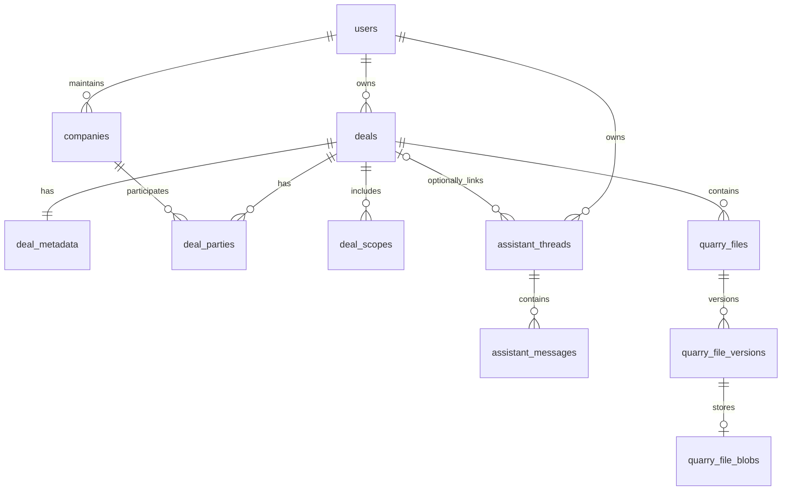

# Deal, company, and engagement data model plan

Date: 2026-10-15. Status: proposed implementation plan; no implementation or data reset has been performed.

This plan uses the supplied transaction-model findings and the live working tree. The
[architecture](../docs/ARCHITECTURE.md) remains the description of current behavior until
implementation lands. Existing uncommitted backend, frontend, test, and documentation work
must be preserved and incorporated where it overlaps this effort.

## 1. Objective and explicit scope

Separate the diligence engagement, underlying transaction, participating companies, and deal
metadata. Support buy-side and sell-side work, optional buyers and sponsors, reusable company
records, and multiple roles for the same company without duplicating that company.

The implementation includes:

- A smaller `deals` record with separate engagement and transaction types and nullable dates.
- New `companies` and `deal_parties` tables.
- Retention and refinement of the existing `deal_metadata` table.
- `deal_scopes` for the diligence disciplines in scope.
- Nullable `assistant_threads.deal_id`: chats can be deal-linked or freeform.
- Coordinated Axum, TypeScript contract, web/desktop adapter, UI, prompt, and test changes.
- A destructive development database reset followed by direct creation of the final schema.

**No data-preserving migrations, historical upgrade ladder, row conversion, backfill, or
legacy-schema compatibility work is included.** The user has authorized discarding current
development SQLite data. Do not delete anything while preparing this plan. During implementation,
replace the schema directly and discard old development records rather than translating them.

Deferred: company ownership hierarchies, `company_relationships`, business units, a separate
transaction entity shared by multiple engagements, company enrichment/merging, production
identity/workspace membership, and automatic document retrieval for Assistant answers.

## 2. Findings from the current repository

| Area | Verified current state | Consequence |
| --- | --- | --- |
| SQLite setup | `backend/src/app/migrations.rs` defines schema version **8**, rebuilds pre-v6 databases, and has incremental v6/v7 branches. | The supplied version discussion and root guide's version-6 statement lag the code. Replace the setup path for this development reset; do not design from an assumed v3 or v6 schema. |
| Deals | `deals` requires `start_date`, `close_date`, `transaction_type`, and string-valued target, buyer, and sponsor. | Both storage and transport validation must change. |
| Metadata | `deal_metadata` already exists, including questions, local/SharePoint source, SOW, fact-sheet, and RL links, plus a duplicate `user_id`. | Retain this concept and its consumers; a second metadata table is unnecessary. |
| Creation | `DealService::create` inserts the deal and then upserts metadata separately. | Make aggregate creation atomic when adding parties and scopes. |
| Listing | Repository list orders by `close_date`, hides archived records, and reads metadata separately per deal. | Define nullable-date ordering and avoid multiplying per-deal queries for new children. |
| Archiving | Repository writes `status = 'Archived'`; related files remain. | Separate archiving from engagement status before constraining status values. |
| Frontend | Add-deal form requires the old fields; mappers, table, Kanban, search, summaries, and metrics consume them. | A database-only refactor would break the product and produce misleading summaries. |
| Prompts | `DealExtractionPromptData` and `backend/prompts/diligence_review.md` assume target/buyer/sponsor strings and PE diligence. | Supply role-aware context without changing the explicit-question extraction contract. |
| Assistant | Threads belong to users, have no `deal_id`, and use persisted messages plus idempotent streamed runs. Data Room chat currently has no deal context. | Add optional association through the full thread lifecycle; preserve freeform chat. |
| Documents | SQLite files reference deals; versions and blobs cascade from files. Helix is a separate search projection. | Keep document identities/storage contracts; resetting SQLite alone must not leave old search results accessible. |
| Desktop | Tauri already relays JSON GET/POST and multipart requests; shared UI calls Axum through `@quarry/runtime`. | Use the existing relay for new JSON operations. Do not add desktop business logic or native database access. |

Primary implementation anchors:

- [Schema setup](../backend/src/app/migrations.rs), [bootstrap](../backend/src/app/bootstrap.rs),
  [SQLite client](../backend/src/adapters/sqlite/client.rs), and
  [query builder](../backend/src/adapters/sqlite/query/builder.rs).
- [Deal repository](../backend/src/domains/deals/repository.rs),
  [service](../backend/src/domains/deals/service.rs),
  [handler](../backend/src/domains/deals/handler.rs),
  [routes](../backend/src/domains/deals/route.rs), and
  [metadata handler](../backend/src/domains/deals/extraction_handler.rs).
- [Shared API contract](../frontend/src/contracts/quarryApi.ts),
  [deal types and mapping](../frontend/src/data/dealExtraction.ts),
  [workspace types](../frontend/src/data/workspace.ts), and
  [portfolio selectors](../frontend/src/data/dealsView.ts).
- [Assistant persistence](../backend/src/domains/assistant/chat/repository.rs),
  [service](../backend/src/domains/assistant/chat/service.rs), and
  [frontend runtime](../frontend/src/components/chat/AgentRuntime.tsx).

## 3. Model decisions

### 3.1 Ownership and company reuse

Retain `deals.user_id` as the current development owner. For this iteration, scope the company
directory to that same user with `companies.user_id`; reuse a company across that user's deals.
This is a deliberate refinement of the supplied globally reusable directory, since Quarry has
no authenticated shared workspace boundary today. Do not introduce a global cross-user company
directory accidentally.

Resolve development users through the existing user directory. Party assignment must check that
the company and deal have the same owner, inside the write transaction. A company has no fixed
buyer, target, sponsor, or PortCo flags. Those meanings exist only on `deal_parties`.

Company names are not unique identities. Do not merge records automatically by name or website.
Offer matching existing companies in the picker and require explicit selection. Server-generated
UUIDs identify companies and party rows; preserve the current validated `DEAL-...` deal IDs.

Owner consistency is a data invariant, not authentication. Caller-supplied email remains a
development identity; this work does not make the API safe for public multitenant use.

### 3.2 Engagement, transaction, and status vocabulary

Persist stable lowercase codes; map them to human labels in the frontend and prompt context.
Use matching Rust enums, TypeScript unions, and SQLite `CHECK` constraints.

| Dimension | Codes |
| --- | --- |
| Engagement | `buy_side`, `sell_side`, `other` |
| Transaction | `platform_acquisition`, `add_on_acquisition`, `strategic_acquisition`, `carve_out`, `merger`, `divestiture`, `recapitalization`, `growth_equity`, `other`, `unknown` |
| Engagement status | `pipeline`, `active`, `completed`, `on_hold`, `cancelled` |
| Party role | `target`, `buyer`, `seller`, `pe_sponsor`, `portfolio_company`, `parent_company`, `client`, `other` |
| Diligence scope | `product_architecture`, `corporate_it`, `cybersecurity`, `application_security`, `sdlc`, `it_organization`, `it_financials` |

`recapitalization` and `growth_equity` retain choices already available in Quarry's transaction
picker. Generic Acquisition becomes a choice among the specific acquisition structures, or
`unknown` while undecided. This is new-input behavior, not a conversion of old records.

Store `archived_at` separately from status. Archiving an active or completed deal preserves its
engagement status, parties, metadata, scopes, documents, and chats. Default list behavior still
excludes archived deals; a direct deal lookup continues to resolve them. Do not add hard-delete
or unarchive product flows as part of this refactor.

Frontend lifecycle: completed and cancelled engagements are Historic; pipeline, active, and
on-hold engagements are Current. Transaction closing does not complete an engagement. Update
Kanban lane mappings explicitly for these codes rather than relying on old free-text aliases.

### 3.3 Missing information, dates, and party cardinality

- Buyers, sellers, sponsors, portfolio companies, and clients are optional. Unknown means no
  assignment, not a company named `Unknown`, `N/A`, or an empty string.
- Pipeline deals may have no parties. For an active/completed platform, add-on, or strategic
  acquisition, require exactly one target as a service rule. Other transaction types may have
  multiple targets. Do not add a generic unique `(deal_id, role)` database constraint.
- A company may have several roles in one deal and a different role in another deal. Enforce
  uniqueness only for `(deal_id, company_id, role)`.
- Keep `start_date` optional. Replace ambiguous `close_date` with nullable
  `expected_close_date` and `actual_close_date`; add nullable `engagement_completed_date`.
- Use `YYYY-MM-DD` date-only values and a consistent UTC format for audit timestamps. Validate
  dates at the HTTP boundary; reject blank non-null date strings. Engagement completion cannot
  precede an existing engagement start date. Do not force transaction closing to occur after
  diligence starts: post-close work is possible.
- Neither status `completed` nor `engagement_completed_date` requires a transaction closing
  date. Dates never silently change status, and an unknown completion date may remain null.
- Display distinct expected-close, actual-close, and engagement-completion fields. For a compact
  close-date sort key, use actual close then expected close, unknown dates last, with deal ID as
  a stable tie-breaker. Label the displayed date by its meaning.

## 4. Target SQLite shape

This is the final schema to create directly after the reset, not an upgrade script.



| Table | Final fields and constraints |
| --- | --- |
| `deals` | `deal_id` PK; `user_id` FK to users with delete restriction; nonblank `deal_name`; nullable nonblank `deal_code`; constrained `engagement_type`, `transaction_type`, `status`; nullable `start_date`, `expected_close_date`, `actual_close_date`, `engagement_completed_date`, `archived_at`; required `created_at`, `updated_at`. Remove `target_company`, `primary_buyer`, `deal_sponsor`, and `close_date`. |
| `companies` | `company_id` PK; `user_id` FK with delete restriction; nonblank `name`; nullable nonblank `website`, `industry`, `description`; required `created_at`, `updated_at`. No role/ownership flags and no unique company-name constraint. |
| `deal_parties` | `deal_party_id` PK; `deal_id` FK with `ON DELETE CASCADE`; `company_id` FK with `ON DELETE RESTRICT`; constrained `role`; nullable nonblank `notes`; unique `(deal_id, company_id, role)`. |
| `deal_metadata` | `deal_id` PK/FK with `ON DELETE CASCADE`; `key_questions_json` default `[]`; nullable `local_path`, `sharepoint_link`, `sow_link`, `fact_sheet_link`, `rl_link`. Remove duplicate `user_id`; derive owner from the deal. |
| `deal_scopes` | `deal_id` FK with `ON DELETE CASCADE`; constrained `scope`; composite PK `(deal_id, scope)`. Empty selection means scope is unspecified. |
| `assistant_threads` | Existing fields and constraints, plus nullable `deal_id` FK to deals with `ON DELETE RESTRICT`. Null represents a freeform chat. |

Metadata remains one row per deal, created with the deal. Strengthen stored questions from merely
valid JSON to a JSON array; validate its entries as strings in the owning code. Preserve nullable,
nonblank links, safe HTTPS/SharePoint policies, and the rule that local path and SharePoint source
cannot both be set. Keep `keyQuestionsJson` in the wire metadata for this change to avoid an
unnecessary serialization redesign; remove its redundant wire `userId` along with the column.

Keep the existing users, reminders, app metadata, message, file, version, and blob structures
except for the explicit thread association above. Keep file/version identity, content hashes,
current-version uniqueness, cascade behavior, and archive retention unchanged.

Indexes:

- Deals: owner, status, transaction type, and the two transaction-close date fields; retain
  owner/list ordering coverage as appropriate for the final query.
- Companies: `(user_id, name, company_id)` for bounded directory lookup and stable ordering.
- Parties: `(deal_id, role)` and `company_id`, plus the unique assignment index.
- Scopes: composite primary key is sufficient initially.
- Threads: retain the user/status/recency index; add
  `(user_id, deal_id, status, last_message_at DESC, thread_id)` for scoped lists.

Do not cascade company deletion into deals or chat deletion from deal deletion. Physical deal
deletion is not exposed; its thread restriction guards against silently converting linked
conversations into freeform history or erasing them. The development reset explicitly drops
dependent tables in order, so these restrictions do not prevent that reset.

## 5. API and aggregate contracts

### 5.1 Deal and company operations

All paths below are relative to `/api/v1`. Keep `/api` as the existing compatibility mount,
without targeting it from new client code. This is a coordinated development contract change;
the old company-string payload will not remain a parallel write format.

| Method / path | Planned behavior |
| --- | --- |
| `GET /deals` | Return non-archived deal aggregates with metadata, scopes, and party/company summaries. Preserve the current array envelope. |
| `POST /deals` | Create core deal, metadata, party assignments, and scopes in one SQLite transaction; return 201 with the existing `{deal, metadata}` envelope, where `deal` includes parties and scopes. |
| `GET /deals/{deal_id}` | Return the same aggregate fields, including `archivedAt`, with the existing flattened deal-plus-`metadata` envelope; 404 when absent. |
| `POST /deals/{deal_id}/update` | Update editable deal fields and replace the complete parties/scopes collections atomically; return `{deal, metadata}`. Deal ID and owner are immutable. Metadata is not overwritten by this operation. |
| `POST /deals/{deal_id}/archive` | Set `archived_at` once, update audit timestamp, preserve status and all children; repeated archive is idempotent. Return the updated deal aggregate. |
| `POST /deals/{deal_id}/metadata` | Retain multipart fields, size/MIME validation, link-first persistence, and optional extraction. Return the expanded deal shape in its existing response envelope. |
| `POST /deals/{deal_id}/extraction/upload` | Retain the existing metadata alias using the same handler. |
| `GET /companies` | Owner-scoped, bounded search using development `userEmail`, optional `query`, `limit`, and `offset`; return `{companies, hasMore}` in stable name/ID order. Default limit 30, maximum 100. |
| `POST /companies` | Explicitly create a directory record for the resolved development owner; return 201 and the company. |
| `POST /companies/{company_id}/update` | Update company details for its resolved owner; return the company. Referenced deals read the current company details. No delete or merge operation in this iteration. |

Use JSON POST for update commands because both existing transports already support it. Do not
add PATCH IPC support solely for this refactor. Do not change upload, PDF, job, or SSE routes.

Deal write fields:

```text
dealId                 create only; current DEAL- identifier validation
userEmail              create owner resolution; existing development identity convention
dealName, dealCode
engagementType, transactionType, status
startDate, expectedCloseDate, actualCloseDate, engagementCompletedDate
localPath, sharepointLink  create-time source only; retain existing source safeguards
parties: [{ companyId, role, notes }]
scopes: [scopeCode]
```

For the update body, require the complete editable scalar fields, nullable dates, parties, and
scopes; omitted collections are an error, while `[]` explicitly clears them subject to service
rules. Do not make ambiguous partial-null/omitted-field semantics. Exclude source fields from the
update operation; source/metadata behavior remains in the existing flow. Party row IDs are
server-owned: preserve IDs for unchanged `(companyId, role)` pairs during replacement.

Read parties contain `dealPartyId`, `companyId`, `role`, `notes`, and a typed company summary.
Sort by documented role order, company name, and ID; never select an arbitrary first buyer or
target and present it as the only participant. Lists and get/create/update results share the
same domain types even though their existing envelopes differ.

The company picker explicitly saves a new company through `POST /companies` before selecting
its ID for a deal. The resulting directory entry intentionally remains if deal creation fails
or the user cancels the deal form; show that creation has succeeded. This keeps company creation
simple and reusable without a temporary-reference payload protocol. Atomic deal writes cover
the deal and its children, not previously saved directory entries.

Validate enums, identifiers, dates, array bounds, duplicate role assignments, and URL/text input
in handlers. Bound party assignments to 100 per deal and optional company search text to 200
characters; define and test field limits in the DTOs. Check persisted company ownership and
transaction-specific target rules in services/repository operations. Reject unsupported codes;
do not silently coerce them to `other`.

Use 400 for invalid transport input, 404 for missing referenced records, 409 for conflicting
deal IDs or persisted relationship conflicts, and sanitized 500 for unexpected storage errors.
Ensure storage errors are not blanket-converted to client validation errors as current deal
creation does. Do not promise every Axum extractor rejection uses Quarry's error envelope.

### 5.2 Assistant: nullable deal association and list semantics

**A chat does not require a deal.** Persist `assistant_threads.deal_id = NULL` for freeform
conversations. Store a deal ID only when the user starts a deal-scoped conversation.

- Thread creation accepts optional `dealId`; omitted or explicit null creates a freeform thread.
  A non-null value must reference an existing deal belonging to the resolved thread owner.
- Thread summaries/details always return `dealId: string | null`. Continue using user ownership
  for thread access regardless of association.
- Extend list input with `scope=all|freeform|deal` and optional `dealId`. Default/omitted scope is
  `all` to retain the current owner-wide list behavior. `freeform` means SQL `deal_id IS NULL`;
  `deal` requires a valid `dealId`. Reject conflicting scope/ID combinations.
- Retain archive filtering, the current recency/thread-ID cursor ordering, and page-size bounds.
  Apply owner, association, archive, and cursor filters before limiting. Reset pagination when
  changing scope so a cursor from one list cannot hide another list's results.
- The main Assistant defaults to All chats, displays a Deal/Freeform indicator, and offers a
  Freeform filter. Its New chat action creates a freeform conversation.
- Data Room's Synthesis Canvas chat uses `scope=deal` for its active deal and creates threads
  with that `dealId`. It must not show another deal's or freeform conversations in that picker.
- Key runtime ownership by user and chat scope/deal, with stale-request cancellation and no
  effect-body state setters. Switching deals must not reuse a draft, selected thread, request,
  or cached list from the previous deal.
- Association is immutable for this iteration. Moving/linking an existing freeform thread later
  is a separate feature, avoiding a conversation whose historical messages change context.
- Run requests continue to identify the thread. Load its persisted association on the server;
  do not accept a per-turn deal ID override or infer one from browser navigation.
- Preserve messages, request-ID idempotency, existing stream events and cancellation behavior.
  Archive a deal without deleting, unlinking, or archiving its chats.

Add a narrow exported `DealContextReader` at the deals domain boundary, analogous to the
existing `DataRoomSourceReader`, and inject it into Assistant through bootstrap. For linked
threads, load bounded current deal name, engagement/transaction types, party roles, and scopes
for new runs. Treat this as untrusted reference context, separate from policy and user prompt
instructions. Freeform threads receive no implicit deal context. Do not include local paths,
credentials, unrelated deals, or entire documents in that context.

Preserve replay behavior before external generation: replaying an existing completed request
returns its persisted response without regenerating it against newly edited deal metadata.
New turns may use current deal details. Deal context is not document retrieval or evidence that
Assistant searched the data room.

## 6. Implementation sequence

### Phase 1 — Define final schema and reset behavior

1. Recheck the working tree and overlapping edits before implementation. Use Axum 0.8.9,
   rusqlite 0.39.0, and the locked dependencies; no dependency upgrade is needed.
2. Replace historical schema conversion branches in `backend/src/app/migrations.rs` with one
   current-schema initializer and an explicitly invoked development reset operation. A schema
   marker may remain solely to detect an incompatible layout; it is not an upgrade chain.
3. Create the final schema directly for an empty database. Normal startup validates/reuses the
   current schema and fails clearly on incompatible layouts until the deliberate reset is run.
   It must never erase a valid database on every startup.
4. Make reset drop dependent tables first, including messages/threads, file blobs/versions/files,
   scopes/parties/metadata, deals/companies, then remaining application tables. Recreate all
   tables/indexes in one controlled transaction; restore foreign-key enforcement on success and
   failure and check foreign-key consistency before accepting the result.
5. Replace old version-preservation tests with fresh creation, explicit destructive reset,
   idempotent reopen, incompatibility rejection, rollback, and final-schema invariant tests.
   Retain file-ownership/current-version tests and update their deal fixtures.

Exit: temporary databases can be initialized/reset to the final shape; no legacy row
translation or data-preserving upgrade code is required.

### Phase 2 — Add typed domain records and atomic persistence

1. Put deal enums, inputs, and aggregate types in a focused deals model module. Keep HTTP DTO
   validation at the handler boundary rather than adding transport rules to services.
2. Add a small `companies` domain with model/repository/service/handler/routes and a narrow
   directory interface for other domains. Wire it in bootstrap using the existing registry
   pattern; handlers receive service handles, never the SQLite client.
3. Extend the deal repository for companies-by-ID validation and aggregate writes using the
   existing `SqliteClient::transaction_async` and parameterized query builder. Reuse the current
   transaction abstraction rather than constructing raw connections or ad hoc SQL in services.
4. Atomically create/update the deal, metadata when creating, parties, and scopes. Invalid
   references, ownership mismatches, duplicate assignments, or a failed child write must roll
   back every change in that aggregate operation.
5. Assemble read aggregates with joined or bounded batch reads, not one metadata/company/scope
   query for every deal or party. Use one consistent read snapshot so an update cannot expose
   half of the old aggregate and half of the new one. Keep deterministic ordering.
6. Remove duplicated metadata ownership from repository models/upserts and adapt
   `DataRoomSourceReader`. Preserve local/SharePoint source semantics and safe resource links.
7. Add the exported `DealContextReader` without exposing deal repositories to Assistant.

Exit: role reuse, nullable fields, aggregate consistency, archive retention, and owner
consistency are proven in isolated repository/service tests.

### Phase 3 — Update APIs, metadata extraction, and both adapters

1. Update Axum deal/company routes, DTOs, validation, sanitized conflict mapping, and response
   shapes. Keep body-consuming extractors last and retain existing request limits.
2. Update `frontend/src/contracts/quarryApi.ts` and deal types together. Add company operations,
   deal update, the new typed fields, role collections, and scopes.
3. Update both `frontend/src/api/httpQuarryApi.ts` and `tauriQuarryApi.ts`, including every test
   mock implementing `QuarryApi`. Preserve URL encoding and nullable JSON fields.
4. Check Tauri JSON relay tests against the new payloads; generic GET/POST should need no new
   capability. Change Rust only if a concrete validation/transport requirement demands it.
5. Update `DealExtractionPromptData`, allowed prompt variables, template rendering, and
   `backend/prompts/diligence_review.md` to use engagement type, transaction type, role-labeled
   companies, and diligence scope. Remove the PE-only assumption. Never substitute sponsor for
   buyer or target when a role is absent.
6. Keep extraction output exactly `{keyQuestions: string[]}` and preserve the rule to extract
   only explicitly listed qualifying questions. Context must not turn extraction into inferred
   analysis. Preserve links saved before an optional OpenAI failure and explicit unavailable
   behavior when OpenAI is unconfigured.

Exit: API tests and web/desktop adapter tests agree on new enums, nullability, and aggregates;
link-only metadata still works without OpenAI.

### Phase 4 — Update creation, editing, and deal views

1. Keep the existing two-step Add deal / optional metadata workflow and Skip metadata behavior.
   Update `AddDealModal.tsx` and `DealTypePicker.tsx` with separate engagement and transaction
   choices, optional date controls, scope selection, and reusable company-role rows.
2. Use bounded async company search with loading, empty, retry/error, and stale-result handling.
   Allow explicit company creation and reuse the selected company for several role rows.
   Buyers and sponsors must no longer be required fields.
3. Add an Edit deal action using the same field components and the update endpoint. It must
   support adding/removing parties, changing roles/scopes, clearing nullable dates, and changing
   engagement status. Edit deal-specific notes separately from shared company details.
4. Adapt `data/dealExtraction.ts`, `data/workspace.ts`, `data/dealsView.ts`, `useWorkspaceDeals`,
   and `WorkspaceProvider` so server aggregates are the source of truth after writes/refetches.
   Eliminate the summary sentence that assumes one target, one buyer, and one sponsor.
5. Update Deals table/Kanban, filtering/search, Deal Room header/summary/overview, and date
   metrics. Render multiple named parties honestly, unknown values as unavailable, and separate
   engagement/transaction labels. Search across all assigned company names and relevant roles.
6. Keep shared routes, navigation state, metadata resources, document workflows, runtime aliases,
   and fixture/API distinction. Store updated demo records only under `frontend/src/fixtures/`.
7. Reuse current controls/tokens; inspect keyboard navigation, role picker names, dialog focus
   restoration, viewport behavior, theme behavior, and reduced motion.

Exit: a user can create, reload, and edit representative deals without inventing a sponsor,
buyer, or closing date, in both web and desktop distributions.

### Phase 5 — Wire optional deal context into persisted chats

1. Add nullable `deal_id` in the direct schema definition, repository row mapping, create/list/get
   methods, handler DTOs, and thread summary/detail contracts. Preserve existing user ownership.
2. Wire `DealContextReader` into `AssistantChatService`; validate linked-deal ownership before
   thread creation and resolve persisted context for new runs.
3. Extend `QuarryApi` create/list thread inputs, both adapters, and runtime mocks. The stream
   continues using the thread ID, so do not broaden Tauri's stream path allowlist or add a
   caller-controlled per-run deal field.
4. Wire the main Assistant and Data Room chat to the scope behavior in section 5.2. Maintain the
   existing freeform entry point and make association visible.
5. Test filtered pagination, same-owner association, freeform persistence, linked context,
   idempotent replay, archived-deal chats, and state isolation when switching deals.

Exit: freeform and deal-linked conversations coexist without association leaks or lost history.

### Phase 6 — Apply the disposable development reset and finish documentation

1. Complete code and isolated tests first. The reset is an implementation rollout action, not
   something performed by this planning task or used as routine verification.
2. Stop the selected development backend and drain uploads/runs before resetting its SQLite
   tables. Coordinate any pre-existing user-owned listeners instead of terminating them without
   authorization. Do not reset an ambiguously selected database.
3. The reset intentionally discards all current development SQLite records, including users,
   deals, metadata, chats/messages, files/versions/blobs, and reminders. No backup, import, or
   data-recovery project is a prerequisite under the user's discard instruction.
4. Do not resume against the old populated Helix projection. Pair the fresh SQLite database
   with a fresh, isolated disposable Helix store using supported documented configuration.
   This avoids deleting an existing graph, which the SQLite discard instruction does not
   authorize. Do not run `clear_helix` as part of this plan's checks. No new graph shape or
   automatic SQLite-to-Helix rebuild feature is required.
5. Restart against the final schema, recreate development profiles, and upload fresh test
   documents. Reload clients/restart the desktop runtime as needed to discard stale sessions,
   user IDs, resource caches, chat selections, and process-local folder grants.
6. Update `docs/ARCHITECTURE.md` for the implemented schema, reset semantics, company domain,
   APIs/DTOs, archive/date behavior, scope ownership, Assistant association/context, and remaining
   security gaps. Correct the stale schema-version statement in `AGENTS.md` at that point.
7. Recovery from a failed rollout is to fix the implementation and recreate an empty development
   schema, or revert code and recreate its empty schema. Do not promise recovery of discarded
   records or run old code against the incompatible new layout.

Exit: a clean development environment runs the new model, repeated startup preserves newly
created data, and canonical documentation describes what actually shipped.

## 7. Verification and acceptance

### Behavioral cases

| Case | Required result |
| --- | --- |
| Pipeline engagement with unknown transaction | Saves with no parties or dates and no placeholder companies. |
| PE add-on | Same company ID is buyer, portfolio company, and optionally client; a separate PE sponsor and target retain their roles. |
| Strategic buy-side acquisition | Saves with target and buyer but no sponsor. |
| Sell-side mandate | Saves without a known buyer; seller/client and target remain distinct relationships. |
| Merger or multi-target carve-out | Several targets round-trip without a universal one-target constraint. |
| Ordinary active acquisition | Zero or multiple targets fail the service rule; a pipeline draft remains possible. |
| Engagement completed before transaction closes | Completed status and engagement date save with actual closing date still null. |
| Party/scopes replacement fails midway | Previous aggregate survives unchanged; no partial child updates. |
| Shared company edited | All linked deals read its updated company details without duplicating records. |
| Duplicate names | Separate company IDs remain distinct; no implicit merge. |
| Company from another owner | Assignment is rejected before commit. This does not assert production authentication. |
| Archive | List hides the deal; direct lookup, documents, and linked chats remain; status is preserved. |
| Metadata without files | Links persist without OpenAI; local/SharePoint exclusivity remains enforced. |
| Extraction failure after link save | Links remain persisted and the UI exposes failure/retry, not invented questions. |
| Freeform chat | Missing/null `dealId` persists as null; reload, run, rename, archive, and delete still work. |
| Linked chat | Correct owner/deal reference persists; run context distinguishes target, buyer, sponsor, client, and scope. |
| Chat scope switch | All, freeform-only, and deal-only lists/pagination are correct; drafts and stale responses do not cross deals. |
| Reset/restart | Only the explicit reset discards data; normal reopen preserves records and rejects incompatible layouts. |
| Fresh uploads after reset | SQLite and the isolated Helix projection agree on accessible documents; no old search hits appear. |

### Test locations and execution

Update the existing included suites rather than assuming old test paths still apply:

- `backend/tests/integration/app/migrations_tests.rs` for schema creation/reset and constraints.
- `backend/tests/integration/domains/deals/service_tests.rs` and new appropriately included
  company/deal repository suites for aggregate behavior and rollback.
- `backend/tests/integration/domains/assistant/chat/repository_tests.rs`,
  `backend/tests/unit/domains/assistant/chat/service_tests.rs`, and
  `backend/tests/integration/http_tests.rs` for Assistant/API behavior.
- `backend/tests/integration/architecture_tests.rs` for dependency boundaries, plus existing
  document-store/ingestion tests with updated deal seeds.
- `frontend/tests/api/httpQuarryApi.test.ts`, `tauriQuarryApi.test.ts`,
  `frontend/tests/data/dealExtraction.test.ts`, `dealsView.test.ts`,
  `frontend/tests/components/hub/sidebar/AddDealModal.test.tsx`, and affected deal/chat runtime
  and page tests for both request mapping and visible behavior.

Rust tests are manually included (`autotests = false`); include any new suite explicitly.
Start with real module-name filters selected after tests are implemented, then run these gates.
These are planned commands, not checks claimed to have passed during planning.

From `backend/`:

```sh
cargo fmt --all -- --check
cargo check --locked --all-targets
cargo clippy --locked --all-targets -- -D warnings
cargo test --locked --all-targets
```

From `frontend/`:

```sh
npm run typecheck
npm run check:boundaries
npm test
npm run build:web
npm run check:web-bundle
npm run build:desktop-ui
```

If native relay code changes, also run from `frontend/src-tauri/`:

```sh
cargo fmt --all -- --check
cargo clippy --locked --all-targets -- -D warnings
cargo test --locked --all-targets
```

Inspect creation, editing, listing, archiving, metadata retry, and both chat modes using disposable
runtime dependencies in web and desktop. Check console/network/IPC failures, loading/empty/error
states, keyboard/focus behavior, supported theme modes, and relevant viewport sizes. Record and
stop only task-owned runtime processes after inspection. No `cargo run` against ordinary local
data and no unrelated Diligence Studio server change or verification is needed.

Before implementation handoff, review all changed files across correctness, readability,
architecture, security, and performance; re-read the relevant architecture sections; run
`git diff --check`; review final status; and report exact check outcomes, skipped external checks,
and any failures that predated this work.

## 8. Definition of done and planning boundary

- All required tables, constraints, transactional operations, typed contracts, and UI consumers
  use the new model without parallel string-valued company truth.
- Metadata resources and document/version storage retain their current guarantees.
- Chat `deal_id` is nullable throughout storage, API, adapters, and UI; freeform and deal-linked
  conversations are both first-class supported cases.
- New development data survives reopen; the intentional reset requires no migration/backfill
  framework and does not expose stale graph documents.
- Required checks pass, representative user flows are inspected, and architecture documentation
  is updated with implemented behavior and remaining limitations.

Architecture impact of this planning-only change: none — this file describes proposed work and
does not change the current schema, runtime behavior, APIs, or canonical architecture. The
implementation has substantial architecture impact and must update the canonical document in
the same change.
